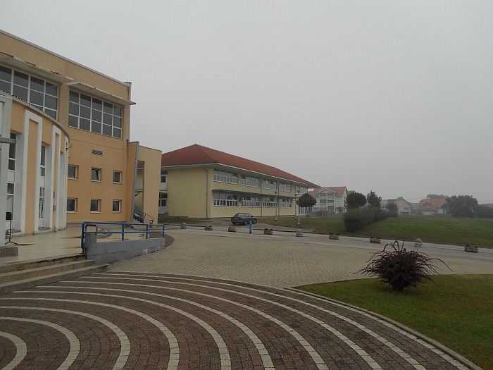
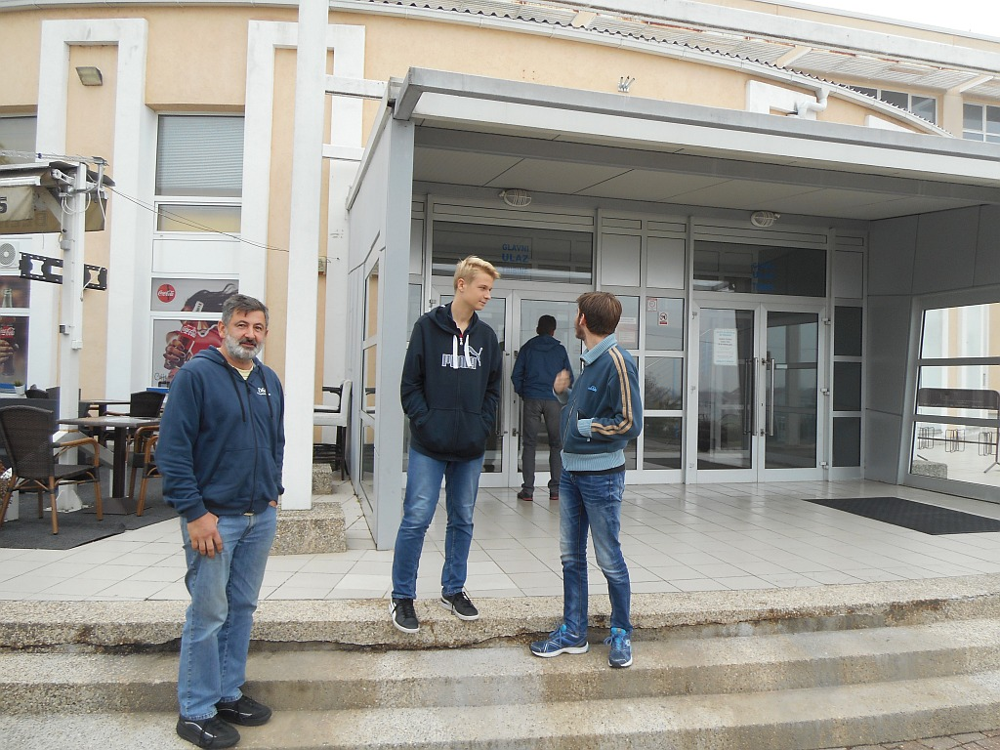

**Seniori, 8. kolo  
**U maglovito jesenje jutro uspješno je odigrano još jedno kolo u borbi za ostanak u ligi. Prijateljskim remijem sa vodećom ekipom lige upisali smo još jedan važan bod. Nastupili smo u jednoj od najačih postava i brzim remijem odgodili rasplet [lige](http://chess-results.com/tnr332243.aspx?lan=13&art=0) do preostalih susreta s direktnim konkurentima, zadržavši pri tome osmu poziciju na tablici. Prijašnjih godina domaćin je imao ozbiljnih problema s izborom suca, a ovaj put su bolje izabrali. Sudac meča Miroslav Klarić  bio je neprimjetan, baš kako treba u šahovskom meču. Od naših igrača, Vraneša je i dalje neporažen, ali si je malo pokvario nacionalni rejting u kojem mu još malo nedostaje do druge kategorije. Sljedeći susret igra se za dva tjedna, 21. listopada, kada nam u goste dolazi ŠK Rugvica-Vrbani.

<table><tbody><tr><td></td><td></td><td>&nbsp;&nbsp;ŠK Dugo Selo, Zagreb</td><td>–</td><td></td><td>&nbsp;&nbsp;ŠK Odra, Zagreb</td><td>3 : 3</td></tr><tr><td>1.</td><td>MK</td><td><table><tbody><tr><td></td><td>Korov, Zvonko 2095</td></tr></tbody></table></td><td>–</td><td>MK</td><td><table><tbody><tr><td></td><td>Bačurin, Juraj 2040</td></tr></tbody></table></td><td>½ – ½</td></tr><tr><td>2.</td><td>MK</td><td><table><tbody><tr><td></td><td>Josipović, Perica 2125</td></tr></tbody></table></td><td>–</td><td>MK</td><td><table><tbody><tr><td></td><td>Maravić, Stjepan 2108</td></tr></tbody></table></td><td>½ – ½</td></tr><tr><td>3.</td><td>FM</td><td><table><tbody><tr><td></td><td>Ivanović, Željko 1994</td></tr></tbody></table></td><td>–</td><td>MK</td><td><table><tbody><tr><td></td><td>Vidaković, Darko 2116</td></tr></tbody></table></td><td>½ – ½</td></tr><tr><td>4.</td><td>I</td><td><table><tbody><tr><td></td><td>Gavran, Marinko 1998</td></tr></tbody></table></td><td>–</td><td>MK</td><td><table><tbody><tr><td></td><td>Cvetković, Ivan 1942</td></tr></tbody></table></td><td>½ – ½</td></tr><tr><td>5.</td><td>MK</td><td><table><tbody><tr><td></td><td>Materni, Anton 2015</td></tr></tbody></table></td><td>–</td><td>II</td><td><table><tbody><tr><td></td><td>Maravić, Ivan 1721</td></tr></tbody></table></td><td>½ – ½</td></tr><tr><td>6.</td><td>III</td><td><table><tbody><tr><td></td><td>Sesan, Josip 1757</td></tr></tbody></table></td><td>–</td><td>III</td><td><table><tbody><tr><td></td><td>Vraneša, Ivan 1665</td></tr></tbody></table></td><td>½ – ½</td></tr></tbody></table>
