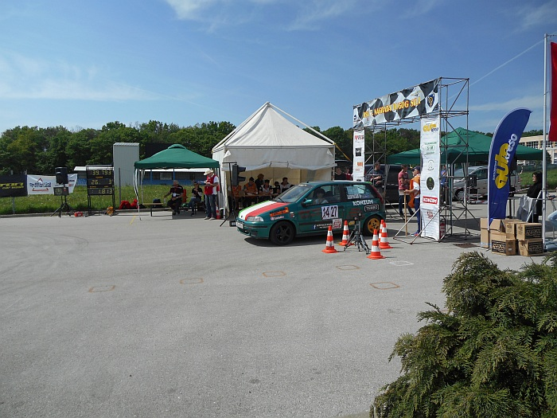
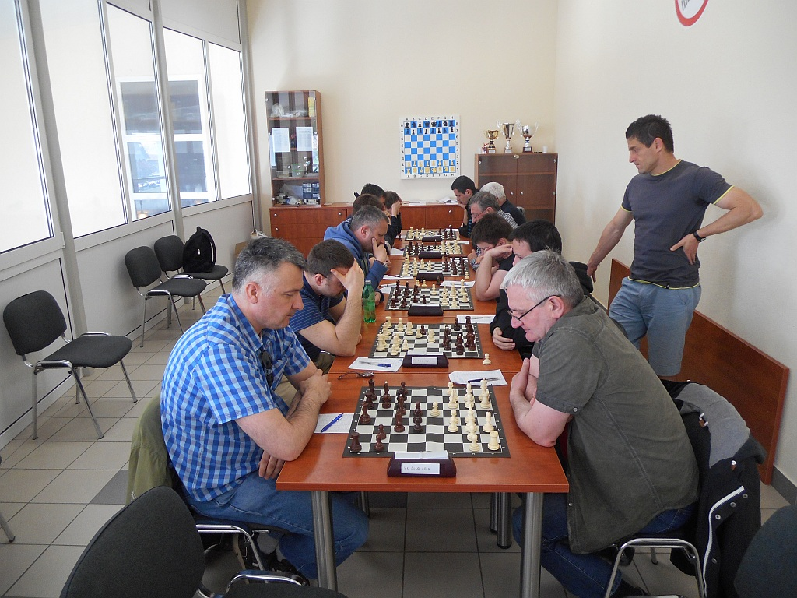
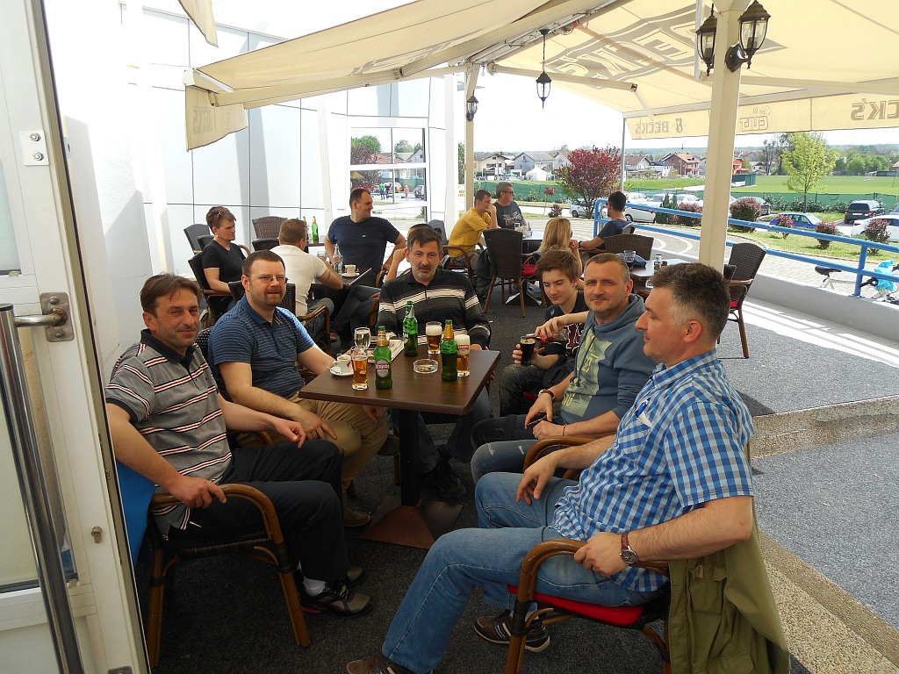

**Seniori, 4. kolo  
  
**Nakon četvrtoga kola seniorska ekipa učvrstila se na posljednjemu mjestu na tablici. Danas smo izgubili meč protiv dobre ekipe ŠK Dugo Selo. Šanse smo imali, ali ih nismo iskoristili. Prvi je remizirao mali Ivan ušavši u blokiranu poziciju s pješakom više kojeg nije mogao iskoristiti. Ostale su pozicije tada izgledale vrlo dobro, osim Zvjezdanove. Jura je nadigrao protivnika i samo je tražio način da probije obranu. Nažalost, počelo mu se događati ono što se obično događa Darku, da u dobivenoj poziciji ne vidi dobitnički potez. Ovaj put ne samo da nije vidio dobitnički potez nego se uspio i preračunati u napadu te izgubiti materijal i partiju. Stipe je imao figuru više i, uvjeren u laku realizaciju, pomalo nonšalantno vodio igru. No njegov je protivnik uspio postaviti pješačku strukturu tako da je Stipe nije mogao probiti usprkos figuri više. Cvetko je odigrao čvrsto, imao siguran remi, ali je zbog situacije na ostalim pločama Stipe tražio od njega da forsira, što je ovaj i učinio.  
Forsirajući remi-poziciju, ostali smo i bez njegovih  pola boda. Zvjezdan je od početka zapao u probleme, a poslije uspio i previdjeti važnog pješaka. Darko je u probleme zapao nešto kasnije, ali se uspio izvući i pokrenuti rokadni napad, ali se njegov protivnik precizno branio i partija je otišla u remi. Sve u svemu, opet smo poklonili dva boda, taman da umjesto meč-pobjede upišemo meč-poraz. U ovom kolu nastupili smo u trenutačno vjerojatno najjačem sastavu, što se neće dogoditi u sljedećem kolu. U goste nam za tjedan dana dolazi ŠK Caissa, trenutačno vodeća ekipa lige.  
 

**ŠK Dugo Selo – ŠK Odra  4½:1½**

1\. MK Ganić, Martin 2101 – MK Vidaković, Darko 2132         ½ – ½  
2\. MK Filipović, Tomislav 2106 – MK Karlić, Zvjezdan 2191   1 – 0  
3\. I Gavran, Marinko 1980 – MK Maravić, Stjepan 2091        ½ – ½  
4\. MK Korov, Zvonko 2045 – MK Bačurin, Juraj 2067             1 – 0  
5\. MK Materni, Anton 1996 – MK Cvetković, Ivan 1969          1 – 0  
6\. III Matić, Daniel 1834 – III Maravić, Ivan 1439                   ½ – ½
