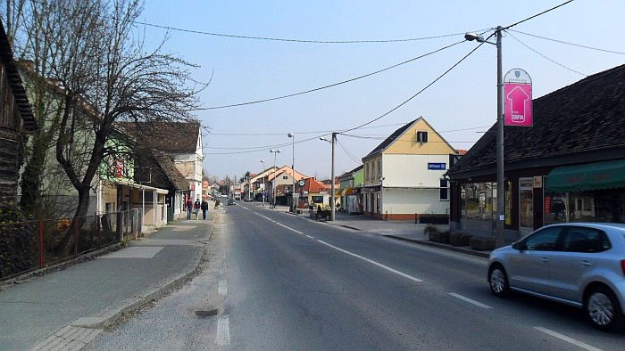
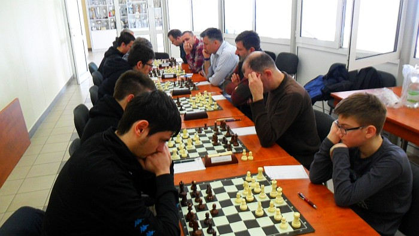

**Seniori, 2. kolo**

  
U drugom kolu seniorske lige prilično pomlađena ekipa ŠK Dugo Selo uvjerljivo je svladala danas nemoćnu ekipu ŠK Odra. U ranoj fazi igre Boris je ostao bez pješaka, a njegov je protivnik tu prednost u dubokoj završnici pretvorio u bod. Ivan je na šestoj ploči potpao pod rohadni napad u kraljevo-indijskoj poziciji i nije se uspio izvući. Cvetko je forsirao, ali je u takvom napadu ostao bez dvaju pješaka te na kraju izgubio. Stipe je iskoristio previd protivnika i brzo završio pobjedom. U četvrti sat igre otišle su samo partije Darka i Ljubića s obećavajućim pozicijama. Tada je Ljubić previdio figuru i meč je bio odlučen. Darko je cijelu partiju napadao, pod kraj partije previdio dobitak i na kraju spašavao (i spasio) remi. Ljubić je nakon meča izjavio da je do previda došlo zbog manjka partija koje godišnje odigra te se svi iskreno nadamo da će ćešće naći vremena za nedjeljne mečeve, pogotovo jer smo ove godine ostali bez čvrstoga i standardnog Brajdića.  
Domaćin je bio gostoljubiv, uvjeti za igru dobri, a sudac Miroslav Klarić profesionalan, susretljiv i neprimjetan za vrijeme meča. Očito je da je ŠK Dugo Selo napredovao u svim područjima u posljednjih godinu dana.

ŠK Dugo Selo – ŠK Odra 4,5:1,5

1\. MK Ganić Martin – MK Ljubić Ivan                      1:0  
2\. MK Filipović Tomislav – MK Maravić Stjepan      0:1  
3\. MK Korov Zvonko – MK Vidaković Darko           1/2  
4\. II Jukić Dario – MK Cvetković Ivan                      1:0  
5\. II Gavran Marinko – IV Kobali Borislav                1:0  
6\. VK Matić Danijel – IV Maravić Ivan                     1:0
