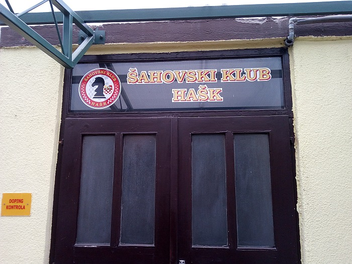
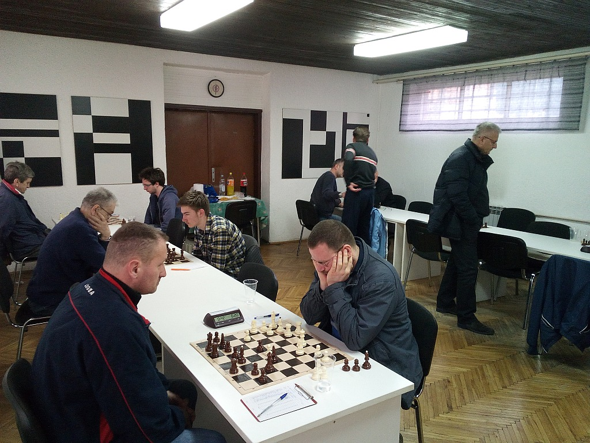
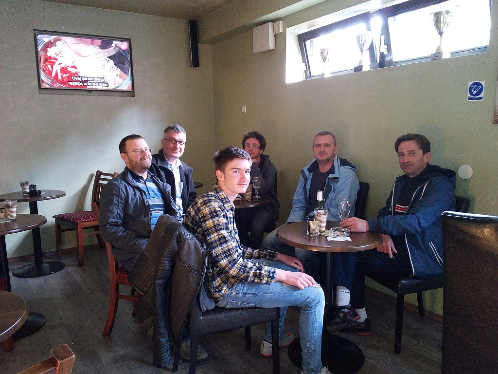

**Seniori, 2. kolo  
**

Za drugo kolo seniorske lige skupili smo respektabilnu ekipu. Svejedno, domaćin ŠK HAŠK pokazao se kao (pre)tvrd orah i možemo biti zadovoljni neodlučenim ishodom. Partije su brzo završili Darko i Stipe. Darku je protivnik ostavio figuru još u otvaranju, a Stjepkov protivnik nije dugo branio tešku poziciju s mnogo slabosti. Tin je na šestoj ploči dobro igrao, ali se osjetio nedostatak partija. U ulasku u završnicu neoprezno je ostavio pješaka i Ivančić je to iskoristio te upisao pobjedu. Zvjezdan je imao nadmoćnu poziciju, ali je uspio previdjeti kvalitetu. Tada se morao mučiti i na kraju je uspio iščupati pola boda. Ivan je igrao solidno, ali je imao i nekih previda koje protivnik nije iskoristio. Ušao je u mnogo bolju završnicu, ali je bio tanak s vremenom te izmijenio figure i prihvatio ponuđeni remi. Na prvoj ploči Jura je izašao nadmoćno iz otvaranja, ali je jednom pogrešnom odlukom dopustio Damiću da se razmaše te lijepom žrtvom figure pokrene napad koji je rezultirao materijalnim gubicima i gubitkom partije za Juru. Prema pozicijama, meč je mogao prevagnuti i na jednu i na drugu stranu, ali na kraju je završio pravednom podjelom bodova. Sljedeće kolo igra se za tjedan dana, 2. travnja.

**ŠK HAŠK – ŠK Odra 3:3**

1\. I Damić, Dalibor 1913 – MK Bačurin, Juraj 2061 1:0  
2\. I Andrašević, Željko 1823 – MK Vidaković, Darko 2125 0:1  
3\. III Kraljević, Mijo 1813 – MK Maravić, Stjepan 2100 0:1  
3\. III Martić, Marko 1779 – MK Karlić, Zvjezdan 2146 1/2  
3\. II Portada, Ratimir 1706 – III Maravić, Ivan 1626 1/2  
3\. II Ivančić, Mate 1919 – VK Furčić, Tin 1600 1:0  
  
