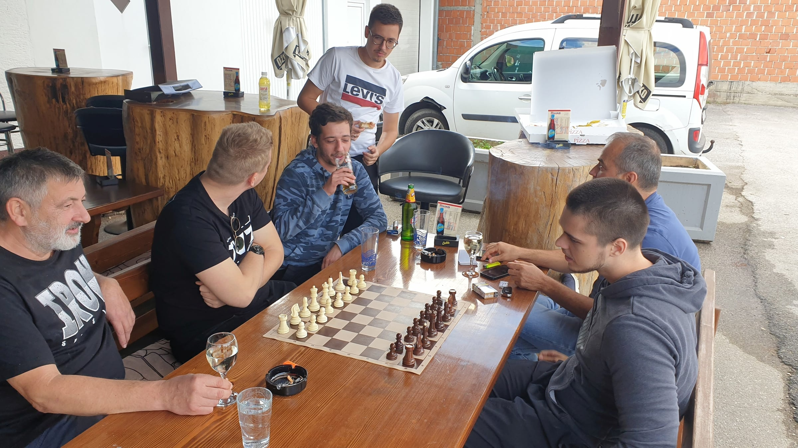

###### Seniori – II. ekipa, 6.kolo



Protekle nedjelje, **11\. listopada**, druga ekipa ŠK Odre gostovala je kod ekipe ŠK HAŠK te ostvarila uvjerljivu [**pobjedu**](https://s1.chess-results.com/tnr1352599.aspx?lan=13&art=3&rd=6&SNode=S0) rezultatom **4:2**.

Ekipa je nastupila u sastavu: Božo, Tin, Luka Lesničar, Slavko, Filip Horvat i Filip Cvetković.

**Božo** je na prvoj ploči odigrao veoma preciznu partiju i zasluženo upisao pobjedu. Njegovu partiju donosimo u prilogu.

**Tin** je, kao i obično, odigrao dominantno i donio još jedan važan bod za ekipu. Njegovu partiju također donosimo u prilogu. Bravo za Tina koji nastavlja s odličnim igrama!

**Luka Lesničar** je već iz otvaranja izašao s boljom pozicijom te je strpljivom i sigurnom igrom postupno povećavao prednost i na kraju upisao pobjedu. Bravo za Luku!

**Slavko** je ovoga puta lošije odigrao otvaranje, no u središnjici njegov protivnik radi grubu grešku koju Slavko uspješno iskorištava. Nakon toga privodi partiju kraju i osvaja važan bod za ekipu.

**Filip Horvat** i **Filip Cvetković** na posljednje dvije ploče pružili su dobar otpor svojim protivnicima, no ovoga puta nisu uspjeli doći do bodova te su obojica na kraju upisala poraze.

Sve u svemu, odličan dan za drugu ekipu ŠK Odre! S ukupnih **4:2** zasluženo je upisana nova pobjeda, a ekipa je još jednom pokazala da može ravnopravno igrati i uspješno osvajati bodove u ligi.

**Posljednje kolo lige igra se 25. listopada**, kada ŠK Odra II na domaćem terenu dočekuje ekipu ŠK Rugvica II. Nadamo se da će naši dečki nastaviti u istom ritmu i sezonu zaključiti još jednom pobjedom! 💪♟️

<table><tbody><tr><td>Pl.</td><td></td><td><strong>ŠK HAŠK</strong></td><td>–</td><td></td><td><strong>ŠK Odra II</strong></td><td><b>2:4</b></td></tr><tr><td>1.</td><td>II</td><td>Martić, Marko</td><td>–</td><td>III</td><td>Cvetković, Božo</td><td>0-1</td></tr><tr><td>2.</td><td>MK</td><td>Pintarić, Ivica</td><td>–</td><td>III</td><td>Furčić, Tin</td><td>0-1</td></tr><tr><td>3.</td><td>II</td><td>Kovačević, Mladen</td><td>–</td><td>IV</td><td>Lesničar, Luka</td><td>0-1</td></tr><tr><td>4.</td><td>&nbsp;III</td><td>&nbsp;Kraljević, Mijo</td><td>–</td><td>V</td><td>Biondić, Slavko</td><td>0-1</td></tr><tr><td>5.</td><td>&nbsp;III</td><td>Čarapović, Slavko</td><td>–</td><td>V</td><td>Horvat, Filip</td><td>1-0</td></tr><tr><td>6.</td><td></td><td>Mjeržva, Bruno</td><td>–</td><td></td><td>Cvetković, Filip</td><td>1-0</td></tr></tbody></table>

```pgn
[Event "5 B Liga Centar"]
[Site "Zagreb"]
[Date "11.10.2026."]
[Round "6"]
[White "Martić, Marko"]
[Black "Cvetković, Božo"]
[Result "0-1"]
[WhiteElo "1892"]
[BlackElo "1680"]
[Board "1"]

1. d4 d5 2. c4 e6 3. Nc3 c6 4. e3 f5 5. Nf3 Bd6 6. Bd3 Nf6 7. O-O O-O 8. Qc2 Nbd7 9. c5 Bc7 10. b4 Ne4 11. a4 e5 12. dxe5 Nxe5 13. Nxe5 Bxe5 14. Bb2 Qf6 15. Rac1 g5 16. f4 gxf4 17. exf4 Bd4+ 18. Kh1 Ng3+ 19. hxg3 Qh6# 0-1
```

```pgn
[Event "5 B Liga Centar"]
[Site "Zagreb"]
[Date "11.10.2026."]
[Round "6"]
[White "Furčić, Tin"]
[Black "Pintarić, Ivica"]
[Result "1-0"]
[WhiteElo "1842"]
[BlackElo "1823"]
[Board "2"]

e4 e5 2. Nf3 Nc6 3. Bb5 a6 4. Ba4 Bc5 5. O-O b5 6. Bb3 d6 7. h3 Na5 8. c3 Nxb3 9. Qxb3 Ba7 10. d4 Qe7 11. Qd5 Rb8 12. dxe5 Bb7 13. exd6 cxd6 14. Qg5 Qxg5 15. Bxg5 f6 16. Bf4 Rd8 17. Nd4 g6 18. Nd2 Kf7 19. a4 b4 20. Nc4 Ke7 21. Rad1 h5 22. Na5 Rd7 23. Nxb7 Rxb7 24. Nc6+ Kf8 25. Bxd6+ Kg7 26. Nxa7 Rxa7 27. Bxb4 Nh6 28. Rd5 Rc8 29. Rfd1 Rcc7 30. Bd6 Rf7 31. b4 Ng8 32. c4 Ne7 33. Bxe7 Rfxe7 34. f3 Rec7 35. R1d4 Kf7 36. Kf2 Ke7 37. Ke3 Rab7 38. c5 Rc6 39. Kd3 g5 40. Kc4 Re6 41. Rd6 Rxd6 42. Rxd6 Ra7 43. Kd5 h4 44. Kc6 Ra8 45. Kb7 Rf8 46. Rd5 Ke6 47. Kxa6 1-0
```
