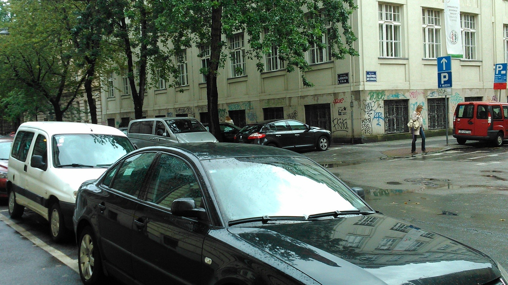

**Seniori, 7. kolo**

U nedjelju 7. rujna odigrano je sedmo kolo seniorske lige. Domaćin našoj ekipi bila je ekipa ŠK Ina u svom prostoru u Gajevoj ulici. Sudeći po rezultatu, ekipa je bila prilično raspoložena za igru. Iz ekipe su ispali Darko, Ivan i Cvetko jer u posljednje vrijeme nisu pokazali igru zadovoljavajuće kvalitete, a ekipi se, uspješno oporavljen, u punoj snazi i potpuno preporođen, pridružio Jura. To se pokazalo kao pun pogodak! Sljedeći vikend u goste nam stiže ekipa ŠK Ban Jelačić iz Zaprešića, zatim slijedi kraća stanka te odlučujući mečevi protiv ŠK Zaprešić i ŠK HRT.

Luka je krenuo u školu, a Zlatko dobio posao. U petak na analizi partija očekujemo i Goluba.

**Šahovska škola nastavlja se u petak 12. rujna u 18:30** za prvu skupinu te u 19:30 za drugu skupinu kadeta.

## ŠK INA – ŠK ODRA 1:5

<table id="tablepress-3" class="tablepress tablepress-id-3"><tbody class="row-hover"><tr class="row-1 odd"><td class="column-1">1.</td><td class="column-2">MK</td><td class="column-3">Prskalo Zoran</td><td class="column-4">MK</td><td class="column-5">Ljubić Ivan</td><td class="column-6">1/2</td></tr><tr class="row-2 even"><td class="column-1">2.</td><td class="column-2">II</td><td class="column-3">Orinčić Damir</td><td class="column-4">MK</td><td class="column-5">Maravić Stjepan</td><td class="column-6">0:1</td></tr><tr class="row-3 odd"><td class="column-1">3.</td><td class="column-2">MK</td><td class="column-3">Branković Ljubomir</td><td class="column-4">MK</td><td class="column-5">Brajdić Danko</td><td class="column-6">0:1</td></tr><tr class="row-4 even"><td class="column-1">4.</td><td class="column-2">MK</td><td class="column-3">Jakovljevski Radivoje</td><td class="column-4">MK</td><td class="column-5">Karlić Zvjezdan</td><td class="column-6">1/2</td></tr><tr class="row-5 odd"><td class="column-1">5.</td><td class="column-2">I</td><td class="column-3">Borota Igor</td><td class="column-4">MK</td><td class="column-5">Bačurin Juraj</td><td class="column-6">0:1</td></tr><tr class="row-6 even"><td class="column-1">6.</td><td class="column-2">I</td><td class="column-3">Bilafer Neđeljko</td><td class="column-4">VK</td><td class="column-5">Furčić Tin</td><td class="column-6">0:1</td></tr></tbody></table>
