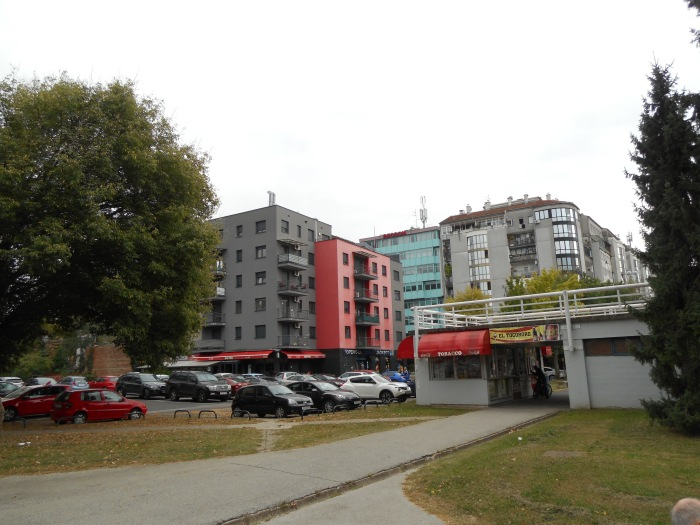

**IV. A liga, 9. kolo  
  
**

U nedjelju, 17.10. odigrali smo 9. kolo seniorske lige. Ugostila nas je ŠK INA u Domu sportova. Nakon prijateljskih remija na 1. i 3. ploči, Tin (koji je pobjedom u Dubravi osvojio IV. kategoriju!)  je preopteretio figure i ostao bez jedne. Božo je mogao biti i u puno boljoj poziciji, ali nije se ohrabrio uzeti pješaka kod protivničke rokade te zatim odigrao nekoliko pasivnih poteza koje je njegov iskusan protivnik znao iskoristiti i priveo partiju u svoju korist. Tako smo nakon dva sata gubili 1-3. Cvetko je držao pritisak cijelu partiju, ali što je manje vremena imao, to je manje kontrole imao nad pozicijom, tako je u cajtnotu došao u izgubljenu poziciju, i kad se činilo da će izgubiti, uzeo je damu. Zadnji je ostao igrati Ivan Maravić, cijelu partiju postupno je nadigravao protivnika i povećavao prednost, uzeo pješaka, i polako, ali sigurno realizirao prednost u završnici. Kako je izgledalo nakon dva sata, na kraju možemo biti zadovoljni podjelom bodova.

<table><tbody><tr><td>Pl.</td><td></td><td><strong>ŠK INA</strong></td><td>–</td><td></td><td><strong>ŠK Odra</strong></td><td><strong>3-3</strong></td></tr><tr><td>1.</td><td>MK</td><td>Padjen Zdenko 1943</td><td>–</td><td>MK</td><td>Karlić Zvjezdan 2095</td><td>½–½</td></tr><tr><td>2.</td><td>I</td><td>Kaplan Jan 1954</td><td>–</td><td>I</td><td>Maravić Ivan 1935</td><td>0-1</td></tr><tr><td>3.</td><td>I</td><td>Borota Igor 1934</td><td>–</td><td>MK</td><td>Bačurin Juraj 2017</td><td>½–½</td></tr><tr><td>4.</td><td>I</td><td>Ćelepirović Vinko 1950</td><td>–</td><td>MK</td><td>Cvetković Ivan 1950</td><td>0-1</td></tr><tr><td>5.</td><td>MK</td><td>Prskalo Zoran 1816</td><td>–</td><td>IV</td><td>Furčić Tin 1633</td><td>1-0</td></tr><tr><td>6.</td><td>II</td><td>Biljak Tomislav 1869</td><td>–</td><td>III</td><td>Cvetković Božo 1440</td><td>1-0</td></tr></tbody></table>

*IvanM*
