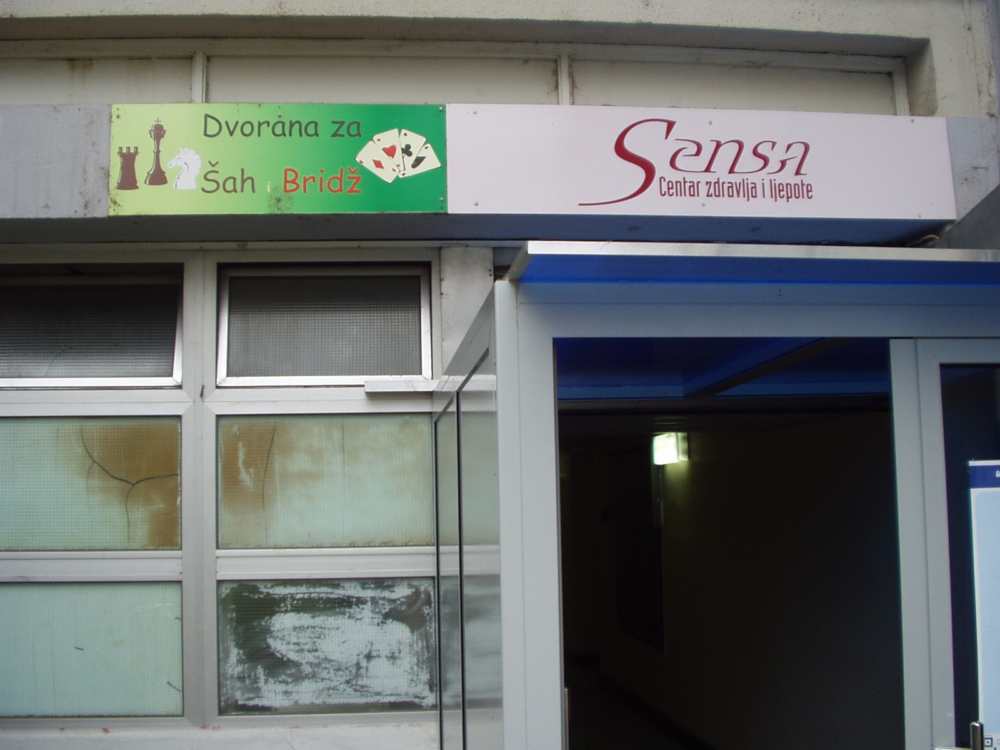

**10\. kolo, seniori**

U Domu sportova, u turobnom prostoru istovjetnom ulazu u isti (vidi sliku!), uz poplavljen muški WC (a važeći je prijedlog da se u siječnju ili veljači u istom prostoru odigra i prvenstvo Grada za osnovne škole!?) danas je odigrano pretposljednje kolo. Igrači HRT-a pokazali su dobru igru i zasluženo pobijedili. Stipe je igrao čvrsto, ali se u dubokoj završnici vidio nedostatak energije i koncentracije. Danko je loše izašao iz otvaranja, ali je njegov protivnik grubo pogriješio i izgubio skakača. Cvetko je igrao napokon dobro, no u solidnoj poziciji ipak je previdio dvojni udar i ostao bez ključnog pješaka. Darko je katastrofalno izašao iz otvaranja i samo zahvaljujući vremenskom tjesnacu u koji je njegov protivnik upao, uspio je iščupati cijeli bod. Jura je igrao solidno, bio bolji, ali je pred kraj partije nepotrebno dopustio protivniku da udvostruči topove na sedmom redu, ostao bez pješaka i izgubio topovsku završnicu. Vjeko je (sada se to već može nazvati njegovim stilom! :)) hrabro ušao u napad uz žrtve, ali napad se i ovaj put rasplinuo…  Realno gledajući, mogao je ovo biti i teži poraz.

    ŠK HRT   – ŠK ODRA                          4:2

1. Malada Vinko – Maravić Stjepan        1:0  
2\. Vukić Aleksandar – Brajdić Danko      0:1  
3\. Basarić Srđan – Cvetković Ivan         1:0  
4\. Ivetić Vladimir – Vidaković Darko       0:1  
5\. Konić Zlatko – Bačurin Juraj              1:0  
6\. Flamengo Joško – Novak Vjekoslav  1:0
