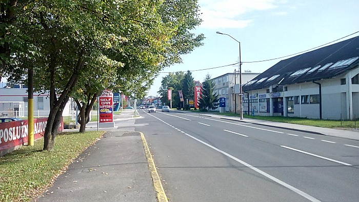

**Seniori, 10. kolo  
  
**U pretposljednjem kolu seniorske lige ŠK Odra gostovao je u Jastrebarskom. Krajnji rezultat bila je zaslužena podjela bodova, ali, kao i prošle godine, malo je nedostajalo da se uzmu oba boda. Ipak, prošle smo godine izgubili na ovom gostovanju. Prema izvještaju Ivana Maravića, Stipe je od početka stajao slabije, Vraneša je uletio u varijantu koju ne poznaje i vrlo rano pogriješio, a isto se dogodilo i Ivanovu protivniku na petoj ploči. Cvetko je cijelu partiju stajao bolje, ali je na kraju ipak ušao u remi–završnicu, usprkos materijalnoj prednosti. Vraneša je brzo izgubio, a nekako u isto vrijeme Jura je matirao protivnika. Stipe je svjesno izbjegao kompliciranu varijantu u kojoj je mogao tražiti i više od pola boda jer je bio uvjeren u Cvetkovu pobjedu, a time i meč-pobjedu, jer je u međuvremenu Ivan iskusno priveo svoju partiju kraju svladavši protivnika u topovskoj završnici. Boris je cijelu partiju dobro stajao, ali se pred kraj partije “smotao”, najvjerojatnije zbog umora.  
Zvjezdan i Darko ovo su kolo propustili zbog privatnih obveza. Zvjezdan je odustao u posljednji trenutak pa je kao zamjena upao mladi Vraneša i na svu sreću naletio na varijantu koju će odsad znati. Vjerujem da će je demonstrirati klupskim kolegama već u petak na redovitom druženju.  
Posljednje kolo igra se za dva tjedna, 6. studenoga, a ŠK Odra je domaćin ŠK Klaka.

**ŠK Jaska, Jastrebarsko – ŠK Odra, Zagreb 3:3  
**  
1\. I Deriš, Antun 1945 – MK Maravić, Stjepan 2100          1/2  
2\. I Kelečić, Dragutin 1924 – MK Bačurin, Juraj 2055      0:1  
3\. II Jagunić, Vladimir 1851 – MK Cvetković, Ivan 1950   1/2  
4\. III Vrabec, Stjepan 1762 – IV Kobali, Borislav 1675       1:0  
5\. II Zoretić, Zlatko 1816 – III Maravić, Ivan 1433              0:1  
6\. IV Korak, Milivoj 1779 – IV Vraneša, Ivan 1341              1:0

darko

---

```pgn
[Event "IV liga centar A"]
[Site "www.sahovski-klub.com"]
[Date "2016.10.23"]
[Round "10"]
[White "Zlatko, Zoretić 1816"]
[Black "Ivan, Maravić 1433"]
[Result "0-1"]
[ECO "C31"]
[PlyCount "98"]

1. e4 e5 2. f4 d5 3. exd5 c6 4. Qe2 cxd5 5. Qxe5+ Be7 6. Be2 Nc6 7. Qe3 Nf6 8.
Bf3 O-O 9. Ne2 d4 10. Qf2 Nb4 11. Na3 d3 12. Nc3 dxc2 13. O-O Nd3 14. Qg3 Qd4+
15. Kh1 Bxa3 16. bxa3 Rd8 17. Be2 Bf5 18. Qe3 Qxe3 19. dxe3 Rac8 20. Nb5 a6 21.
Nd4 Be4 22. Bd2 Rd7 23. Kg1 Rdc7 24. Bc1 Kf8 25. g4 Nxc1 26. Raxc1 Rc3 27. Kf2
Nd5 28. Ke1 Nxe3 29. Rg1 Ng2+ 30. Kd2 Nxf4 31. Rgf1 Nxe2 32. Nxe2 Rd3+ 33. Ke1
Rxa3 34. Kd2 Bg6 35. Nf4 Rd8+ 36. Ke2 Bd3+ 37. Nxd3 Rdxd3 38. Rxc2 Re3+ 39. Kf2
Rf3+ 40. Kg2 Rxf1 41. Kxf1 Ke8 42. Rc7 b5 43. Rc8+ Ke7 44. Rh8 Rxa2 45. Rxh7
Kf6 46. Rh5 b4 47. Rc5 b3 48. Rc6+ Ke7 49. Rb6 b2 0-1
```
