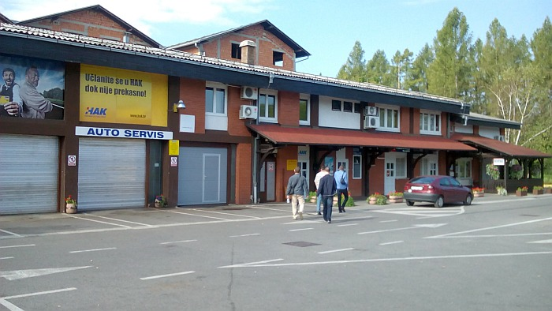

**Seniori, 7. kolo**

U prostorijama Autokluba Jastrebarsko odigrano je sedmo kolo seniorske lige između domaćina ŠK Jaska i ekipe ŠK Odra. Ovaj put rezultat je prevagnuo na stranu domaćina, koji je zasluženo slavio s 3,5:2,5. Ljubić je odigrao hrabro i napadački, ali je protivnik u obostranome rohadnom napadu ipak bio za potez brži. Zvjezdan je uspio pozicijski nadigrati protivnika, osvojiti i nekoliko pješaka, ali je njegov protivnik dobro zablokirao poziciju i tu nije bilo više od pola boda. Stipe je rano osvojio kvalitetu, ali je zatim podcijenio napad protivnika pa nije na vrijeme išao u vraćanje materijala te je zapao pod neobranjiv napad. Darko je cijelu partiju forsirao, ali se njegov protivnik precizno branio te na kraju imao i kvalitetu više, ali je tada, baš kao i Stipe na trećoj ploči, povukao nekoliko nepreciznih poteza i potpao pod napad od kojeg se nije uspio obraniti. Cvetko je odigrao čvrsto, iskoristio pasivnu igru protivnika te u napadu na rohadni položaj protivnika, uz žrtvu topa, brzo završio partiju. Ivan je na šestoj ploči odigrao dobro otvaranje, ali tada iz nepoznatog razloga nije uzeo materijal. Nekoliko poteza poslije ipak je to učinio, no uz to je, umjesto da smiri igru, nastavio divljati, žrtvovao oba topa, ali nekorektno, te izgubio. Time je nastavljen negativan niz rezultata i šanse za opstanak u ligi sve su tanje.

ŠK JASKA – ŠK ODRA 3,5:2,5

1\. I Deriš, Antun 2033 – MK Ljubić, Ivan 2155                       1:0  
2\. I Rudić, Željko 1981 – MK Karlić, Zvjezdan 2152               1/2  
3\. MK Divjak, Želimir 1902 – MK Maravić, Stjepan 2098        1:0  
4\. II Jagunić, Vladimir 1875 – MK Vidaković, Darko 2098       0:1  
5\. III Vrabec, Stjepan 1803 – MK Cvetković, Ivan 1950          0:1  
6\. VK Kišan, Josip 1601 – III Maravić, Ivan 1777                    1:0

Liga se nastavlja 18. listopada, a u goste dolazi ekipa ŠK Končar.

darko
