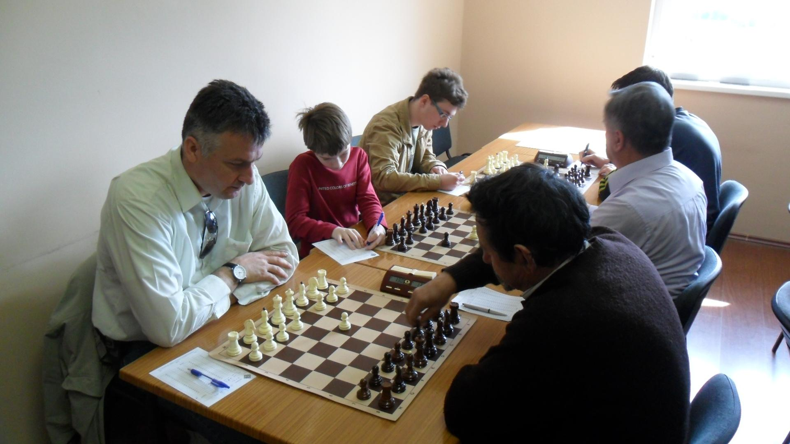
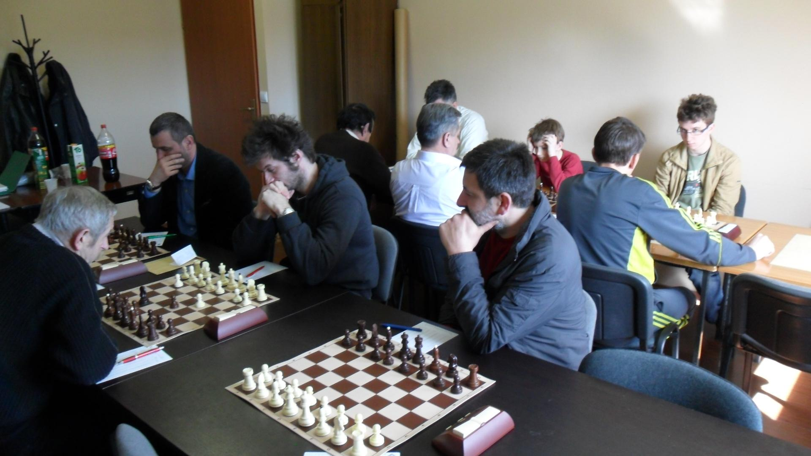
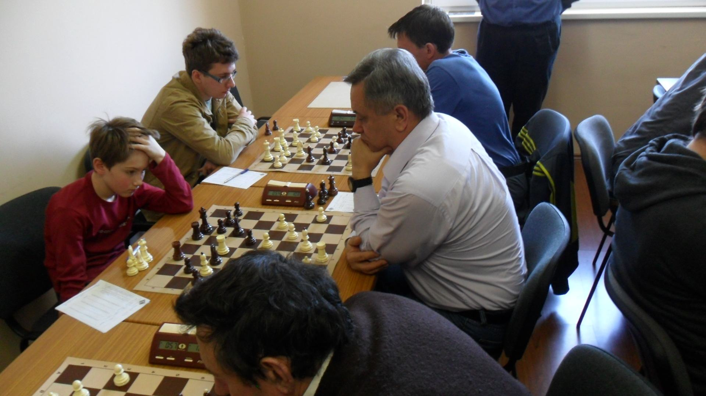

## **3\. kolo, seniori**

U trećem kolu ekipa ŠK Odra naišla je na vrlo raspoloženu ekipu ŠK Jaska i pretrpjela zasluženi poraz. Na prvoj ploči Stipe je loše odigrao otvaranje i pozicija se sama urušavala. Na drugoj i trećoj ploči Cvetković i Brajdić imali su remi pozicije koje je bilo praktički nemoguće dobiti, ali su forsirali do kraja u želji da ostvare što bolji meč- rezultat, a to je dovelo do gubitka boda na trećoj ploči i ipak samo remija na drugoj. Na četvrtoj ploči u obostranom cajtnotu Vidaković je uspio protivnika uhvatiti u matnu mrežu.

Zanimljive i nadasve poučne partije odigrao je podmladak seniorske ekipe na petoj i šestoj ploči. Ivan je na petoj ploči odigrao izvrsno otvaranje, ali je onda pogrešno zamijenio lovca koji je služio za pokrivanje točke d5. Tin je zaboravio ispraviti udvojene pješake i uz to na krivu boju slagao pješake u završnici s lovcem. Vjerujem da su im ove partije bile vrlo korisne i obojica zaslužuju pohvale za trud i zalaganje.

  

REZULTATI:

ŠK JASKA – ŠK ODRA    4,5 : 1,5

1\. Kelečić Dragutin – Maravić Stjepan   1:0

2\. Deriš Antun  – Brajdić Danko  1/2

3\. Rudić Željko  – Cvetković Ivan  1:0

4\. Divjak Želimir – Vidaković Darko  0:1

5\. Jagunić Vladimir – Maravić Ivan  1:0

6\. Cvetko Vjekoslav  – Furčić Tin  1:0

v.d.
