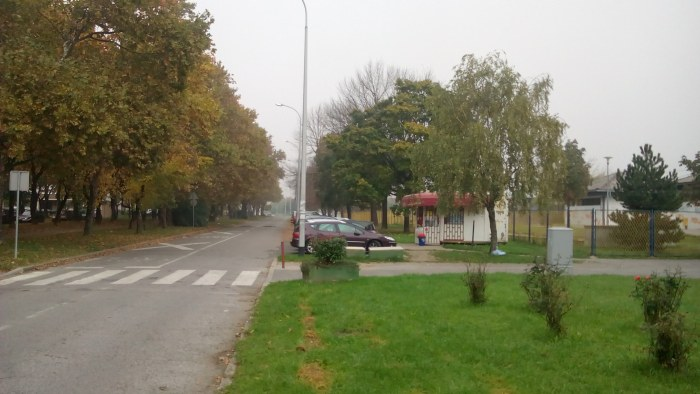
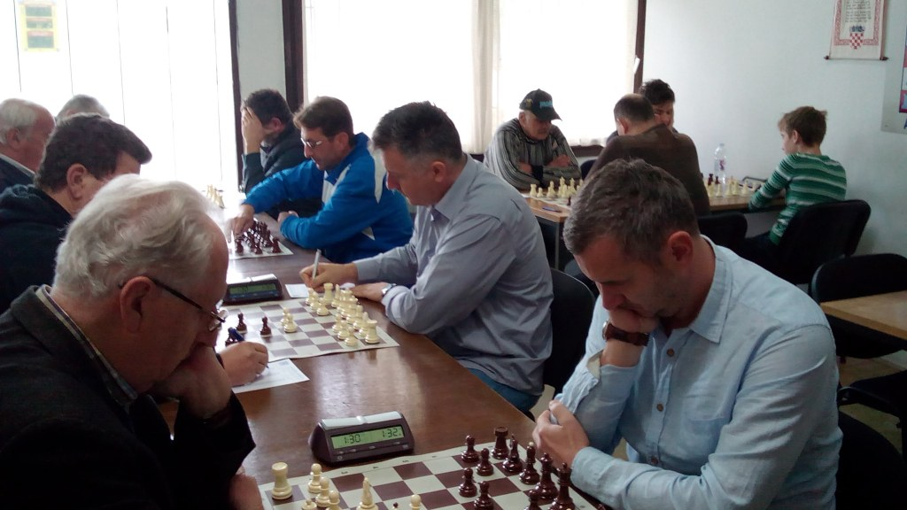
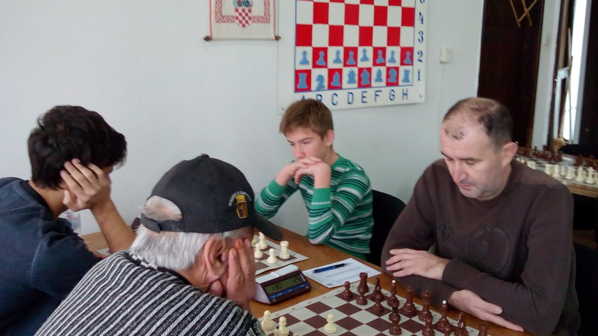

**Seniori, 9. kolo**

Promijenilo se vrijeme, tako da smo prošlu noć vratili sat za jedan unatrag. Nažalost, nije došlo do promjene u igri ŠK Odra te je i ovo, deveto kolo, ostao bez bodova. Darko je odigrao dobru partiju, propustio dobitak u središnjici jer njegov mali mozak nije u stanju izračunati nešto duže od tri poteza, pred kraj partije ušao u cajtnot, zaboravio na slabost prvog reda i izgubio. Jura je uspio izjednačiti u indijskoj poziciji i pokrenuti uspješan napad na rohadu protivnika te zabilježio danas jedinu pobjedu za ŠK Odra. Cvetko je odigrao čvrsto od početka do kraja, kako i inače igra u posljednje vrijeme, te je partija završila remijem. Stipe je na prvoj ploči također pokrenuo jak napad, ali ni njegov protivnik nije samo gledao u poziciji sa suprotnim rohadama. Na kraju je Stipe remizirao ponavljanjem poteza u poziciji u kojoj ima forsirani dobitak, ali prilično kompliciran, tako da ga uistinu nije bilo lako vidjeti. Nažalost, na šestoj ploči Ivana je protivnik nadigrao, a Boris je na petoj iz nepoznatih razloga dopustio protivniku otvaranje veoma čvrste pozicije u kojoj je bio samo bolji te nastradao u komplikacijama. Zasluženom pobjedom ŠK Klaka izvukao se iz opasne zone, a ŠK Odra učvrstio se na posljednjoj poziciji, na koju je zasjeo prošlo kolo. Još su dva kola do kraja prvenstva, a sljedeće kolo igra se 8. studenoga, kada nam u goste dolazi ŠK Ina.

ŠK KLAKA – ŠK ODRA  4:2

1\. Šunjić, Vitomir – Maravić, Stjepan 1/2  
2\. Josipović, Perica – Vidaković, Darko 1:0  
3\. Paić, Ivica – Bačurin, Juraj 0:1  
4\. Gujić, Leonard – Cvetković, Ivan 1/2  
5\. Mitrović, Milivoj – Kobali, Boris 1:0  
6\. Horvat, Damjan – Maravić, Ivan 1:0

   Zahvaljujemo sucu meča, gospodinu Josipu Banduru, na fotografijama.

v.d.
