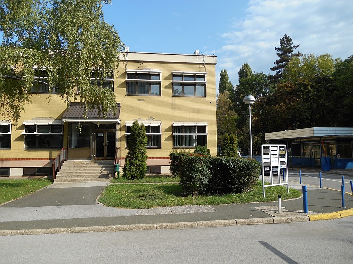
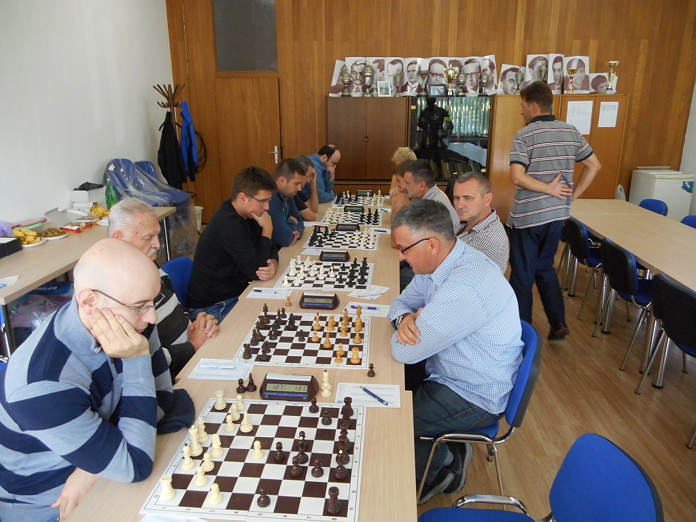

**Seniori, 6. kolo**

Započeo je jesenski dio seniorske lige, a u šestom kolu ekipa ŠK Odra gostovala je kod kod ekipe ŠK Končar II. Kako su kadeti imali nogomet, a Zvjezdan i Tin privatne obaveze, nije bilo lako sastaviti ekipu. Na kraju su u ekipu ipak uvršteni Ivan i Vraneša, a Vraneša je brzinski riješio partiju teoretskom žrtvom u otvaranju i još stigao i na nogometnu utakmicu! Ivan je izgubio partiju jer je podcijenio prijetnje po svog kralja sve dok nije bilo prekasno. Stipe je dočekao pogrešku protivnika i upisao cijeli bod. Darko je odigrao ravnopravnu partiju i prihvatio remi u izjednačenoj poziciji, kada se već vidjelo da će i Jura na prvoj ploči osvojiti cijeli bod. Jura je izašao slabije iz otvaranja, ali je njegov protivnik nepotrebno dopustio izmjenu dama, nakon čega ga je Jura pješačkim prodorom u centru doveo pred neobranjiv mat. Time su bila već osvojena potrebna 3,5 boda. Jedino se Cvetko, koji je loše odigrao otvaranje, mučio u dubokoj završnici, a obzirom da je cijelo vrijeme bio lošiji sa vremenom, očekivano je izgubio ionako tešku završnicu. U svakom slučaju, lijepa pobjeda i novih dva boda. Ostala su još tri kola do kraja lige, a sljedeće kolo se igra za tjedan dana kada nam u goste dolazi ŠK Draganići.

**ŠK KONČAR II – ŠK ODRA 2,5:3,5**  
1\. II Stipe Pavičić 2000 – MK Juraj Bačurin 2049          0:1  
2\. MK Peter Šribar 1979 – MK Darko Vidaković 2116   1/2  
3\. II Antun Pfeifer 1974 – MK Stjepan Maravić 2092    0:1  
4\. II Tadija Dalić 1881 – MK Ivan Cvetković 1968         1:0  
5\. I Vladimir Ostojić 1928 – II Ivan Maravić 1700          1:0  
6\. III Marko Sučec 1719 – III Ivan Vraneša 1490          0:1

darko
