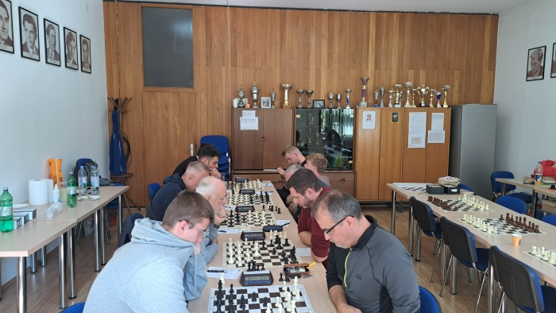

**Seniori – I. ekipa, 9.kolo  
  
**  
Ove nedjelje smo odigrali [meč](https://chess-results.com/tnr1127780.aspx?lan=13&art=3&rd=9) protiv jake ekipe Končara i zasluženo izgubili. Ivan Maravić je na prvoj ploči odigrao čvrsto otvaranje koje njegov protivnik nije bio voljan probijati te ja partija završena brzim remijem. Stjepko je na četvrtoj ploči odigrao dobru partiju te stajao puno bolje, ali tada radi veliki previd te može biti sretan da Skrbin nije vidio više od vječnoga šaha. Kraj te partije donosimo u prilogu. Mladen je bio pospan te je tako i odigrao, nije vidio protivnički dvojni udar nakon kojega mu nije ništa preostalo osim predaje. Ivo je nakon dugo vremena odigrao natjecateljsku partiju i to se vidjelo, krivo je procijenio poziciju te je došao pod neobranjivi napad. Također se treba odati priznanje njegovom protivniku Erendi koji je partiju precizno i efektno priveo kraju. Hrvoje je odigrao dobro i čvrsto otvaranje, ali ga je protivnik pažljivim manevriranjem uspio iscijediti i upisati cijeli bod. Ivan Vraneša je iz otvaranja izašao potpuno dobiven, nakon toga radi neshvatljive stvari ne koristeći višestruke prilike za uzimanje pješaka u potezu te dolaženje topom na sedmi red s tempom. Nakon propuštenih prilika partija završava remijem. Čestitamo Končaru, a na nama je da se okrenemo idućem kolu kada igramo protiv ŠK Stjepan Bosak.

<table><tbody><tr><td>Pl.</td><td></td><td><strong>ŠK Končar</strong></td><td>–</td><td></td><td><strong>ŠK Odra</strong></td><td><strong>4,5-1,5</strong></td></tr><tr><td>1.</td><td>MK</td><td>Pavčević, Bruno 2178</td><td>–</td><td>MK</td><td>Maravić, Ivan 2096</td><td>½–½</td></tr><tr><td>2.</td><td></td><td>Rajić, Ivan 2127</td><td>–</td><td>MK</td><td>Sliepčević, Mladen 2056</td><td>1-0</td></tr><tr><td>3.</td><td>NM</td><td>Dugandžić, Boris 2150</td><td>–</td><td>MK</td><td>Kovač, Hrvoje 2008</td><td>1-0</td></tr><tr><td>4.</td><td>MK</td><td>Skrbin, Krešimir 2091</td><td>–</td><td>MK</td><td>Maravić, Stjepan 2067</td><td>½–½</td></tr><tr><td>5.</td><td>MK</td><td>Erenda, Bruno 2092</td><td>–</td><td>II</td><td>Pahljina, Ivo 1865</td><td>1-0</td></tr><tr><td>6.</td><td>MK</td><td>Starčević, Krešimir 2081</td><td>–</td><td>II</td><td>Vraneša, Ivan 1865</td><td>½–½</td></tr></tbody></table>

```pgn
[Event "III A liga - Končar : Odra"]
[FEN "2kr4/pp3pbQ/2n1pq2/3p4/3P1BP1/2P2N2/PP1K1P2/R7 w - - 0 19"]
[Site "sahovski-klub.com"]
[Date "2025.10.12"]
[Round "9"]
[White "MK Maravić, Stjepan"]
[Black "MK Skrbin, Krešimir"]
[Result "1/2-1/2"]
[WhiteElo "2067"]
[BlackElo "2091"]
[PlyCount "68"]
20. Bg5 {Velika greška, trebalo je samo obraniti lovca nekako.} (20.Ke3) (20.Qh2) Qxf3 21. Bxd8 Qxf2+ 22. Kd3 Qf3+ {Umjesto toga crni ima više direktnih dobitaka kao npr.} (22... Nb4+) 23. Kd2 Qf2+ 24. Kd3 1/2-1/2
```
