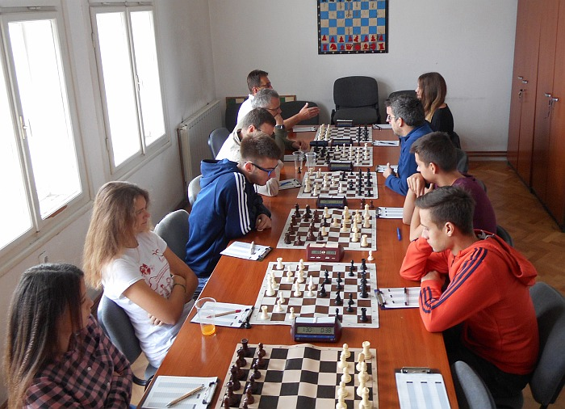

**Seniori, 8. kolo  
  
**Rezultatski najuvjerljiviju pobjedu, ove godine, ostvarili smo u današnjem devetom kolu seniorske lige. Samanta nažalost nije imala protivnika, a Ana je lako savladala svog starijeg, ali neiskusnijeg protivnika. Jura je kasnio na partiju, a Mihaela je nadmoćnu završnicu završila simpatičnom taktikom. Ivan je opet silio i komplicirao, bio čak u izgubljenoj, ali kompliciranoj poziciji koju je na kraju ipak preveo u svoju korist. Hrabrosti mu ne nedostaje, ali bi ipak trebao igrati racionalnije, želi li svoju igru podići na višu razinu. Zvjezdanu se danas nije baš igralo pa je ponudio remi koji je protivnik odbio. Ipak, damska završnica na kraju partije je bila remi. Stipe je odigrao najzanimljiviju partiju. Vrlo rano naveo je protivnika u poziciju  koja je samo njemu odgovarala i pravocrtno ju priveo kraju. Mogao je i ranije završiti, ali nije želio ulaziti u komplikacije.  
Zahvaljujući dobrom stanju na [tablici](http://chess-results.com/tnr414083.aspx?lan=13&art=0), mlađim članovima se pruža sve više prilika odmjeriti snage i u seniorskoj konkurenciji. Posebno djevojkama, kojima školsko prvenstvo počinje za nepuna dva mjeseca. Sljedeće kolo igra se 6. listopada kada gostujemo kod ŠK Prigorje Markuševec, te se nadam da će više mlađih iskoristiti ovu priliku.

<table><tbody><tr><td></td><td></td><td>&nbsp;<strong>&nbsp;ŠK Odra</strong></td><td><strong>–</strong></td><td><strong>&nbsp;</strong></td><td><strong>&nbsp; HAŠK Mladost II</strong></td><td><strong>4,5 :</strong> <strong>1,5</strong></td></tr><tr><td>1.</td><td>MK</td><td><table><tbody><tr><td></td><td>Bačurin, Juraj 2033</td></tr></tbody></table></td><td>–</td><td>WFM</td><td><table><tbody><tr><td></td><td>Blažeka, Mihaela 2092</td></tr></tbody></table></td><td>0 – 1</td></tr><tr><td>2.</td><td>MK</td><td><table><tbody><tr><td></td><td>Maravić, Stjepan 2117</td></tr></tbody></table></td><td>–</td><td>II</td><td><table><tbody><tr><td></td><td>Tomić, Stjepan 1901</td></tr></tbody></table></td><td>1 – 0</td></tr><tr><td>3.</td><td>MK</td><td><table><tbody><tr><td></td><td>Karlić, Zvjezdan 2113</td></tr></tbody></table></td><td>–</td><td>II</td><td><table><tbody><tr><td></td><td>Lovrinić, Vlatko 1743</td></tr></tbody></table></td><td>½ – ½</td></tr><tr><td>4.</td><td>I</td><td><table><tbody><tr><td></td><td>Maravić, Ivan 1947</td></tr></tbody></table></td><td>–</td><td>IV</td><td><table><tbody><tr><td></td><td>Spahija, Roko 1818</td></tr></tbody></table></td><td>1 – 0</td></tr><tr><td>5.</td><td>II</td><td><table><tbody><tr><td></td><td>Kolovrat, Ana 1179</td></tr></tbody></table></td><td>–</td><td>VK</td><td><table><tbody><tr><td></td><td>Ilić, Antonio 1608</td></tr></tbody></table></td><td>1 – 0</td></tr><tr><td>6.</td><td>III</td><td><table><tbody><tr><td></td><td>Halužan, Samanta 1185</td></tr></tbody></table></td><td>–</td><td>VK</td><td><table><tbody><tr><td></td><td>Vasung, Patrik 1600</td></tr></tbody></table></td><td>1 – 0*</td></tr></tbody></table>

---

```pgn
[Event "J. Bačurin vs M. Blažeka"]
[Date "2019.09.22"]
[Round "8"]
[SetUp "3"]
[FEN "8/4n2p/p2k1pp1/P1p5/bp2PP2/1N2K3/2P3PP/2N5 b - - 0 29"]29... Nc6 30. Kd3 c4+ 0-1
```
