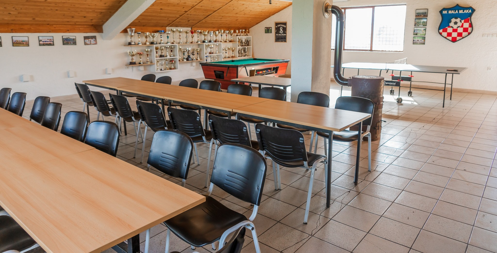

###### Seniori – II. ekipa, 6.kolo



Protekle nedjelje ŠK Odra II ugostila je ekipu ŠK Duga Resa na domaćem terenu – preciznije rečeno, na nogometnom terenu. Nažalost, rezultat nije išao u našu korist jer su protivnici pokazali da su iskusniji i kvalitetniji tim.

Za ŠK Odru II nastupili su: Šutić, Božo, Luka Fiolić, Karlović, Filip Horvat i Filip Cvetković.

-   **Šutić** se našao na prvoj ploči protiv njihovog najjačeg igrača. Iako je partiju izgubio relativno brzo, imao je jednu ozbiljnu priliku za povratak u igru koju nažalost nije iskoristio.
-   **Božo** je igrao solidno, no nekoliko pozicijskih grešaka vodilo je prema izgubljenoj završnici. Ipak, partija je bila borbena i poučna.
-   **Luka Fiolić**, samoprozvano „svjetlo na kraju tunela“, odigrao je preciznu i stabilnu partiju kojom je donio **jedinih pola boda** za ekipu. Luka je pokazao zrelost i koncentraciju te je njegov remi u završnici bio zaslužen. Bravo Luka! Njegovu partiju donosimo u prilogu.
-   **Karlović** je imao tešku partiju pod, kako kaže, “sumnjivim okolnostima”, te brzo došao do izgubljene pozicije. Možda ga je zbunila činjenica da je protivnica bila – dama.
-   **Filip Horvat** je debitirao za seniorsku ekipu i ostavio odličan dojam. Pokazao je strpljenje, taktičko razumijevanje i borbenost. Čestitamo mu na hrabrom prvom nastupu!
-   **Filip Cvetković** imao je perspektivnu poziciju, ali nedostajalo mu je malo više iskustva i smirenosti da je kapitalizira. Ipak, partija pokazuje dobar potencijal.

Protivnicima iz ŠK Duga Resa čestitamo na zasluženoj pobjedi. Pokazali su snagu i zrelost, te se s razlogom smatraju najjačom ekipom lige. Ovo kolo bilo je ujedno i posljednje u ovoj polusezoni, koju **ŠK Odra II završava na visokom 8. mjestu**. S obzirom na mladu postavu i razvojni karakter ekipe, ovo je itekako respektabilan rezultat.

<table><tbody><tr><td>Pl.</td><td></td><td><strong>ŠK Odra II</strong></td><td>–</td><td></td><td><strong>ŠK Duga Resa</strong></td><td><strong>0.5 – 5.5</strong></td></tr><tr><td>1.</td><td>II</td><td>Šutić, Darko</td><td>–</td><td>NM</td><td>Šlogar, Dubravko</td><td>0-1</td></tr><tr><td>2.</td><td>III</td><td>Cvetković, Božo</td><td>–</td><td>MK</td><td>Stojković, Josip</td><td>0-1</td></tr><tr><td>3.</td><td>&nbsp;IV</td><td>Fiolić, Luka</td><td>–</td><td>I</td><td>Jakšić, Damir</td><td>&nbsp;½–½</td></tr><tr><td>4.</td><td></td><td>Karlović, Ivan</td><td>–</td><td>&nbsp;NM</td><td>Štadler, Brigita</td><td>0-1</td></tr><tr><td>5.</td><td></td><td>Horvat, Filip</td><td>–</td><td>&nbsp;I</td><td>Dotlić, Zdravko</td><td>0-1</td></tr><tr><td>6.</td><td></td><td>Cvetković, Filip</td><td>–</td><td>&nbsp;III</td><td>Jančić, Goran</td><td>0-1</td></tr></tbody></table>

```pgn
[Event "5. Liga ŠZŽ Centar 2025"]

[Site "Mala Mlaka"]
[Date "2025.05.25"]
[Round "6"]
[White "Fiolić Luka"]
[Black "Jakšić Damir"]
[Result "1/2-1/2"]

1. e4 d6 2. d4 Nf6 3. Nc3 c6 4. Nf3 Qa5 5. Bd2 e5 6. dxe5 dxe5 7. Nd5 Qd8 8. Nxf6+ Qxf6 9. Bg5 Qd6 10. Qxd6 Bxd6 11. Rd1 Bc7 12. Bc4 Nd7 13. O-O b5 14. Bb3 Nc5 15. Rfe1 a5 16. a3 Nxb3 17. cxb3 Be6 18. Rd3 f6 19. Be3 Rd8 20. Red1 Bxb3 21. Rxd8+ Bxd8 22. Rd6 Be7 23. Rxc6 Kd7 24. Rc3 a4 25. Nd2 Be6 26. Bc5 Rc8 27. Bxe7 Rxc3 28. bxc3 Kxe7 29. f3

1/2-1/2
```
