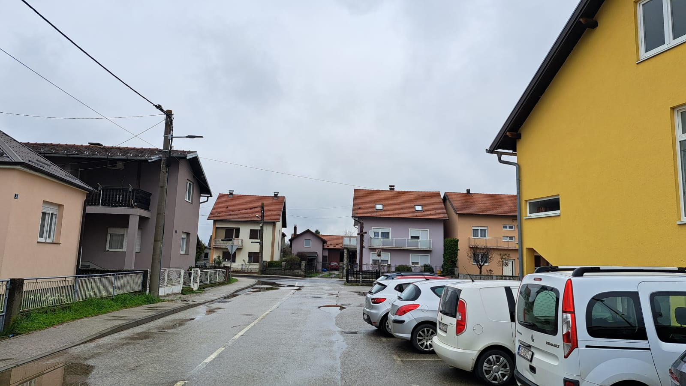
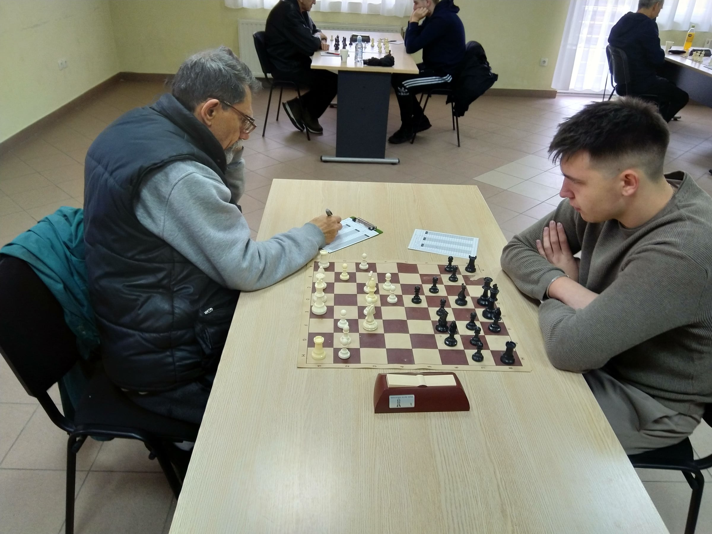
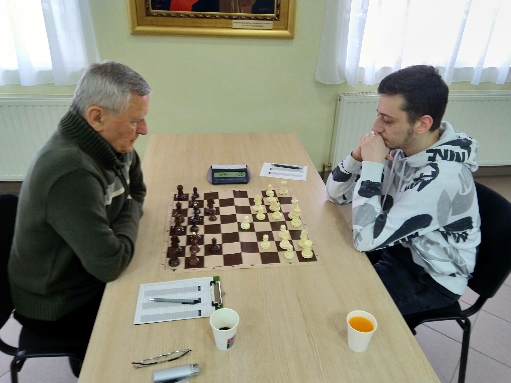
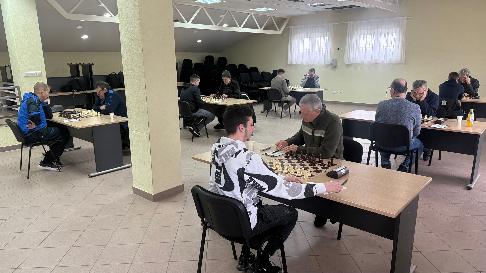
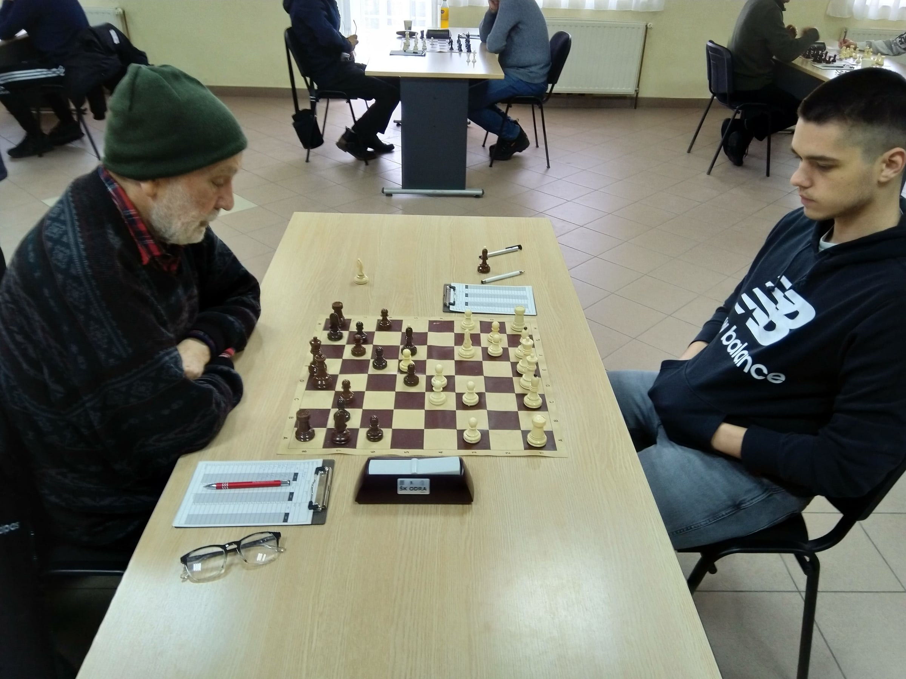
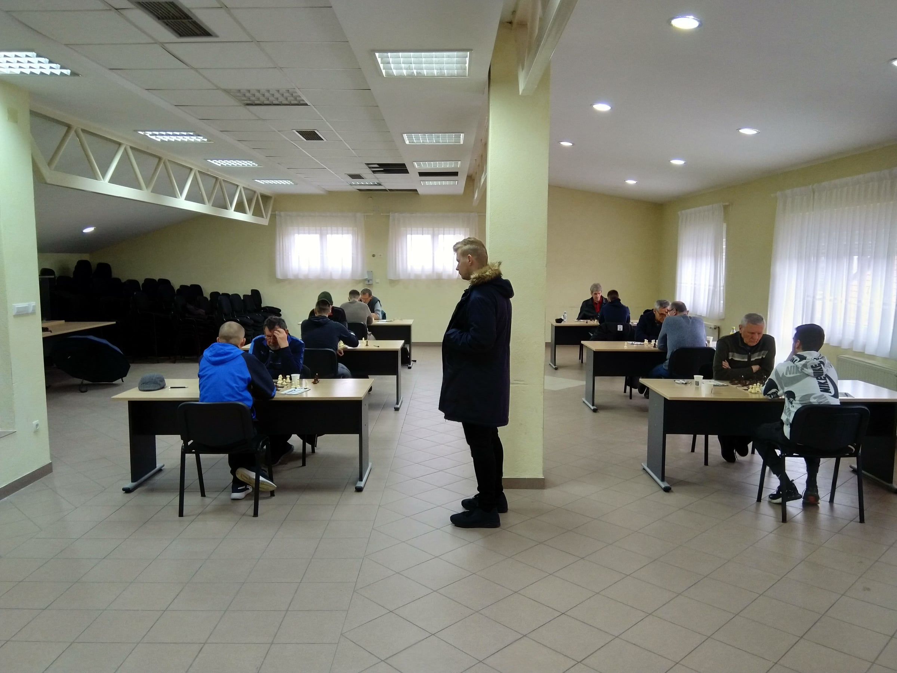
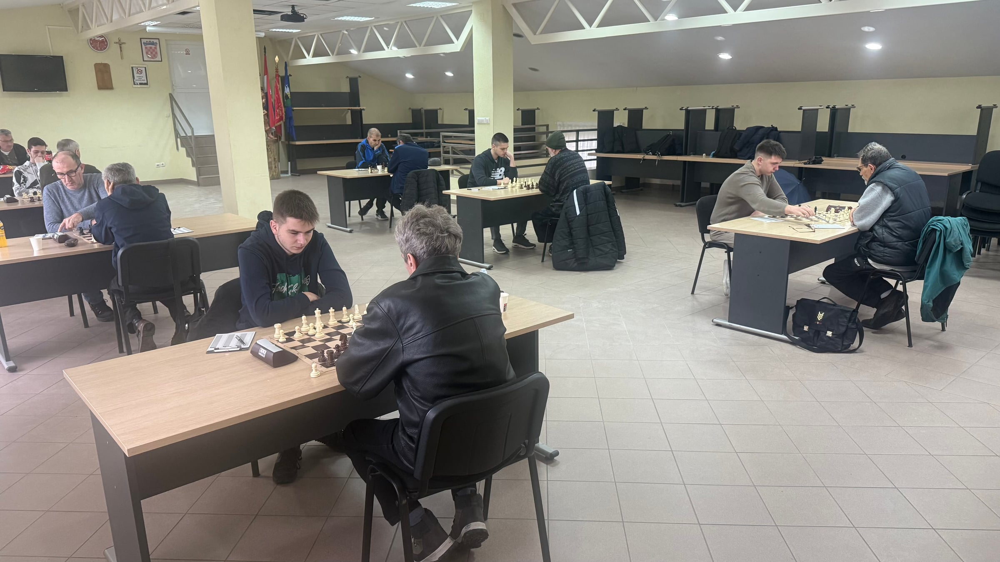

###### Seniori – II. ekipa, 1.kolo

###### ****

Ovo je prvi put u povijesti kluba da imamo dvije seniorske ekipe! Proteklu nedjelju ekipa ŠK Odra II odigrala je [meč](https://chess-results.com/tnr1127793.aspx?lan=13&art=3&rd=1) protiv ŠK HAŠK na domaćem terenu. Meč je bio napet i neizvjestan do samog kraja, a naši igrači su pokazali borbenost i kvalitetnu igru.

Za ekipu su igrali Božo, Boris, Luka Fiolić, Goran, Lucijan i Ivan Karlović. Ivan je prvi završio i donio prvi bod ekipi, napravio je hrabru žrtvu lovca i doveo protivnika u nezgodnu situaciju. Lucijan je pobijedio brzo nakon Ivana. Kaznio je protivnikovu brzu igru, te ubrzo realizirao veliku materijalnu prednost. Nakon toga, Boris je osigurao pola boda ekipi mirnom i sigurnom igrom. Goran je trošio puno vremena i polako došao u izgubljenu poziciju te izgubio partiju. Luka se našao u izgubljenoj završnici, ali je iskoristio protivnikovu grešku i uspio osigurati još jedan remi, približivši nas pobjedi meča. Božo je zadnji završio partiju, pokazao zašto je kapetan novonastale ekipe. Igrao je sporu i preciznu partiju te nadigrao protivnika.

Ukupno, ekipa je ostvarila zasluženu pobjedu, što im daje dodatan motiv za sljedeće susrete. Sljedeću nedjelju očekuje ih gostovanje kod ŠK Pravi Potez, gdje će tražiti novu priliku za pobjedu!

<table><tbody><tr><td>Pl.</td><td></td><td><strong>ŠK Odra II</strong></td><td>–</td><td></td><td><strong>ŠK HAŠK</strong></td><td><strong>4-2</strong></td></tr><tr><td>1.</td><td>III</td><td>Cvetković, Božo</td><td>–</td><td>MK</td><td>Pintarić, Ivica</td><td>1-0</td></tr><tr><td>2.</td><td>IV</td><td>Kobali, Borislav</td><td>–</td><td>III</td><td>Kraljević, Mijo</td><td>½–½</td></tr><tr><td>3.</td><td>IV</td><td>Fiolić, Luka</td><td>–</td><td>II</td><td>Ivančić, Mate</td><td>½–½</td></tr><tr><td>4.</td><td>II</td><td>Fiolić, Goran</td><td>–</td><td>III</td><td>Carapović, Slavko</td><td>0-1</td></tr><tr><td>5.</td><td></td><td>Hadviger, Lucijan</td><td>–</td><td></td><td>Tanković, Šemso</td><td>1-0</td></tr><tr><td>6.</td><td></td><td>Karlović, Ivan</td><td>–</td><td></td><td>Mjeržva, Bruno</td><td>1-0</td></tr></tbody></table>

```pgn
[Event "5. Liga ŠZŽ Centar 2025"]

[Site "Mala Mlaka"]
[Date "2025.03.16"]
[Round "1"]
[White "Cvetković Božo"]
[Black "Pintarić Ivica"]
[Result "1-0"]

1. b3 Nf6 2. Bb2 e6 3. e3 b6 4. Nf3 Be7 5. Be2 Bb7 6. d4 O-O 7. O-O d6 8. c4 Nbd7 9. Nbd2 h6 10. Qc2 Re8 11. Rfe1 Nf8 12. Bd3 d5 13. cxd5 Nxd5 14. a3 Rc8 15. Ne5 c6 16. Rac1 Bd6 17. Ndc4 Bb8 18. Nf3 Qc7 19. Nce5 Qd6 20. Nc4 Qe7 21. Nce5 Nd7 22. Qe2 b5 23. Rc2 Nxe5 24. Nxe5 Bxe5 25. dxe5 a6 26. Rec1 Rc7 27. Rc5 Rec8 28. Be4 Nb6 29. b4 Na4 30. R5c2 Nxb2 31. Rxb2 c5 32. Bxb7 Rxb7 33. Rd2 c4 34. Rd6 Ra7 35. Qd2 g6 36. Qd4 Qc7 37. Qf4 Rd8 38. Rcd1 Rc8 39. h4 c3 40. h5 c2 41. Rc1 Qe7 42. hxg6 fxg6 43. Qe4 Qf7 44. Rxc2 Rac7 45. Rdc6 Rxc6 46. Rxc6 Ra8 47. Rxe6 Qxe6 48. Qxa8+ Kg7 49. Qb7+ Kg8 50. Qb8+ Kg7 51. Qc7+ Kg8 52. Qd6 Kf7 53. Qxe6+ Kxe6 54. f4

1-0
```








IvanV
