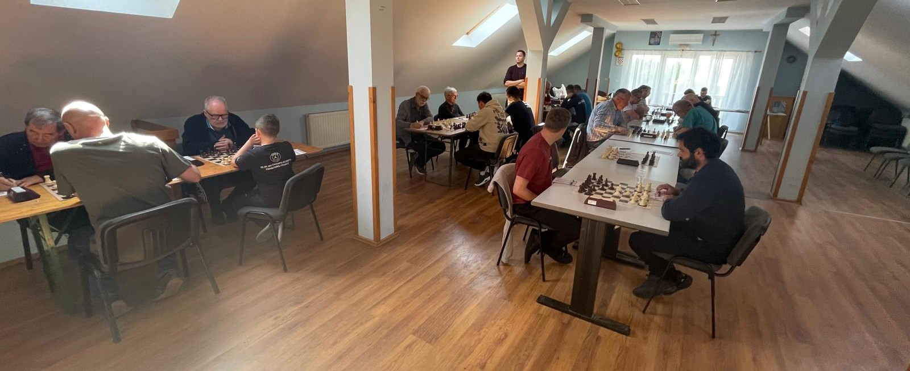

###### Seniori – II. ekipa, 5.kolo



Protekle nedjelje, 11. svibnja, na domaćem terenu u Maloj Mlaki, ŠK Odra je u napetom i neizvjesnom meču svladala ekipu ŠK Jakovlje rezultatom **3.5 : 2.5**. Iako je susret mogao otići na obje strane, ovoga puta sreća i odlučnost bile su na strani naših.

Za ŠK Odru su nastupili: **Boris, Luka Fiolić, Lucijan, Ivan Karlović, Luka Lesničar i Filip Cvetković**. Posebno veseli što su **Luka Lesničar i Filip Cvetković po prvi puta nastupili za seniorsku ekipu**, i to pobjedama! Duple čestitke za obojicu!

Na prvoj ploči, **Boris** je imao najteži zadatak – suočiti se s daleko najjačim protivničkim igračem. Iako je partiju izgubio, pokazao je borbenost i timsku požrtvovnost. Ipak, savjet iz ekipe: vrijeme je za malo ponavljanja otvaranja i raniju rokadu!

**Luka Fiolić** otvorio je partiju solidno, iako je u središnjici pozicija bila nešto slabija. Protivnik to nije iskoristio, a Luka dolazi do dobivene završnice u kojoj ipak pristaje na remi. Od Luke očekujemo više samopouzdanja.

**Lucijan** je, već po tradiciji, odigrao sigurnu partiju. Taktičkom vilicom dolazi do figure viška i mirno privodi partiju kraju. Klasična Lucijanova izvedba.

**Ivan Karlović** dobro je stajao do jedne pogrešne kalkulacije i previda koji su ga nažalost koštali partije. No, borbenost nije izostala.

**Luka Lesničar** je odigrao prvu seniorsku partiju i odmah upisao pobjedu. Čestitke na sjajnom startu! Njegovu partiju donosimo u prilogu.

**Filip Cvetković** također je debitirao i pokazao da je vrijedno pojačanje za drugu ekipu. Nakon nešto slabijeg otvaranja, ušao je u taktičku središnjicu u kojoj je preuzeo inicijativu i dominirao protivnika u napadu. Pobjeda u stilu, a njegovu partiju donosimo u prilogu.

Ovom pobjedom druga ekipa ŠK Odre ostaje u borbi za vrh tablice. U posljednjem kolu polusezone na domaćem terenu dočekuju **ŠK Duga Resa.** 

<table><tbody><tr><td>Pl.</td><td></td><td><strong>ŠK Odra II</strong></td><td>–</td><td></td><td><strong>ŠK Jakovlje</strong></td><td><strong>3.5 – 2.5</strong></td></tr><tr><td>1.</td><td>IV</td><td>Kobali, Borislav</td><td>–</td><td>MK</td><td>Globan, Tomislav</td><td>0-1</td></tr><tr><td>2.</td><td>IV</td><td>Fiolić, Luka</td><td>–</td><td>IV</td><td>Koretić, Stjepan</td><td>½–½</td></tr><tr><td>3.</td><td></td><td>Hadviger, Lucijan</td><td>–</td><td>IV</td><td>Kleković, Anđelko</td><td>1-0</td></tr><tr><td>4.</td><td></td><td>Karlović, Ivan</td><td>–</td><td></td><td>Kuhta, Franjo</td><td>0-1</td></tr><tr><td>5.</td><td></td><td>Lesničar, Luka</td><td>–</td><td></td><td>Baretić, Zvonimir</td><td>1-0</td></tr><tr><td>6.</td><td></td><td>Cvetković, Filip</td><td>–</td><td></td><td>Fruk, Petar</td><td>1-0</td></tr></tbody></table>

```pgn
[Event "5. Liga ŠZŽ Centar 2025"]

[Site "Mala Mlaka"]
[Date "2025.05.11"]
[Round "5"]
[White "Fruk Petar"]
[Black "Cvetković Filip"]
[Result "0-1"]

1. e4 Nc6 2. Nf3 d6 3. Bc4 Bg4 4. h3 Bh5 5. d3 Nf6 6. Bg5 h6 7. Be3 e5 8. Nc3 a6 9. a4 Be7 10. g4 Bg6 11. Qd2 Qd7 12. Nh4 O-O-O 13. Nf5 Bxf5 14. gxf5 Nd4 15. O-O-O d5 16. exd5 Bb4 17. f4 Bxc3 18. bxc3 Qxa4 19. Kb1 Nxd5 20. Bxd5 Rxd5 21. c4 Ra5 22. Qc3 Qa2+ 23. Kc1 Ne2+

0-1
```

```pgn
[Event "5. Liga ŠZŽ Centar 2025"]

[Site "Mala Mlaka"]
[Date "2025.05.11"]
[Round "5"]
[White "Lesničar Luka"]
[Black "Baretić Zvonimir"]
[Result "1-0"]

1. e4 e5 2. Nf3 Nf6 3. Nxe5 Qe7 4. Nf3 Qxe4+ 5. Be2 Bc5 6. d4 Bb6 7. Nc3 Ba5 8. O-O Bxc3 9. bxc3 O-O 10. Bd3 Qc6 11. c4 d6 12. d5 Qa4 13. Bb2 Nbd7 14. Re1 b6 15. Qd2 h6 16. Re7 c5 17. Qf4 Qb4 18. Bxf6 Nxf6 19. Qxd6 Ba6 20. Qf4 b5 21. Qd6 Qb2 22. Ree1 Rfe8 23. Qxa6 Rxe1+ 24. Rxe1 b4 25. Qc6 Qxa2 26. Qxa8+

1-0
```
