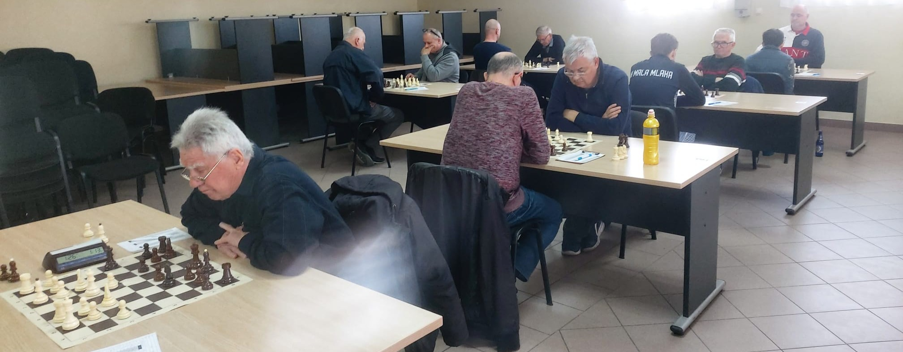

###### Seniori – II. ekipa, 3.kolo



Protekle nedjelje, **12\. travnja**, druga ekipa ŠK Odre odigrala je napet meč na domaćem terenu protiv jake ekipe ŠK Maksimir. Nažalost, unatoč dobroj borbi, ekipa je upisala **[poraz](https://s2.chess-results.com/tnr1352599.aspx?lan=13&art=3&rd=3&SNode=S0)** rezultatom 2,5:3,5.

Za ekipu su nastupili: Tin, Boris, Luka Fiolić, Filip Horvat, Filip Cvetković i Darko Vraneša.

**Tin** je na prvoj ploči odigrao lijepu, školsku partiju u kojoj je potpuno nadigrao svog protivnika. Sigurna i dominantna izvedba – bravo za Tina! Njegovu partiju donosimo u prilogu.

**Boris** je odigrao prepoznatljivo čvrstu i stabilnu partiju te ekipi donio vrijednih pola boda.

**Luka** je dobro ušao u partiju i odigrao solidno otvaranje, no u središnjici dolazi pod snažan pritisak protivnika koji na kraju nije uspio izdržati.

**Filip Horvat** odigrao je kvalitetnu partiju i bio u dobroj poziciji, no zbog vremenskog pritiska na satu nažalost gubi na vrijeme. Šteta za Filipa, jer je partija obećavala.

**Filip Cvetković** odigrao je vrlo lijepu taktičku partiju u kojoj je nadigrao svog protivnika i zasluženo upisao puni bod. Čestitke!

**Darko Vraneša** upisao je svoj prvi nastup za drugu ekipu, ujedno i prvi ligaški nastup nakon duže pauze. Dobro je odigrao otvaranje, no u središnjici dolazi do pada u igri što protivnik koristi i privodi partiju kraju.

**Na kraju**, borben nastup naše ekipe, ali nažalost nedovoljan za bodove ovaj put. U sljedećem kolu druga ekipa ŠK Odre gostuje kod ekipe ŠK Silent.

<table><tbody><tr><td>Pl.</td><td></td><td><strong>ŠK Odra II</strong></td><td>–</td><td></td><td><strong>ŠK Maksimir</strong></td><td><b>2,5:3,5</b></td></tr><tr><td>1.</td><td>&nbsp;III</td><td>Furčić, Tin</td><td>–</td><td>I</td><td>Horvatinec, Ivan</td><td>1-0</td></tr><tr><td>2.</td><td>&nbsp;III</td><td>Kobali, Borislav</td><td>–</td><td>I</td><td>Marević, Alen</td><td>1/2-1/2</td></tr><tr><td>3.</td><td>&nbsp;IV</td><td>Fiolić, Luka</td><td>–</td><td>&nbsp;II</td><td>Gradinščak, Josip</td><td>0-1</td></tr><tr><td>4.</td><td>&nbsp;V</td><td>Horvat, Filip</td><td>–</td><td>III</td><td>Curković, Damir</td><td>0-1</td></tr><tr><td>5.</td><td></td><td>Cvetković, Filip</td><td>–</td><td>&nbsp;I</td><td>&nbsp;Vukman, Branko</td><td>1-0</td></tr><tr><td>6.</td><td></td><td>Vraneša, Darko</td><td>–</td><td>&nbsp;I</td><td>Crnjaković, Željko</td><td>0-1</td></tr></tbody></table>

```pgn
[Event "5. B Liga ŠZŽ Centar 2026"]

[Site "Mala Mlaka"]
[Date "2026.04.12"]
[Round "3"]
[White "Furčić, Tin"]
[Black "Horvatinec, Ivan"]
[Result "1-0"]

[WhiteElo "1793"]
[BlackElo "1921"]
[Board "1"]

1. e4 d5 2. exd5 Qxd5 3. Nc3 Qa5 4. d4 c6 5. Nf3 Nf6 6. h3 Bf5 7. Bd3 Bxd3 8. Qxd3 e6 9. O-O Bd6 10. Ne4 Nxe4 11. Qxe4 Nd7 12. Bd2 Qh5 13. Rfe1 Nf6 14. Qd3 O-O-O 15. a4 Nd7 16. Ng5 Rdf8 17. b4 Qg6 18. Qb3 Re8 19. b5 c5 20. Ne4 e5 21. Qd5 Bc7 22. dxc5 f5 23. Nd6+ Bxd6 24. cxd6 Re6 25. Qc4+ Kb8 26. Qc7+ Ka8 27. Bb4 Qe8 28. a5 Qc8 29. b6 a6 30. Ra3 Rd8 31. Rc3 Qxc7 32. dxc7 Rc8 33. Rd3 Nf6 34. Rd8 Re8 35. Red1 Ne4 36. Rxc8+ Rxc8 37. Rd8 *
```

IvanV
