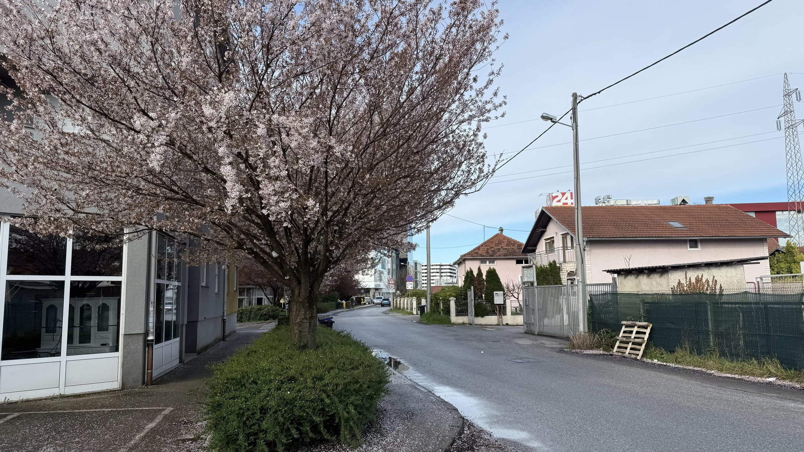

###### Seniori – II. ekipa, 3.kolo



Proteklog vikenda ekipa ŠK Odra II odigrala je uzbudljiv [meč](https://chess-results.com/tnr1127793.aspx?lan=1&art=3&rd=3) na domaćem terenu protiv favorizirane ekipe ŠK Maksimir. Nakon napetih partija, rezultat je završio izjednačeno 3-3, što je sjajan rezultat s obzirom na snagu protivnika.

Za ekipu su nastupili redom: Darko Šutić, Božo, Boris, Luka Fiolić, Lucijan i Ivan Karlović.

Darko je briljirao u partiji, demonstrirajući moć poljskog otvaranja i nadigravši protivnika pozicijskom igrom. Njegovu partiju donosimo u prilogu. Kapetan ekipe Božo se dobro postavio protiv londonskog sustava, no nekoliko loših procjena u središnjici dovelo ga je u potpuno izgubljenu poziciju.

Boris je također solidno započeo, ali pasivnom igrom završio u izgubljenoj završnici. Luka je, kako sam kaže, igrao sve “po kompjuteru” dok nije previdio figuru. Imao je dobru ideju zarobljavanja protivničkog topa, ali ju je primijenio u pogrešnom trenutku.

Lucijan je imao dosta sreće – u otvaranju je mogao izgubiti čistu figuru, ali protivnik to nije iskoristio. Nakon tog propuštenog trenutka, Lucijan se preciznom igrom vratio i doveo svog protivnika u izgubljenu poziciju.

Ivan Karlović je u otvaranju bio u problemima i lošiji, no protivnik nije iskoristio prednost. A kad Ivan dobije priliku, svi znamo kako to završava – preokretom i pobjedom!

Na kraju, uz malo znanja i puno sreće, ekipa ŠK Odra II uzela je vrijedan bod protiv četvrtih nositelja lige. Sljedeće kolo donosi gostovanje kod starih prijatelja iz ŠK Karlovac II, ali jedno je sigurno – ŠK Odra II ne poklanja remije olako!

<table><tbody><tr><td>Pl.</td><td></td><td><strong>ŠK Odra II</strong></td><td>–</td><td></td><td><strong>ŠK Maksimir</strong></td><td><b>3 – 3</b></td></tr><tr><td>1.</td><td>&nbsp;II</td><td>Šutić, Darko</td><td>–</td><td>I</td><td>Nesek, Zdenko</td><td>1-0</td></tr><tr><td>2.</td><td>&nbsp;III</td><td>Cvetković, Božo</td><td>–</td><td>I</td><td>&nbsp;Horvatinec, Ivan</td><td>0-1</td></tr><tr><td>3.</td><td>&nbsp;IV</td><td>Kobali, Borislav</td><td>–</td><td>&nbsp;I</td><td>Marević, Alen</td><td>0-1</td></tr><tr><td>4.</td><td>&nbsp;IV</td><td>Fiolić, Luka</td><td>–</td><td>III</td><td>Curković, Damir</td><td>0-1</td></tr><tr><td>5.</td><td></td><td>Hadviger, Lucijan</td><td>–</td><td>&nbsp;II</td><td>&nbsp;Gradinščak, Josip</td><td>1-0</td></tr><tr><td>6.</td><td></td><td>Karlović, Ivan</td><td>–</td><td></td><td>Ikica, Šime</td><td>1-0</td></tr></tbody></table>

```pgn
[Event "5. Liga ŠZŽ Centar 2025"]

[Site "Mala Mlaka"]
[Date "2025.03.30"]
[Round "3"]
[White "Šutić Darko"]
[Black "Nesek Zdenko"]
[Result "1-0"]

1. b4 Nf6 2. Bb2 d6 3. e3 g6 4. c4 Bg7 5. Nf3 O-O 6. Be2 e5 7. O-O Nc6 8. b5 Ne7 9. Qc2 Bf5 10. d3 e4 11. Nd4 exd3 12. Bxd3 Bxd3 13. Qxd3 Nd7 14. Nd2 Nc5 15. Qc2 Re8 16. Rfd1 h6 17. N2f3 Qc8 18. Rac1 f5 19. a4 Kf7 20. a5 Ng8 21. Ba3 Nf6 22. Bxc5 dxc5 23. Ne2 Ne4 24. Rd3 g5 25. Rcd1 Nd6 26. Ng3 Qe6 27. Rd5 b6 28. a6 Kg6 29. h4 g4 30. h5+ Kf7 31. Nh4 Be5 32. Nhxf5 Rg8 33. Nxh6+ Qxh6 34. Rxe5 Rae8 35. Rxe8 Rxe8 36. Qd3 Re5 37. Qe2 Qe6 38. Rd5 Nxc4 39. Rxe5 Nxe5 40. Qc2 Kf6 41. Qh7 Nf7 42. Qg6+ Ke5 43. Qe4+ Kf6 44. Qf4+ Kg7 45. Qxc7 Qd5 46. e4 Qd1+ 47. Kh2 Qd3 48. h6+ Kg6 49. h7 Qd4 50. Qf4 Nh6 51. Qc7 c4 52. Qxa7 c3 53. Qc7 Qc5 54. Qxc5 bxc5 55. h8=Q 1-0
```

IvanV
