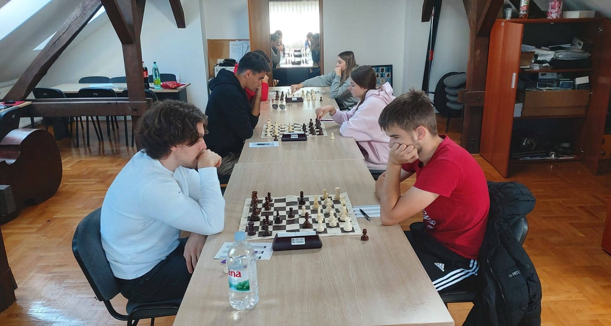

###### Seniori – II. ekipa, 10.kolo

  

Protekle nedjelje, 19. listopada, druga ekipa ŠK Odra odigrala je meč protiv ŠK Novi Zagreb II. Borba je bila neizvjesna do samoga kraja i završila je rezultatom 3:3.

Ekipa je nastupila u sastavu: Luka Fiolić, Ivana Fiolić, Lucija Fiolić, Lucijan, Slavko i Filip Horvat.

**Luka** je na prvoj ploči imao jednaku poziciju gotovo cijelu partiju, no u završnici je napravio grubi previd te je izgubio. Uz još malo iskustva i vježbe, rezultati će  biti bolji.

**Ivanu** i **Luciju** treba pohvaliti bez obzira na poraze. Redovitom igrom i vježbom na Lichessu doći će i do stabilnijih nastupa te pobjeda u ligi.

**Lucijan** je odigrao vrlo zanimljivu i taktički bogatu partiju s mnogo kombinacija u kojoj se dobro snašao. Njegovu partiju donosimo u prilogu.

**Slavko** je ostvario treću pobjedu zaredom i zaslužuje pohvale. Ulaže trud, redovito trenira i to pokazuje rezultatima.

**Filip** je također ostvario treću uzastopnu pobjedu te dodatno doprinio ukupnom rezultatu ekipe.

**Sve u svemu**, bilo je to solidno deseto kolo koje je završilo u „remi“ stilu. U posljednjem kolu druga ekipa gostuje kod ŠK Špansko II. Želimo im sreću i uspješan završetak sezone.

<table><tbody><tr><td>Pl.</td><td></td><td><strong>ŠK Odra II</strong></td><td>–</td><td></td><td><strong>ŠK Zaprešić II</strong></td><td><strong>3 – 3</strong></td></tr><tr><td>1.</td><td>IV</td><td>Fiolić, Luka</td><td>–</td><td>II</td><td>Vidaković, Jurica</td><td>0-1</td></tr><tr><td>2.</td><td>II</td><td>Fiolić, Ivana</td><td>–</td><td>IV</td><td>Maksić, Vedran</td><td>0-1</td></tr><tr><td>3.</td><td>&nbsp;III</td><td>Fiolić, Lucija</td><td>–</td><td></td><td>Arambašić, Luka</td><td>0-1</td></tr><tr><td>4.</td><td>&nbsp;I</td><td>Hadviger, Lucijan</td><td>–</td><td></td><td>Radović, Sven</td><td>1-0</td></tr><tr><td>5.</td><td></td><td>Biondić, Slavko</td><td>–</td><td>&nbsp;IV</td><td>Vidaković, Janko</td><td>1-0</td></tr><tr><td>6.</td><td></td><td>Horvat, Filip</td><td>–</td><td></td><td>Stefanović, Simeon</td><td>1-0</td></tr></tbody></table>

```pgn
[Event "5 A Liga Centar"]
[Site "Mala Mlaka"]
[Date "19.10.2025."]
[Round "10"]
[White "Radović, Sven"]
[Black "Hadviger, Lucijan"]
[Result "0-1"]
[WhiteElo "1773"]
[BlackElo "2039"]
[Board "5"]

d4 d5 2. c4 e6 3. Nf3 Nf6 4. g3 Bb4+ 5. Nbd2 dxc4 6. Bg2 c6 7. a4 c3 8. bxc3 Bxc3 9. Ra3 Bb4 10. Rb3 c5 11. O-O Nc6 12. Bb2 Na5 13. Re3 Nd5 14. Re5 c4 15. Nb1 c3 16. Ba3 Qd6 17. Bxb4 Qxb4 18. Ne1 O-O 19. Bxd5 exd5 20. Rxd5 b6 21. Rh5 g6 22. Rh4 Bd7 23. d5 Qc5 24. Qc2 Rac8 25. Nd3 Qxd5 26. Nxc3 Qb3 27. Qxb3 Nxb3 28. Nd5 Kg7 29. Ne5 Be6 30. Nf4 Bf5 31. Nfd3 Rc2 32. Rb4 Nc5 33. g4 Bxd3 34. exd3 f6 35. d4 Na6 36. Rc4 Rc8 37. Rxc8 Rxc8 38. Nf3 Rc3 39. Kg2 Ra3 40. Rd1 Kf7 41. d5 Ke7 42. Nd4 Nb4 43. Rb1 Rxa4 44. Rxb4 Rxb4 45. Nc6+ Kd6 46. Nxb4 a5 47. Nc2 Kxd5 48. Kf3 Kc4 49. Ke2 Kc3 50. Ne3 a4 51. Kd1 a3 52. Nd5+ Kb3 0-1
```

IvanV
