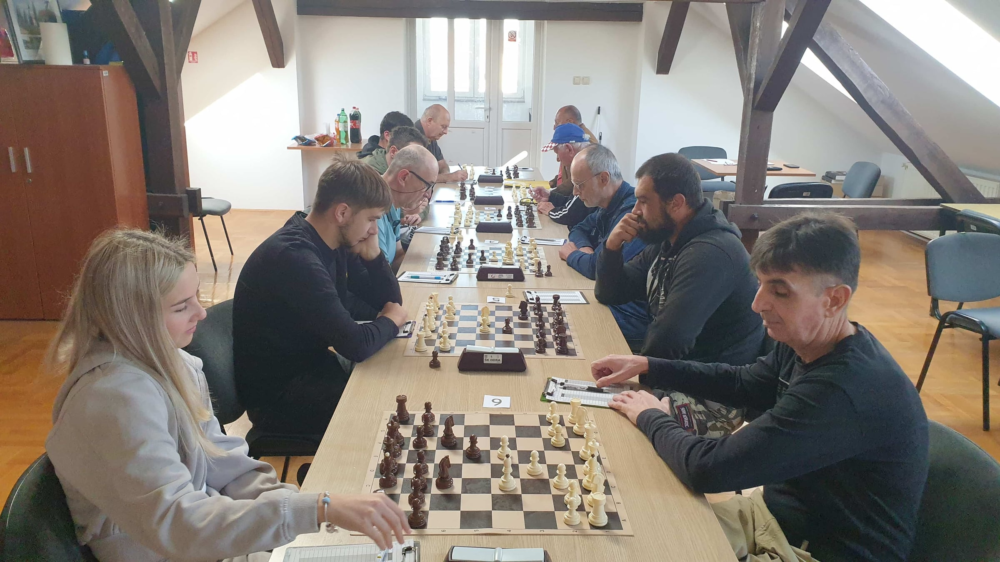

###### Seniori – II. ekipa, 5.kolo



Prošle nedjelje, **4\. listopada**, druga ekipa ŠK Odre u jesenskom nastavku 5.B lige Centar odigrala je meč protiv ekipe ŠK Sloga, Novoselec-Križ. Nažalost, ekipa je upisala **[poraz](https://s1.chess-results.com/tnr1352599.aspx?lan=13&art=3&rd=5&SNode=S0)** rezultatom 4:2.

Za ekipu su nastupili: Darko Šutić, Božo, Tin, Boris, Luka Fiolić i Lucija Fiolić.

**Darko Šutić** je na prvoj ploči odigrao solidnu partiju, no nakon gubitka kvalitete i pod pritiskom protivnika nije uspio preokrenuti situaciju te je na kraju izgubio partiju. Njegovu partiju donosimo u prilogu.

**Božo** se ovoga puta nije puno namučio jer se njegov protivnik nije pojavio, pa je ekipa bez borbe upisala jedan bod.

**Tin** nije briljirao u ovoj partiji, no uz malo sreće situacija se pred sam kraj okrenula u njegovu korist te je upisao još jedan bod za ekipu.

**Boris** je odigrao dobru i izjednačenu partiju, no u jednom trenutku previdio je topa i izgubio partiju. Igra je bila malo prebrza, pa je šteta kada se dogodi ovakav previd.

**Luka Fiolić** se ovoga puta nije najbolje naspavao pa je nakon relativno kratkog vremena došao u velike probleme jer nije na vrijeme napravio rokadu. Protivnik je iskoristio priliku i snažnom taktikom stvorio odlučujuću prednost, nakon čega je Luka predao partiju. Njegovu partiju također donosimo u prilogu.

**Lucija Fiolić** pružila je dobar otpor protivniku, no uz dosta razmišljanja došla je u ozbiljan vremenski pritisak. Na kraju ju je upravo nedostatak vremena koštao partije.

**Na kraju**, jednostavno nije išlo. Unatoč tome što je ekipa od samog početka imala bod prednosti zbog nepojavljivanja protivnika, danas se nismo pokazali u najboljem svjetlu te je upisan poraz 4:2.

Trenutno se druga ekipa ŠK Odre nalazi na **6\. mjestu ljestvice od ukupno 8 ekipa**. Do kraja sezone ostala su još dva kola i nadamo se da ćemo u završnici popraviti rezultat i sezonu završiti na što boljoj poziciji.

<table><tbody><tr><td>Pl.</td><td></td><td><strong>ŠK Odra II</strong></td><td>–</td><td></td><td><table class="CRs1"><tbody><tr class="CRg1b"><th class="CR">ŠK Sloga, Novoselec-Križ</th></tr></tbody></table></td><td><b>2:4</b></td></tr><tr><td>1.</td><td>II</td><td>Šutić, Darko</td><td>–</td><td>I</td><td>Vortel, Damir</td><td>0-1</td></tr><tr><td>2.</td><td>III</td><td>Cvetković, Božo</td><td>–</td><td>III</td><td>Verner, Darko</td><td>+ – –</td></tr><tr><td>3.</td><td>&nbsp;III</td><td>&nbsp;Furčić, Tin</td><td>–</td><td>&nbsp;I</td><td>Srdić, Jovo</td><td>1-0</td></tr><tr><td>4.</td><td>&nbsp;III</td><td>&nbsp;Kobali, Borislav</td><td>–</td><td>IV</td><td>Barišić, Josip</td><td>0-1</td></tr><tr><td>5.</td><td>&nbsp;IV</td><td>Fiolić, Luka</td><td>–</td><td></td><td>&nbsp;Šegota, Dominik</td><td>0-1</td></tr><tr><td>6.</td><td>&nbsp;III</td><td>Fiolić, Lucija</td><td>–</td><td></td><td>Piljek, Dražen</td><td>0-1</td></tr></tbody></table>

```pgn
[Event "5. B Liga ŠZŽ Centar 2026"]

[Site "Mala Mlaka"]
[Date "2026.10.04"]
[Round "5"]
[White "Šutić, Darko"]
[Black " Vortel, Damir"]
[Result "0-1"]

[WhiteElo "1924"]
[BlackElo "1825"]
[Board "1"]

1.b4 d5 2. Bb2 e6 3. e3 Nf6 4. a3 a6 5. c4 dxc4 6. Bxc4 b5 7. Be2 Bb7 8. Nf3 Be7 9. O-O O-O 10. d3 Nbd7 11. Nbd2 Nb6 12. Rc1 Rc8 13. Nb3 Na4 14. Ba1 Nd5 15. Na5 Ba8 16. Nc6 Bxc6 17. Rxc6 Ra8 18. Qc2 Bd6 19. g3 Ne7 20. Nd4 Nxc6 21. Nxc6 Qg5 22. Bf3 Rac8 (22... Rad8 23. e4 e5 24. Bg2 f6 25. d4 Nb6) 23. e4 e5 24. Bg2 f6 25. d4 Nb6 26. dxe5 fxe5 27. Qb3+ Kh8 28. Bh3 Rce8 29. Bb2 Nc4 30. Bc1 Qf6 31. a4 Qf3 32. Qc2 h5 33. axb5 axb5 34. Na7 Rb8 35. Bd7 h4 36. Bg5 Bxb4 37. Bxh4 Ne3 38. Bh3 Nxc2 39. Bg2 Qh5 40. Rc1 *
```

```pgn
[Event "5. B Liga ŠZŽ Centar 2026"]

[Site "Mala Mlaka"]
[Date "2026.10.04"]
[Round "5"]
[White "Fiolić, Luka"]
[Black " Šegota, Dominik"]
[Result "0-1"]

[WhiteElo "1681"]
[BlackElo "1638"]
[Board "5"]

1. e4 c5 2. Nf3 Nc6 3. d4 cxd4 4. Nxd4 e5 5. Nf3 Nf6 6. Nc3 Bb4 7. Qd3 d5 8. Bd2 d4 9. Ne2 Bxd2+ 10. Nxd2 O-O 11. a3 Be6 12. g3 Qa5 13. Bg2 Nb4 14. axb4 Qxa1+ *

*
```
