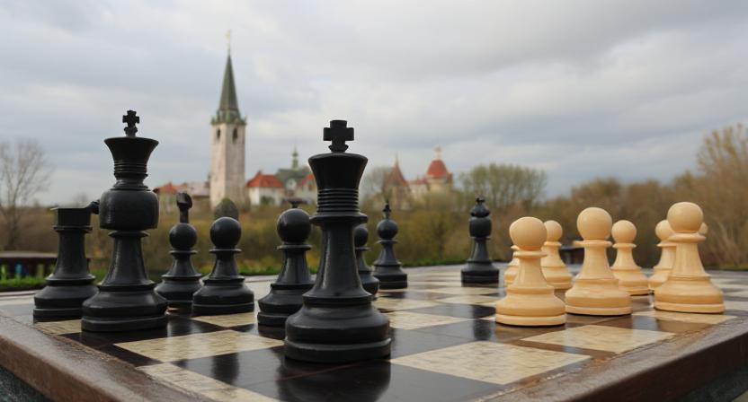

###### Seniori – II. ekipa, 8.kolo



Na domaćem terenu u Maloj Mlaki naša druga ekipa upisala je uvjerljivu pobjedu protiv ekipe **ŠK Zaprešić II** rezultatom **4.5 – 1.5**. Bravo naši! 👏

Ekipa je nastupila u sastavu: **Boris, Luka Fiolić, Lucija Fiolić, Lucijan, Slavko** i **Filip Horvat**.

Na prvoj ploči **Boris** je, već standardno, odigrao borbeno i nesebično — žrtvovao za ekipu i osigurao važnih **pola boda**.

**Luka** još uvijek traži pravu formu, ali nema sumnje da će već u idućem kolu upisati prvu ovosezonsku pobjedu.

Na sredini postave, **Lucija** i **Lucijan** zaslužuju svaku pohvalu — hrabrom i odlučnom igrom donijeli su ekipi **dva ključna boda** i potvrdili dominaciju naše ekipe.

**Slavko** je ponovno dokazao da se trud i rad uvijek isplate. Odlično otvaranje i sigurna igra doveli su protivnika do previda figure, a Slavko je upisao još jednu **uzastopnu pobjedu**. Njegovu partiju donosimo u prilogu. ♟️

Na zadnjoj ploči **Filip** je, unatoč tome što je nakratko zaboravio kako se radi rokada 😄, uspio nadigrati protivnika i zaključiti meč pobjedom, potvrdivši ukupni trijumf ekipe.

Sve u svemu, **odlična nedjelja za našu ekipu**! Takve rezultate želimo gledati i češće. 💪  
U idućem kolu druga ekipa **gostuje kod ŠK Dugo Selo II** — idemo po nove bodove!

<table><tbody><tr><td>Pl.</td><td></td><td><strong>ŠK Odra II</strong></td><td>–</td><td></td><td><strong>ŠK Zaprešić II</strong></td><td><strong>4.5 – 1.5</strong></td></tr><tr><td>1.</td><td>IV</td><td>Kobali, Borislav</td><td>–</td><td>II</td><td>Mesar, Vedran</td><td>½–½</td></tr><tr><td>2.</td><td>IV</td><td>Fiolić, Luka</td><td>–</td><td>III</td><td>Šuker, Petar</td><td>0-1</td></tr><tr><td>3.</td><td>&nbsp;IV</td><td>Fiolić, Lucija</td><td>–</td><td>IV</td><td>Tkalec, Jura</td><td>1-0</td></tr><tr><td>4.</td><td></td><td>Hadviger, Lucijan</td><td>–</td><td>&nbsp;IV</td><td>Doko, Marin</td><td>1-0</td></tr><tr><td>5.</td><td></td><td>Biondić, Slavko</td><td>–</td><td>&nbsp;IV</td><td>Toth, Erik</td><td>1-0</td></tr><tr><td>6.</td><td></td><td>Horvat, Filip</td><td>–</td><td></td><td>Karan, Vid</td><td>1-0</td></tr></tbody></table>

```pgn
[Event "5 A Liga Centar"]
[Site "Mala Mlaka"]
[Date "21.09.2025."]
[Round "8"]
[White "Biondić, Slavko"]
[Black "Toth, Erik"]
[Result "1-0"]
[WhiteElo "1619"]
[BlackElo "1634"]
[Board "5"]

1. d4 d5 2. c4 e6 3. Nc3 Bb4 4. cxd5 exd5 5. Qc2 Nf6 6. Bg5 h6 7. Bh4 O-O 8. e3 Nc6 9. Bd3 Ne7 10. Ne2 Be6 11. O-O Qd6 12. Nb5 Qc6 13. Qxc6 bxc6 14. Nxc7 Rac8 15. Nxe6 fxe6 16. a3 Bd6 17. f3 g5 18. Bf2 g4 19. b4 h5 20. e4 e5 21. Bg3 dxe4 22. Bc4+ Nfd5 23. fxe4 Kg7 24. exd5 cxd5 25. Bb3 Bb8 26. Rxf8 Rxf8 27. Bxe5+ Bxe5 28. dxe5 Nc6 29. Rf1 Nxe5 30. Rxf8 Kxf8 31. Bxd5 Ke7 32. g3 Kf6 33. Nf4 Kg5 34. a4 h4 35. b5 Nd7 36. a5 Nf6 37. b6 axb6 38. axb6 Nd7 39. b7 hxg3 40. hxg3 Nb8 41. Kf2 Kf6 42. Nd3 Ke7 43. Ke3 Kf6 44. Kf4 Nd7 45. Nb4 Ke7 46. Na6 Kd6 47. Bg2 1-0
```

IvanV
