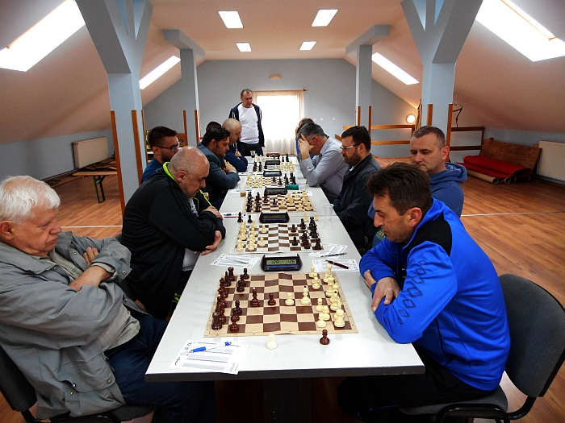
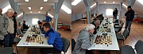

**Seniori, 1. kolo  
  
**Prvo kolo seniorske [IV. A lige centar](http://chess-results.com/tnr414083.aspx?lan=13&art=0), bili smo domaćini, a u goste nam je stigla ekipa iz Karlovca. Meč je, obzirom da je kancelarija u Društvenom domu još uvijek nedostupna (zahvaljujući mudrim odlukama mjesnog odbora), odigran u prostoru DVD Odra i ovim putem im se zahvaljujemo na susretljivosti. Nismo loše igrali, kako inače imamo običaj prvo kolo odigrati, ali su gosti iz Karlovca imali svoj dan te uvjerljivo i zasluženo odnijeli bodove. Lijepim taktičkim udarima, bodove su na prve dvije ploče osvojili Brkić i Bedić, dok se Conjar na trećoj morao zadovoljiti ponavljanjem poteza. Vrlo loše i krajnje neoprezno odigrao je Boris na šestoj ploči i izgubio u minijaturi. Cvetko je remizirao u izjednačenoj poziciji, a Darko je prihvatio remi u slabijoj poziciji kada je ishod meča već bio odlučen. U ekipi su nam nedostajali Vraneša i Ivan koji su danas igrali na Pojedinačnom kadetskom prvenstvu Zagreba do 15 godina. Danas su čak imali i međusobni dvoboj koji su prijateljski remizirali.  
Sljedeće kolo igra se za tjedan dana kada gostujemo u Španskom.

<table><tbody><tr><td></td><td></td><td>&nbsp;&nbsp;<strong>ŠK Odra</strong></td><td>–</td><td></td><td>&nbsp;&nbsp;<strong>Karlovački šahovski klub</strong></td><td><strong>1,5 : 4,5</strong></td></tr><tr><td>1.</td><td>MK</td><td><table><tbody><tr><td></td><td>Bačurin, Juraj 2050</td></tr></tbody></table></td><td>–</td><td>MK</td><td><table><tbody><tr><td></td><td>Brkić, Đorđe 2082</td></tr></tbody></table></td><td>0 – 1</td></tr><tr><td>2.</td><td>MK</td><td><table><tbody><tr><td></td><td>Maravić, Stjepan 2115</td></tr></tbody></table></td><td>–</td><td>MK</td><td><table><tbody><tr><td></td><td>Bedić, Željko 2151</td></tr></tbody></table></td><td>0 – 1</td></tr><tr><td>3.</td><td>MK</td><td><table><tbody><tr><td></td><td>Karlić, Zvjezdan 2115</td></tr></tbody></table></td><td>–</td><td>I</td><td><table><tbody><tr><td></td><td>Conjar, Velimir 1984</td></tr></tbody></table></td><td>½ – ½</td></tr><tr><td>4.</td><td>MK</td><td><table><tbody><tr><td></td><td>Vidaković, Darko 2110</td></tr></tbody></table></td><td>–</td><td>III</td><td><table><tbody><tr><td></td><td>Žibrat, Matija 1799</td></tr></tbody></table></td><td>½ – ½</td></tr><tr><td>5.</td><td>MK</td><td><table><tbody><tr><td></td><td>Cvetković, Ivan 1936</td></tr></tbody></table></td><td>–</td><td>II</td><td><table><tbody><tr><td></td><td>Jusufi, Denis 1882</td></tr></tbody></table></td><td>½ – ½</td></tr><tr><td>6.</td><td>IV</td><td><table><tbody><tr><td></td><td>Kobali, Boris 1660</td></tr></tbody></table></td><td>–</td><td>I</td><td><table><tbody><tr><td></td><td>Smrečki, Neven (2037)</td></tr></tbody></table></td><td>0 – 1</td></tr></tbody></table>

---

```pgn
[Event "Bedić vs Maravić"]
[SetUp "3"]
[FEN "4r2k/6bp/1R4p1/3Bp3/2P5/3b2P1/3B1P2/6K1 b - - 0 32"]
32.  Bf8 32.Bc3 Bc5 33. Rb8 1-0
```
