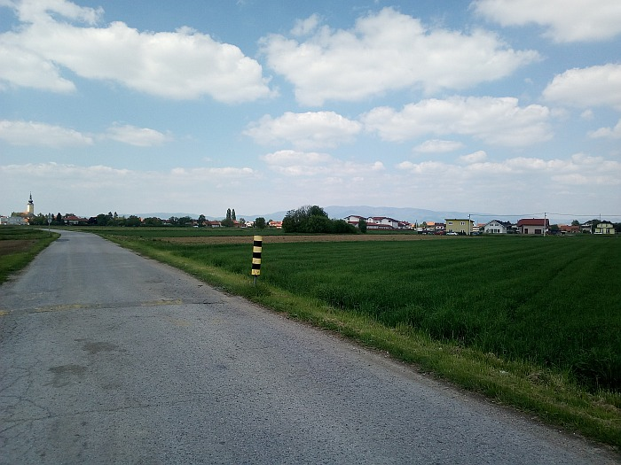
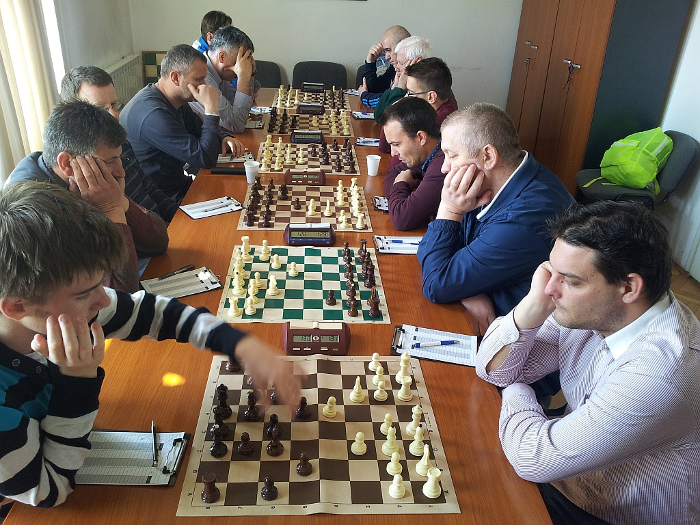
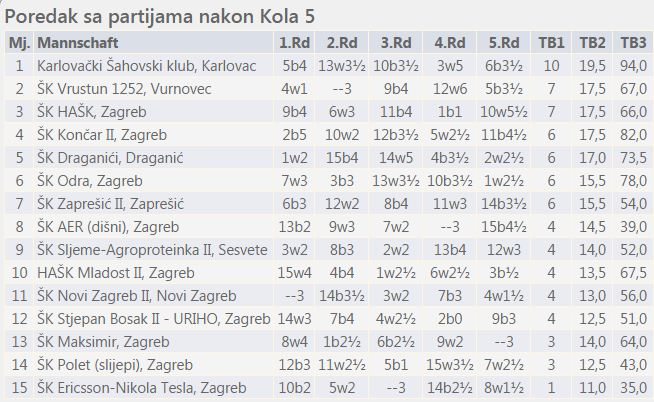

**Seniori, 5. kolo  
  
**Jučer je odigrano peto kolo seniorske lige. Zasluženu pobjedu odnijela je ekipa Karlovačkoga šahovskog kluba, a sve partije bile su na prilično visokoj  razini. Ovom pobjedom Karlovački šahovski klub odvojio se od ostalih ekipa i praktično osigurao ulazak u viši rang natjecanja. Nama ostaju još četiri kola i borba da se možda uhvati drugo mjesto, koje također vodi u višu ligu.  
Na prvoj ploči Jura je brzo ušao u slabiju poziciju, a u nekoliko navrata mogao je ostati i bez pješaka. Njegov protivnik to nije uočio i partija se rasplela u remi-završnicu. Darko je na drugoj ploči izašao bolji iz otvaranja, ali je onda gramzivo uzeo pješaka, ostao bez rokade i brzo izgubio. Stipe je pravocrtno vodio napad na protivničku rokadu, uspio osvojiti pješaka i preveo poziciju u lako dobivenu završnicu istobojnih lovaca. Zvjezdan je imao čvrstu poziciju, ali je onda previdio taktiku te ostao bez figure. Zanimljivo, već u sljedećem potezu njegov protivnik pružio mu je priliku da gotovo izjednači poziciju, ali je tu mogućnost Zvjezdan propustio.  Cvetko je iskoristio previd protivnika u ranoj fazi otvaranja te ga ostavio bez rokade i s pješakom manje. Impresivno je kako je nakon toga bez pogreške realizirao prilično tešku završnicu u kojoj je  jedan tempo odlučio pobjednika. Ivan je odigrao čvrsto otvaranje i došao u praktički dobivenu poziciju. Tada je nažalost na trenutak  zaboravio na slabost zadnjeg reda, potez prerano uveo top u napad i brzo izgubio zbog matnih prijetnji.  
Sljedeće kolo na rasporedu je 10. rujna.

**ŠK ODRA – Karlovački šahovski klub 2,5:3,5**  
1\. MK Juraj Bačurin 2061 – MK Željko Bedić 2227          1/2  
2\. MK Darko Vidaković 2125 – MK Đorđe Brkić 2121      0:1  
3\. MK Stjepan Maravić 2100 – I Velimir Conjar 2025     1:0  
4\. MK Zvjezdan Karlić 2146 – II Izidor Drvar 1920          0:1  
5\. MK Ivan Cvetković 1952 – II Denis Jusufi 1960           1:0  
6\. III Ivan Maravić 1626 – IV Matija Žibrat 1812              0:1

     
