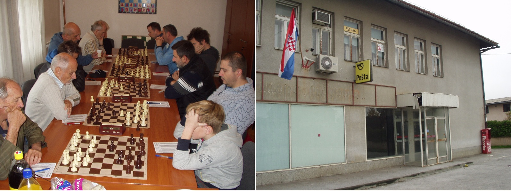

**7\. kolo, seniori**

U Odri je ove nedjelje odigrano sedmo kolo. Ekipa ŠK Odra je zabilježila važnu pobjedu protiv ravnopravne ekipe iz Karlovca. Na prvoj ploči Ljubić je nadigrao Brkića. Stipe se patio u teškoj poziciji, ali je na kraju dočekao pogrešku protivnika, osvojio pješaka i u nedostatku ideje, remizirao. Danko je igrao izjednačen meč i kada je izgledalo da ulazi u inferiorniju završnicu, pronašao je krasnu žrtvu pješaka nakon čega su se njegove dvije figure razigrale i slijedila je laka realizacija. Svaka mu čast! Cvetković je igrao zanimljivo otvaranje, donio dvije jako loše odluke i zapao u tešku poziciju. Ipak, treba odati priznanje i njegovu protivniku Velimiru Conjaru, koji je pronašao lijepu žrtvu kvalitete i efektno dobio partiju. Na petoj ploči Vjekoslav je griješio, ali je pod kraj meča počeo bolje igrati i timski zrelo remizirao. Ipak, prijelomnih pola boda, a time i meč pobjedu (pomalo neočekivano) donio je naš mladi kadet Ivan. Iskoristio je malu nepažnju protivnika i osvojio pješaka. Nakon toga protivnik je napravio snažan pritisak na daminoj strani, ali se Ivan precizno i hladnokrvno branio do kraja i ostvario prve bodove u seniorskoj konkurenciji. Tu partiju  donosimo u prilogu!



ŠK ODRA – KARLOVAČKI ŠK                3,5:2,5

1\. Ljubić Ivan – Brkić Đorđe                      1:0  
2\. Maravić Stjepan – Dotlić Zdravko         1/2  
3\. Brajdić Danko – Drvodelić Miroslav      1:0  
4\. Cvetković Ivan – Conjar Velimir            0:1  
5\. Novak Vjekoslav – Gojmerac Dragutin 1/2  
6\. Maravić Ivan – Marković Božidar          1/2

```pgn
[Event "IV Hrv. Liga Centar A"] [Date "2013.10.13"] [Round "6"] [White "Markovic, Bozidar"] [Black "Maravic , Ivan"] [Result "1/2-1/2"] [ECO "A07"] [PlyCount "109"] [WhiteTeam "SK ODRA"] [BlackTeam "Karlovacki SK Karlovac"]

1. Nf3 Nf6 2. g3 e6 3. Bg2 Be7 4. O-O O-O 5. d3 d5 6. c3 c5 7. b3 Nc6 8. Bb2 Bd7 9. Nbd2 Qc7 10. a3 Rad8 11. d4 cxd4 12. cxd4 Rfe8 13. Rc1 Qb6 14. b4 a6 15. Re1 h6 16. Nb1 Na7 17. Ne5 a5 18. Nxd7 Rxd7 19. Bc3 axb4 20. Qb3 Nc6 21. axb4 Bxb4 22. Bxb4 Qxb4 23. Qxb4 Nxb4 24. Nd2 Nc6 25. e3 Ra8 26. Rb1 Ra2 27. Nb3 Ra7 28. Nc5 Re7 29. Rb2 Ne8 30. Reb1 Nd6 31. Bf1 Kh7 32. g4 g6 33. h4 Kg7 34. Kg2 Na5 35. Ra2 Nc6 36. Rxa7 Nxa7 37. f3 Nc6 38. Bd3 f5 39. Kg3 Kf6 40. f4 Kg7 41. Be2 Ne4+ 42. Nxe4 dxe4 43. g5 h5 44. Rb6 Kf7 45. Bc4 Rc7 46. d5 exd5 47. Bxd5+ Kg7 48. Kf2 Kf8 49. Rb2 Kg7 50. Ke2 Kf8 51. Rb1 Ke7 52. Rb2 Kd8 53. Rb1 Ke7 54. Rb2 Kd8 55. Rb1 1/2-1/2
```

Stanje na tablici nakon 7 kola:

<table><tbody><tr><td>Mj.</td><td>Momčad</td><td>1</td><td>2</td><td>3</td><td>4</td><td>5</td><td>6</td><td>7</td><td>8</td><td>9</td><td>10</td><td>11</td><td>12</td><td>TB1</td><td>TB2</td><td>TB3</td></tr><tr><td>1</td><td>ŠK Stjepan Bosak</td><td>*</td><td></td><td></td><td>2½</td><td>3½</td><td>3½</td><td>5½</td><td></td><td>4½</td><td>3½</td><td>4</td><td></td><td><span>12</span></td><td>27.0</td><td>120.00</td></tr><tr><td>2</td><td>ŠK Končar, Zagreb</td><td></td><td>*</td><td>1½</td><td>3½</td><td>3½</td><td>3</td><td></td><td>4</td><td></td><td>3</td><td>6</td><td></td><td><span>10</span></td><td>24.5</td><td>100.75</td></tr><tr><td>3</td><td>ŠK HRT, Zagreb</td><td></td><td>4½</td><td>*</td><td></td><td>3</td><td></td><td>2½</td><td>3½</td><td>2½</td><td>4</td><td></td><td>5</td><td><span>9</span></td><td>25.0</td><td>89.50</td></tr><tr><td>4</td><td>ŠK Odra, Zagreb</td><td>3½</td><td>2½</td><td></td><td>*</td><td></td><td>3½</td><td>1½</td><td></td><td>3</td><td></td><td>5</td><td>3½</td><td><span>9</span></td><td>22.5</td><td>85.00</td></tr><tr><td>5</td><td>ŠK Sveta Nedelja</td><td>2½</td><td>2½</td><td>3</td><td></td><td>*</td><td></td><td>3</td><td>4</td><td></td><td></td><td>5</td><td>4</td><td><span>8</span></td><td>24.0</td><td>67.75</td></tr><tr><td>6</td><td>Karlovački ŠK,</td><td>2½</td><td>3</td><td></td><td>2½</td><td></td><td>*</td><td>3½</td><td>3</td><td></td><td></td><td>4</td><td>5</td><td><span>8</span></td><td>23.5</td><td>67.50</td></tr><tr><td>7</td><td>ŠK Jaska</td><td>½</td><td></td><td>3½</td><td>4½</td><td>3</td><td>2½</td><td>*</td><td></td><td></td><td>3½</td><td>3</td><td></td><td><span>8</span></td><td>20.5</td><td>85.50</td></tr><tr><td>8</td><td>ŠK Zaprešić</td><td></td><td>2</td><td>2½</td><td></td><td>2</td><td>3</td><td></td><td>*</td><td>3½</td><td>4</td><td></td><td>3½</td><td><span>7</span></td><td>20.5</td><td>64.25</td></tr><tr><td>9</td><td>ŠK Vrbani, Zagreb</td><td>1½</td><td></td><td>3½</td><td>3</td><td></td><td></td><td></td><td>2½</td><td>*</td><td>2½</td><td>3</td><td>4</td><td><span>6</span></td><td>20.0</td><td>54.75</td></tr><tr><td>10</td><td>ŠK INA, Zagreb</td><td>2½</td><td>3</td><td>2</td><td></td><td></td><td></td><td>2½</td><td>2</td><td>3½</td><td>*</td><td></td><td>4½</td><td><span>5</span></td><td>20.0</td><td>44.75</td></tr><tr><td>11</td><td>ŠK Maksimir</td><td>2</td><td>0</td><td></td><td>1</td><td>1</td><td>2</td><td>3</td><td></td><td>3</td><td></td><td>*</td><td></td><td><span>2</span></td><td>12.0</td><td>20.25</td></tr><tr><td>12</td><td>ŠK PIK-Vrbovec II</td><td></td><td></td><td>1</td><td>2½</td><td>2</td><td>1</td><td></td><td>2½</td><td>2</td><td>1½</td><td></td><td>*</td><td><span>0</span></td><td>12.5</td><td>0.00</td></tr></tbody></table>
