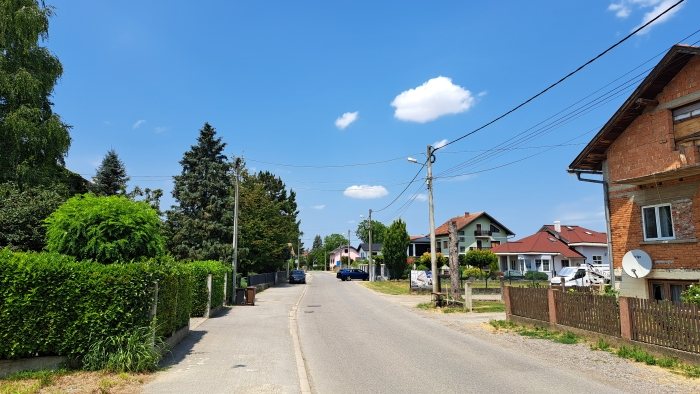

**Seniori – I. ekipa, 6.kolo  
  
**  
Ove nedjelje smo završili proljetnu sezonu [porazom](https://chess-results.com/tnr1127780.aspx?lan=13&art=3&rd=6) od Karlovca, kojima smo redovita mušterija. Meč je počeo dobro jer protivnici nisu imali igrača na petoj ploči te je Hrvoje upisao prvi cijeli bod u ligi ove godine. Nitko se nije otvorio pretjerano dobro. Zvjezdan je brzo nekorektno žrtvovao te zapao u izgubljenu poziciju gdje na kraju previđa mat na zadnjemu redu. Darko je odigrao solidnu partiju koja je brzim izmjenama prešla u remi završnicu. Tu partiju možete pogledati u prilogu. Mladen se slabo otvorio, imao je neko vrijeme prihvatljivu poziciju, ali ona je vremenom postajala sve gora i gora te je na kraju također uletio u mat. Ivo je bio svjetla točka dana, nakon ujednačenog otvaranja je postupno preuzimao inicijativu te je na kraju došao u dobivenu završnicu koju je uvjerljivo realizirao. Ivo se pokazuje kao sve učinkovitiji igrač. Zadnji je ostao igrati Ivan koji je po običaju jedva izvadio figure, da bi ubrzo bio potpuno nadigran od strane njegova iskusna protivnika Bedića. Na kraju Bediću popušta koncentracija i daje šansu Ivanu. Međutim, Ivan to ne koristi i na kraju Karlovčani odlaze s oba boda. Kada se sve zbroji i oduzme, zaslužili smo poraz, nadamo se da ćemo imati na jesen manje ovakvih mečeva i da ćemo više pobjeđivati. Na kraju polusezone smo imali malu zakusku sa već standardno dobrom hranom.

<table><tbody><tr><td>Pl.</td><td></td><td><strong>ŠK Odra</strong></td><td>–</td><td></td><td><strong>KŠK Karlovac</strong></td><td><strong>2,5-3,5</strong></td></tr><tr><td>1.</td><td>MK</td><td>Karlić, Zvjezdan 2093</td><td>–</td><td></td><td>Mykhailets, Polina 1954</td><td>0-1</td></tr><tr><td>2.</td><td>MK</td><td>Maravić, Ivan 2123</td><td>–</td><td>MK</td><td>Bedić, Željko 2103</td><td>0-1</td></tr><tr><td>3.</td><td>MK</td><td>Sliepčević, Mladen 2092</td><td>–</td><td>MK</td><td>Radić, Goran 2094</td><td>0-1</td></tr><tr><td>4.</td><td>MK</td><td>Vidaković, Darko 2130</td><td>–</td><td>II</td><td>Jusufi, Denis 1981</td><td>½–½</td></tr><tr><td>5.</td><td>MK</td><td>Kovač, Hrvoje 2107</td><td>–</td><td>IV</td><td>Poštić, Nenad 1705</td><td>1-0</td></tr><tr><td>6.</td><td>II</td><td>Pahljina, Ivo 1951</td><td>–</td><td>IV</td><td>Sabljak, Davor 1705</td><td>1-0</td></tr></tbody></table>

```pgn
[Event "III A liga - Odra : Karlovac"]
[Site "sahovski-klub.com"]
[Date "2025.05.11"]
[Round "6"]
[White "II Jusufi, Denis"]
[Black "MK Vidaković, Darko"]
[Result "1/2-1/2"]
[ECO "D10"]
[WhiteElo "1981"]
[BlackElo "2130"]
[PlyCount "68"]
1. d4 d5 2. c4 c6 3. cxd5 cxd5 4. Nc3 Nf6 5. Bf4 Nc6 6. e3 a6 7. a3 e6 8. Nf3 Bd6 9. Bxd6 Qxd6 10. Be2 O-O 11. O-O e5 12. dxe5 Nxe5 13. Nxe5 Qxe5 14. Bf3 Rd8 15. Qd4 Qxd4 16. exd4 Be6 17. Rac1 Rac8 18. Ne2 g5 19. g3 Ne4 20. Rxc8 Rxc8 21. Rc1 Rxc1+ 22. Nxc1 Nd2 23. Bg2 Kf8 24. Nd3 Ke7 25. Nc5 b6 26. Nxa6 Nc4 27. Nb4 Kd6 28. Bf1 Nxb2 29. Bb5 Nc4 30. Bxc4 dxc4 31. Kf1 c3 32. Ke2 Bc4+ 33. Kd1 Bb3+ 34. Ke2 Bc4+ 1/2-1/2
```

  
*IvanM*
