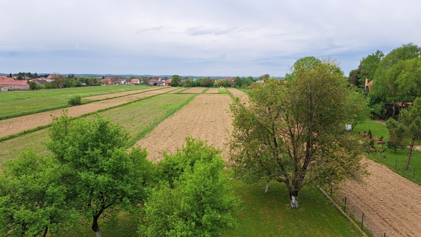
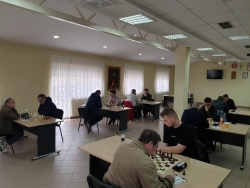

**Seniori – I. ekipa, 4.kolo  
  
**  
Ove nedjelje smo potpuno zasluženo upisali svoj [prvi](https://chess-results.com/tnr1127780.aspx?lan=13&art=3&rd=4) ovosezonski poraz. Sisak je došao u jednome od svojih najjačih sastava te odnio puni plijen. Vraneša je loše odigrao otvaranje te zapao u jako lošu poziciju već od početka, ali njegov protivnik brza na ulasku u završnicu te ispušta svu prednost što dovodi do podjele boda. Fran je odigrao otvaranje jako dobro te je imao priliku uzeti čistoga pješaka, ali u traženju još boljega nastavka griješi te na kraju prelazi u jednaku završnicu koja završava remijem.  Hrvoje je brzo iz otvaranja prešao u podjednaku završnicu u kojoj je imao svoje prilike, nažalost ne koristi ih te griješi i gubi. Mladen je napravio pozicioni pritisak, ali gubi nit te dolazi u izgubljenu poziciju. Kada je već izgledalo da mu nema nade, nalazi briljantnu žrtvu topa kojom spašava partiju! Zvjezdan je odigrao jako dobru i dinamičnu partiju protiv možda i najjačeg igrača u ligi – međunarodnog majstora Antunca. Obojica su imali svoje prilike za dobitak, pa je možda i najpravednije da je partija završila remijem. Taj napet dvoboj možete pogledati u prilogu. Zadnji je ostao Ivan Maravić koji je nakon dobro odigranoga otvaranja počeo igrati loše te je pod pritiskom dopustio ulazak u izgubljenu završnicu. Čestitamo gostima, a mi se nadamo da se vraćamo pobjedničkim putevima već iduće kolo, na prvom ovosezonskom “zagorskom” gostovanju u Stubici.

<table><tbody><tr><td>Pl.</td><td></td><td><strong>ŠK Odra</strong></td><td>–</td><td></td><td><strong>ŠD Sisak</strong></td><td><strong>2-4</strong></td></tr><tr><td>1.</td><td>MK</td><td>Karlić, Zvjezdan 2093</td><td>–</td><td>IM</td><td>Antunac, Goran 2325</td><td>½–½</td></tr><tr><td>2.</td><td>MK</td><td>Maravić, Ivan 2097</td><td>–</td><td>FM</td><td>Brigljević, Milan 2206</td><td>0-1</td></tr><tr><td>3.</td><td>MK</td><td>Sliepčević, Mladen 2092</td><td>–</td><td>FM</td><td>Balenović, Zvonimir 2172</td><td>½–½</td></tr><tr><td>4.</td><td>MK</td><td>Kovač, Hrvoje 2107</td><td>–</td><td>MK</td><td>Mravunac, Damir 2065</td><td>0-1</td></tr><tr><td>5.</td><td>MK</td><td>Šoš, Fran 2130</td><td>–</td><td>MK</td><td>Prihoda, Leonardo 2074</td><td>½–½</td></tr><tr><td>6.</td><td>II</td><td>Vraneša, Ivan 1898</td><td>–</td><td>NM</td><td>Galić, Kruno 2070</td><td>½–½</td></tr></tbody></table>

```pgn
[Event "III A liga - Odra : Sisak"]
[Site "sahovski-klub.com"]
[Date "2025.04.13"]
[Round "4"]
[White "MK Karlić, Zvjezdan"]
[Black "IM Antunac, Goran"]
[Result "1/2-1/2"]
[ECO "B84"]
[WhiteElo "2093"]
[BlackElo "2325"]
[PlyCount "99"]
1. d4 Nf6 2. Nf3 g6 3. g3 Bg7 4. Bg2 c5 5. d5 d6 6. c4 O-O 7. Nc3 e6 8. O-O exd5 9. cxd5 Bg4 10. h3 Bxf3 11. Bxf3 a6 12. a4 Nbd7 13. e4 c4 14. Be3 Rc8 15. Qc2 Nc5 16. Be2 Re8 17. f3 b5 18. axb5 axb5 19. Nxb5 Nxd5 20. exd5 Rxe3 21. Bxc4 Nb3 22. Ra3 Nd4 23. Nxd4 Rxa3 24. bxa3 Qb6 25. Kg2 Qxd4 26. Rc1 Bh6 27. f4 g5 28. Qe2 Kh8 29. fxg5 Bxg5 30. Rc2 Bf6 31. Qd3 Qa1 32. Qf5 Rb8 33. Bd3 Kg7 34. Qxh7+ Kf8 35. Qh6+ Ke7 36. Qe3+ Kf8 37. Rf2 Rb3 38. Qf4 Rxd3 39. Qxf6 Qxf6 40. Rxf6 Ke7 41. Rf3 Rxd5 42. Re3+ Kf6 43. Kf3 Rd2 44. Ke4 d5+ 45. Kf4 Rd4+ 46. Kf3 Ra4 47. g4 d4 48. Rb3 Ke5 49. Rb5+ Ke6 50. Ke4 1/2-1/2
```

  
*IvanM*
