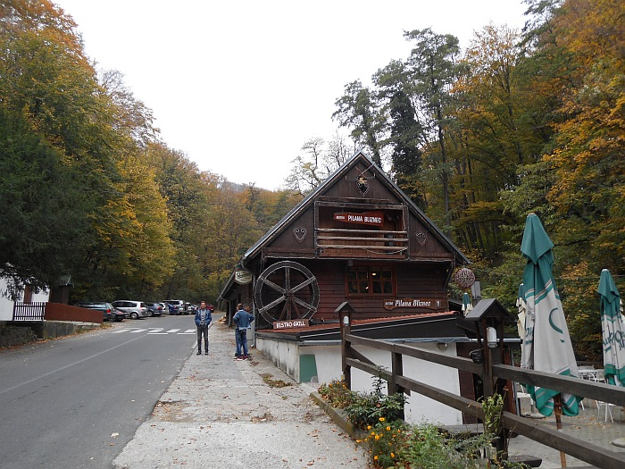
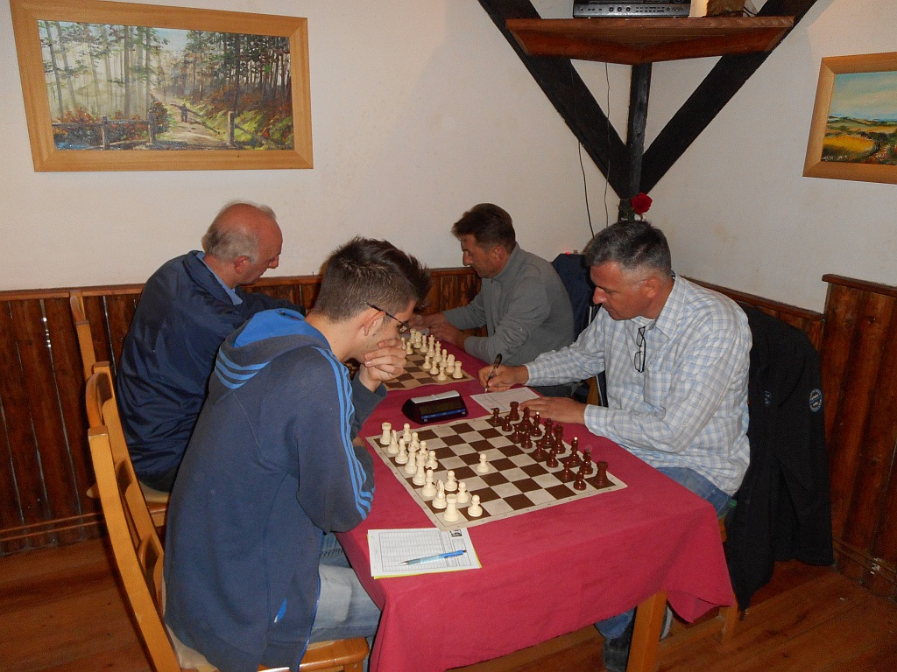
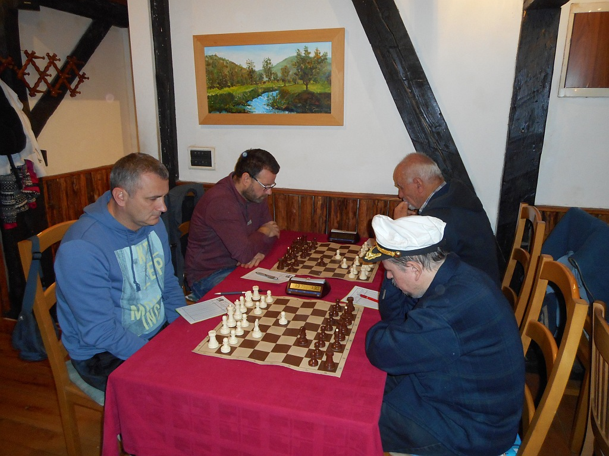
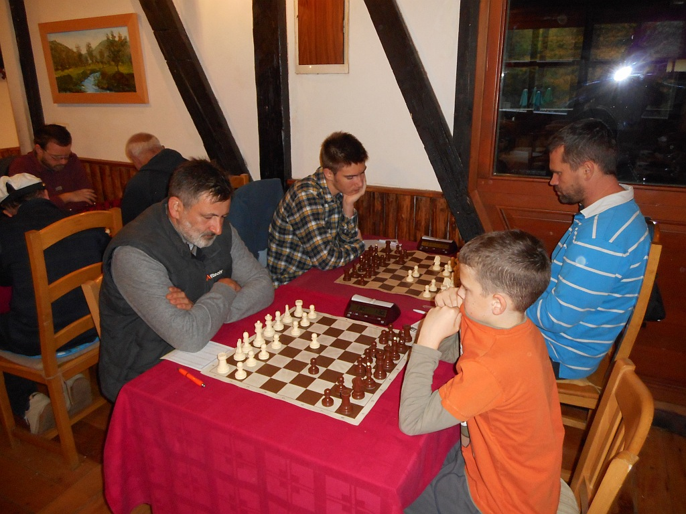
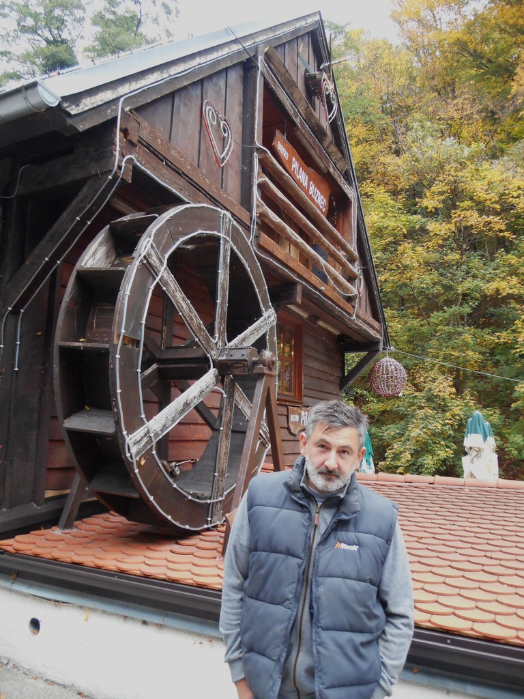
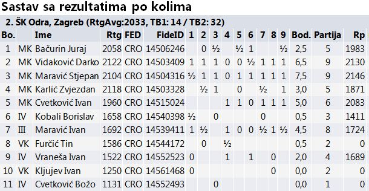
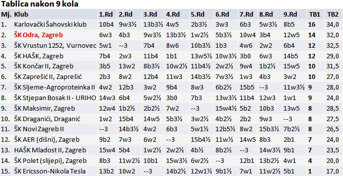

**Seniori, 9. kolo  
  
**U nedjelju, 22. listopada, odigrano je posljednje, deveto kolo V. seniorske lige. Iako smo službeno bili domaćini, domaćin je bio ŠK AER. Ugostili su nas na Sljemenu u ugostiteljskom objektu Pilana Bliznec.  
Meč je protekao u prijateljskom raspoloženju i bez previše stresa, uglavnom zahvaljujući igračima ŠK AER koji su olako poklanjali bodove. Prvo je Stjepkov protivnik previdio figuru, zatim Zvjezdanov, a i Cvetko je taktikom uzeo protivničku figuru. Cvetko je zatim nepotrebno komplicirao, umjesto da jednostavnim izmjenama uđe u završnicu. Jura se puno brže razvio od protivnika, uzeo dva pješaka, ali je onda zakomplicirao napad u tolikoj mjeri da je morao remizirati. Darkov protivnik je trošio neobjašnjivo puno vremena i ušao u cajtnot te se s nekoliko lošijih poteza doveo u izgubljenu poziciju. Mladi Ivan je dosta loše tretirao poziciju, opet se vratio starim navikama da više misli o obrani umjesto napadu, ali mu je protivnik miroljubivo dao remi.  
**ŠK ODRA – ŠK AER 5:1  
**4\. MK Juraj Bačurin 2058 – I Robert Govorko 1841        1/2  
2\. MK Darko Vidaković 2122 – III Mihael Kovač 1699     1:0  
3\. MK Stjepan Maravić 2104 – IV Darijan Mišak  1651    1:0  
4\. MK Zvjezdan Karlić 2118 – III Božo Jurišić 1694          1:0  
5\. MK Ivan Cvetković 1960 – II Leon Putar 1651             1:0  
6\. II Ivan Maravić 1692 – VK Slavko Putar 1517              1/2

     
Ovom pobjedom osvojili smo drugo mjesto i plasirali se u višu ligu. Na turniru smo izgubili samo od Karlovca, ali smo imali i nekoliko neriješenih ishoda. Ove godine dobili smo dva nova igrača, Ivana i Vranešu koji su donijeli nekoliko presudnih bodova i mislim da ubuduće možemo računati na njih. Na Božu i Kljujeva ćemo morati još malo pričekati, ali vjerujem da će dobiti priliku sljedeće godine iskazati se u nešto jačoj ligi. Sva četvorica su još u osnovnoj školi, a za sada samo napreduju, neki brže, neki sporije. Statistički, ove godine vrlo dobro su odigrali Stipe, Darko i Cvetko. Zvjezdan i Jura su manje igrali, a i izgubili su na oštrini, što se vidjelo i u ovom posljednjem kolu kada nisu uspjeli pronaći dobitke u dobivenim pozicijama.  
  

