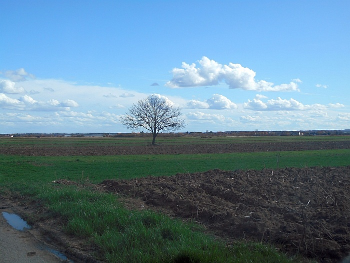
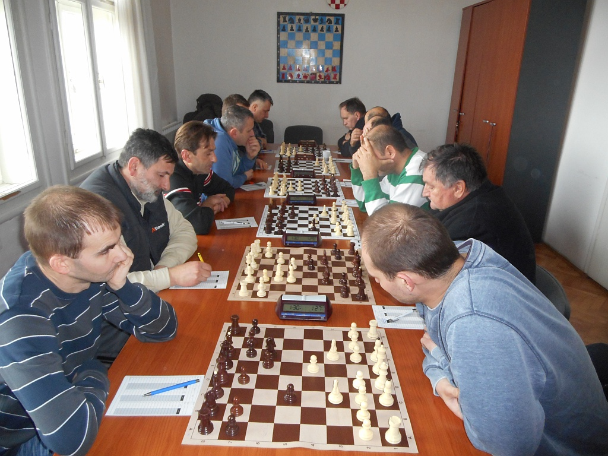

**Seniori, 1. kolo  
  
**Prvo kolo IV. seniorske lige centar ŠK Odra počeo je susretom s ekipom ŠK Ban Jelačić iz Zaprešića.  
Iako je prošle godine Klub bio pretposljednji i trebao ispasti u niži rang, zbog odustajanja Karlovca i Varaždina u ligaškim natjecanjima obje posljednje plasirane ekipe četvrte lige ostale su u istom natjecateljskom rangu. Za Karlovac znam da je odustao zbog financijskih teškoća, dok za Varaždin samo pretpostavljam da je razlog isti. U svakom slučaju, i ove godine ŠK Odra nastavlja gubiti mečeve u IV. ligi centar. Ove godine od natjecateljskog šaha odustao je Ljubić, a aktivirao se Goran Fiolić, koji je danas ponovo zaigrao za ekipu nakon dvadesetak godina pauze. Stariji su kadeti danas igrali finalne mečeve pojedinačnog prvenstva Zagreba, stoga je ekipa danas, silom prilika, bila sastavljena isključivo od seniora. ŠK Ban Jelačić pokazao se kao prejak protivnik i odnio bodove u Zaprešić iako je bilo šansi da se odigra barem neriješeno. Darko je na prvoj ploči trošio previše vremena te na kraju, zbog vremenske oskudice, prihvatio remi u dobivenoj poziciji, Zvjezdan se uspio izvući zamutivši vodu u izgubljenoj poziciji, Stipe je možda pogrešnim planom ispustio prednost te su tako partije na prve tri ploče završile remijem. Jura je komplicirao u dobivenoj poziciji s materijalnom prednošću, preračunao se i potpao pod neobranjiv napad, Cvetka je na petoj ploči protivnik nadigrao, dok je Goran odigrao loše otvaranje, ali se uspio izvući, a poslije odigrao nekoliko nepreciznih poteza i dopustio protivniku da bude brži u napadu u poziciji sa suprotnim rokadama.  
Sljedeće nedjelje ŠK Odra igra drugo kolo protiv ŠK Vladimir Ivetić u Sopotu, Novi Zagreb.

**ŠK ODRA – ŠK BAN JELAČIĆ 1,5:4,5  
**

1.  Vidaković, Darko MK – Ognjan, Renato MK 1/2
2.  Karlić, Zvjezdan MK – Burić, Zdenko MK 1/2
3.  Maravić, Stjepan MK – Ugrin, Dragan MK 1/2
4.  Bačurin, Juraj MK – Đođ, Goran II 0:1
5.  Cvetković, Ivan MK – Trempetić, Mladen I 0:1
6.  Fiolić, Goran II – Sindik, Dario II 0:1
