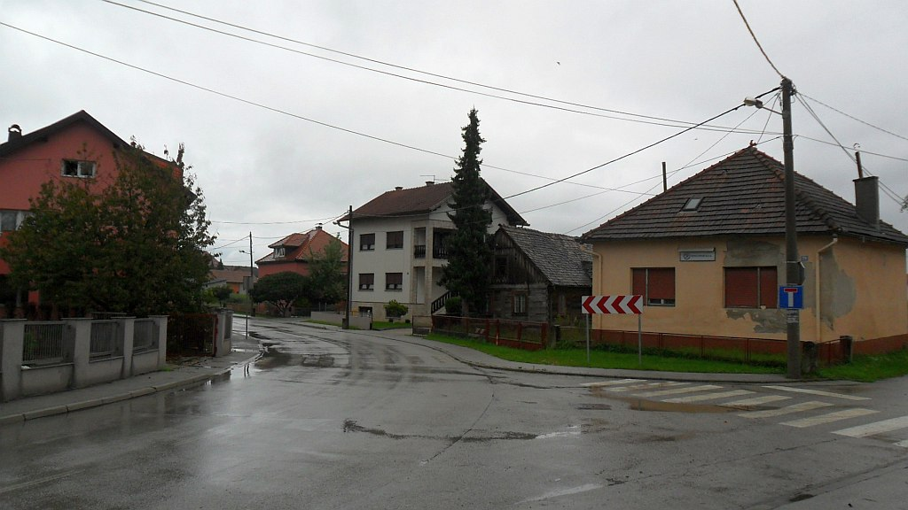
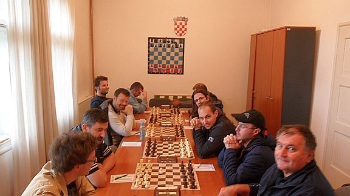

**Seniori, 8. kolo**

Po kišnome i tmurnom vremenu odigrano je osmo kolo seniorske šahovske lige. Ekipa ŠK Odra pobijedila je gotovo ravnopravnog protivnika ŠK Ban Jelačić iz Zaprešića s 4:2. Vrlo brzo izgubio je Tin na šestoj ploči. Nije se uspio snaći protiv pješačke lavine iskusnijeg protivnika. Zatim je već nakon dva sata igre Stipe sklopio remi na prvoj ploči. Ponajprije zbog umora, jer je pozicija usprkos raznobojnim lovcima nudila još dosta za igru. Na četvrtoj ploči Golub je držao lošu poziciju jer je Sindik uspio otvoriti poziciju nakon što je odigrao gambitno otvaranje. Nasreću, ostale su pozicije bile prilično čvrste. Tada je najprije Danko osvojio figuru, a Cvetko i Zvjezdan po pješaka te su zatim precizno privodili igre u završnice, koje su bez pogreške i realizirali. Golub nudi remi koji njegov protivnik, nakon što se napad rasplinuo, i prihvaća te meč završava s izvrsnih 4:2. Klub je sada izbio na treće mjesto i teoretski, uz malo sreće i tri pobjede do kraja lige, moguć je i povratak u treću ligu.

(najava: turnir za kadete, kadetkinje, juniore… [SISAK, sljedeći vikend!](http://www.sahdrustvosisak.info/wp-content/uploads/2014/08/Raspis-Kul-In-2014.jpg))

ŠK ODRA – ŠK BAN JELAČIĆ            4:2     

1\. Maravić Stjepan – Drobne Marijan    1/2  
2\. Brajdić Danko – Đođ Goran              1:0  
3\. Karlić Zvjezdan – Gal Igor                 1:0  
4\. Golub Vladimir – Sindik Dario           1/2  
5\. Cvetković Ivan – Sinković Matija       1:0  
6\. Furčić Tin – Trempetić Mladen          0:1

<table class="CRs1"><tbody><tr class="CRg1b"><td class="CRc">Mj.</td><td class="CR">Momčad</td><td class="CRc">1</td><td class="CRc">2</td><td class="CRc">3</td><td class="CRc">4</td><td class="CRc">5</td><td class="CRc">6</td><td class="CRc">7</td><td class="CRc">8</td><td class="CRc">9</td><td class="CRc">10</td><td class="CRc">11</td><td class="CRc">12</td><td class="CRc">&nbsp;TB1</td><td class="CRc">&nbsp;TB2</td><td class="CRc">&nbsp;TB3</td></tr><tr class="CRg2"><td class="CRc">1</td><td class="CR">ŠK HRT</td><td class="CR">&nbsp;*</td><td class="CRc">4</td><td></td><td class="CRc">3</td><td class="CRc">3½</td><td class="CRc">4</td><td></td><td class="CRc">3</td><td class="CRc">4</td><td></td><td class="CRc">4½</td><td class="CRc">4½</td><td class="CRc"><strong>14</strong></td><td class="CRc">30.5</td><td class="CRc">159.25</td></tr><tr class="CRg1"><td class="CRc">2</td><td class="CR">ŠK Končar</td><td class="CRc">2</td><td class="CR">&nbsp;*</td><td class="CRc">4</td><td class="CRc">4½</td><td></td><td class="CRc">3½</td><td class="CRc">3½</td><td class="CRc">4</td><td></td><td class="CRc">3</td><td class="CRc">4</td><td></td><td class="CRc"><strong>13</strong></td><td class="CRc">28.5</td><td class="CRc">159.25</td></tr><tr class="CRg2"><td class="CRc">3</td><td class="CR">ŠK Odra</td><td></td><td class="CRc">2</td><td class="CR">&nbsp;*</td><td></td><td class="CRc">5</td><td class="CRc">2</td><td class="CRc">3½</td><td class="CRc">5</td><td></td><td class="CRc">5</td><td class="CRc">4</td><td class="CRc">4</td><td class="CRc"><strong>12</strong></td><td class="CRc">30.5</td><td class="CRc">123.50</td></tr><tr class="CRg1"><td class="CRc">4</td><td class="CR">ŠK Zaprešić</td><td class="CRc">3</td><td class="CRc">1½</td><td></td><td class="CR">&nbsp;*</td><td class="CRc">6</td><td class="CRc">4½</td><td class="CRc">3</td><td></td><td class="CRc">4</td><td></td><td class="CRc">4</td><td class="CRc">3½</td><td class="CRc"><strong>12</strong></td><td class="CRc">29.5</td><td class="CRc">131.50</td></tr><tr class="CRg2"><td class="CRc">5</td><td class="CR">ŠK Dugo Selo</td><td class="CRc">2½</td><td></td><td class="CRc">1</td><td class="CRc">0</td><td class="CR">&nbsp;*</td><td></td><td class="CRc">5½</td><td class="CRc">4½</td><td class="CRc">5</td><td class="CRc">4½</td><td class="CRc">4</td><td></td><td class="CRc"><strong>10</strong></td><td class="CRc">27.0</td><td class="CRc">102.00</td></tr><tr class="CRg1"><td class="CRc">6</td><td class="CR">ŠK Špansko</td><td class="CRc">2</td><td class="CRc">2½</td><td class="CRc">4</td><td class="CRc">1½</td><td></td><td class="CR">&nbsp;*</td><td class="CRc">1½</td><td></td><td class="CRc">4½</td><td class="CRc">5</td><td></td><td class="CRc">4½</td><td class="CRc"><strong>8</strong></td><td class="CRc">25.5</td><td class="CRc">81.50</td></tr><tr class="CRg2"><td class="CRc">7</td><td class="CR">ŠK Vrbani</td><td></td><td class="CRc">2½</td><td class="CRc">2½</td><td class="CRc">3</td><td class="CRc">½</td><td class="CRc">4½</td><td class="CR">&nbsp;*</td><td class="CRc">3</td><td></td><td class="CRc">4</td><td class="CRc">4½</td><td></td><td class="CRc"><strong>8</strong></td><td class="CRc">24.5</td><td class="CRc">85.75</td></tr><tr class="CRg1"><td class="CRc">8</td><td class="CR">ŠK INA</td><td class="CRc">3</td><td class="CRc">2</td><td class="CRc">1</td><td></td><td class="CRc">1½</td><td></td><td class="CRc">3</td><td class="CR">&nbsp;*</td><td class="CRc">4½</td><td class="CRc">4½</td><td></td><td class="CRc">4½</td><td class="CRc"><strong>8</strong></td><td class="CRc">24.0</td><td class="CRc">78.50</td></tr><tr class="CRg2"><td class="CRc">9</td><td class="CR">Karlovački ŠK</td><td class="CRc">2</td><td></td><td></td><td class="CRc">2</td><td class="CRc">1</td><td class="CRc">1½</td><td></td><td class="CRc">1½</td><td class="CR">&nbsp;*</td><td class="CRc">3</td><td class="CRc">4½</td><td class="CRc">4½</td><td class="CRc"><strong>5</strong></td><td class="CRc">20.0</td><td class="CRc">39.75</td></tr><tr class="CRg1"><td class="CRc">10</td><td class="CR">ŠK Jaska</td><td></td><td class="CRc">3</td><td class="CRc">1</td><td></td><td class="CRc">1½</td><td class="CRc">1</td><td class="CRc">2</td><td class="CRc">1½</td><td class="CRc">3</td><td class="CR">&nbsp;*</td><td></td><td class="CRc">3½</td><td class="CRc"><strong>4</strong></td><td class="CRc">16.5</td><td class="CRc">38.75</td></tr><tr class="CRg2"><td class="CRc">11</td><td class="CR">ŠK Ban Jelačić</td><td class="CRc">1½</td><td class="CRc">2</td><td class="CRc">2</td><td class="CRc">2</td><td class="CRc">2</td><td></td><td class="CRc">1½</td><td></td><td class="CRc">1½</td><td></td><td class="CR">&nbsp;*</td><td class="CRc">4½</td><td class="CRc"><strong>2</strong></td><td class="CRc">17.0</td><td class="CRc">14.50</td></tr><tr class="CRg1"><td class="CRc">12</td><td class="CR">ŠK Maksimir</td><td class="CRc">1½</td><td></td><td class="CRc">2</td><td class="CRc">2½</td><td></td><td class="CRc">1½</td><td></td><td class="CRc">1½</td><td class="CRc">1½</td><td class="CRc">2½</td><td class="CRc">1½</td><td class="CR">&nbsp;*</td><td class="CRc"><strong>0</strong></td><td class="CRc">14.5</td><td class="CRc">0.00</td></tr></tbody></table>
