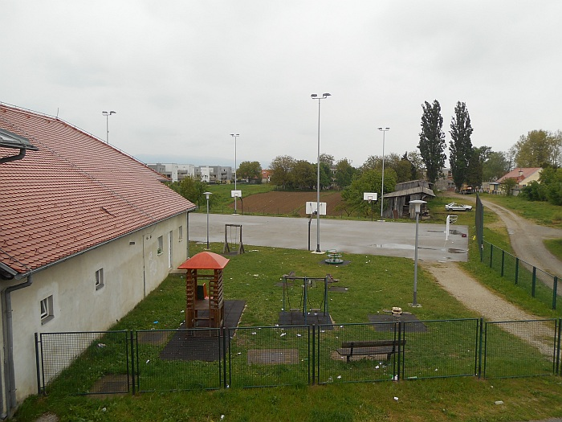
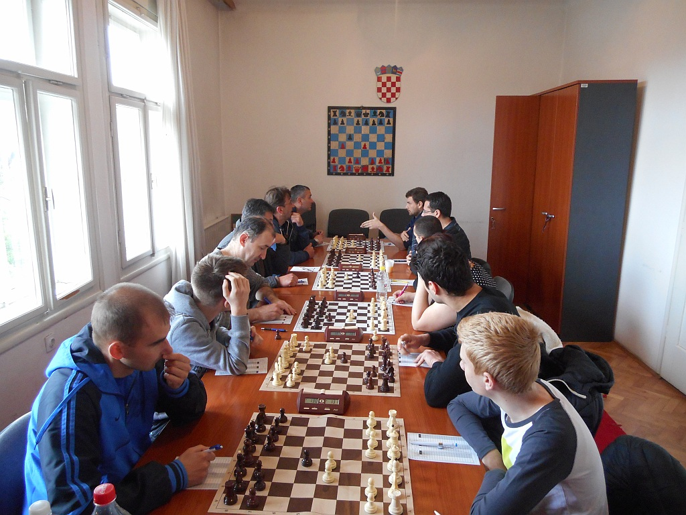

**Seniori, 5. kolo  
**  
Dan poslije Jurjeva, u polukišno prohladno jutro u goste nam je došao ŠK Caissa, vodeća ekipa lige. Naš je sastav bio, recimo to tako, raznolik. Darko i Zvjezdan nisu nastupili u ovom kolu pa su u sastavu igrala samo tri kandidata. Iako od ovoga kola i nismo očekivali neke bodove, partije su se razvijale na zanimljiv način i samo je mrvica Jurine dekoncentracije u završnici presudila da ne uzmemo prvi bod ove godine. Ovako smo i nakon pet kola uvjerljivo na začelju i, iskreno, ne sjećam se da smo ikad imali tako loš početak. Cvetko je brzo remizirao, odmah nakon otvaranja. Stipe se još malo potrudio nakon otvaranja, ali čvrstog Vršeka na prvoj ploči nije mogao slomiti. Goran je grubo pogriješio već u četvrtom potezu i zapao u nerješive probleme. Na drugoj ploči Jura se nije mogao pomaknuti. Ali je zato mladi Ivan stajao nadmoćno, imao centar i lovački par te s pravom odbio ponuđeni remi. Boris ove godine ugodno iznenađuje. U opasnoj poziciji u središnjici našao je jedinstven plan te prebacivanjem kralja iz rokadnog položaja na drugu stranu uspio postići čvrsti remi. Tako su tri prve partije završile neriješeno. Gorana smo već otpisali, gubio je materijal, ušao u cajtnot, ali je i dalje uporno branio neobranjivu poziciju. Nažalost, Ivanova pozicija počela se raspadati. Nije nigdje pogriješio, ali je to bila jedna od rijetkih pozicija gdje su skakači nekako preuzeli inicijativu i Ivan je izgubio pješaka te ostao s minoritetom na daminu krilu. Šteta, jer je napokon odigrao jednu vrhunsku partiju, na razini kandidata. Jura je na drugoj ploči, nakon gotovo četiri sata igre, uspio pronaći protuigru, prihvatio nekorektnu žrtvu figure i ušao u damsku završnicu s figurom više. Goranov mladi protivnik na šestoj ploči činio je pogrešku za pogreškom i Goran je nekim čudom reducirao materijal te ušao u remi. Sada je još samo ostalo da Jura privede posao kraju i završili bismo meč s neodlučenim rezultatom. Ipak, iscrpljenost je učinila svoje i Jura, neshvatljivo, nije uveo figuru u igru i ktomu je maknuo damu s aktivne dijagonale, što je njegov protivnik iskoristio i uhvatio kralja u vječni šah. Presudnih pola boda otišlo je protivničkom timu i propustili smo šansu kojoj se prije početka meča nismo ni nadali. U svakom slučaju, zaslužena pobjeda ŠK Caissa. Sljedeće kolo igra se 8. svibnja gostovanjem kod ŠK Vrbani.

**ŠK Odra – ŠK Caissa 2,5 : 3,5**

1\. MK Maravić, Stjepan 2091 – MK Vršek, Ivan 2224             1/2  
2\. MK Bačurin, Juraj 2067 – MK Podravec, Krešimir 2187     1/2  
3\. MK Cvetković, Ivan 1969 – MK Greb, Nikola 2028              1/2  
4\. IV Kobali, Borislav 1663 – NM Kruljac, Petra 2078              1/2  
5\. III Maravić, Ivan 1439 – I Erenda, Bruno 1984                    0:1  
6\. II Fiolić, Goran 1844 – IV Branica, Vilim 1787                      1/2

Danas je stigao i prijedlog **promjene sustava kadetskih liga**. Problem liga za mlade jest da se ekipe godinama moraju mučiti da uđu u višu ligu, pa opet u višu itd. Kada napokon uspiju doći u prvu ligu, obično nastaje smjena generacija pa klubovi u prvoj ligi nastupaju s ekipom koja objektivno nema što tamo tražiti. Prijedlog je da se švicarskim sustavom igraju tri druge lige, umjesto četvrte, treće i druge te bi tako bilo manje nelogičnosti u raspodjeli ekipa po ligama u odnosu na njihovu snagu. Prijedlog je u prilogu. Tako ćemo vjerojatno imati kadetkinje u prvoj, kadete u drugoj ligi,  a seniore tamo gdje i pripadaju, u posljednjoj, petoj ligi. 🙂

[Prijedlog kadetskih liga za 2017.pdf](/files/wp/2016/04/Prijedlog-kadetskih-liga.pdf)
