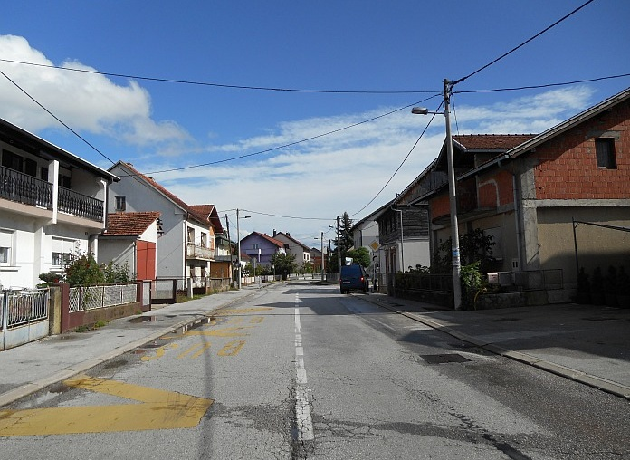
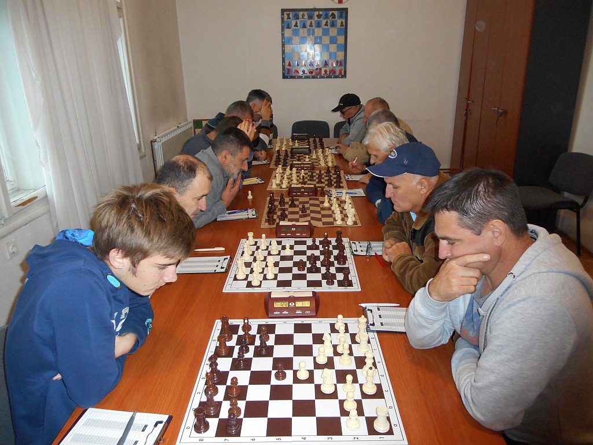

**Seniori, 7. kolo  
**Uz malu pomoć sreće i protivnika, ostvarena je druga uzastopna pobjeda u seniorskoj ligi. U goste nam je došla ekipa ŠK Draganići i pružila otpor znatno veći nego što rezultat prikazuje. Vraneša je ovo kolo ispao iz ekipe  zbog bolesti, a Jura zbog poslovnih obaveza. Nadomjestili su ih Boris i Zvjezdan. Boris je odigrao dobro otvaranje i izašao bolji napravivši slabosti u protivničkoj pješakoj strukturi. Tada je neoprezno krenuo u pješački napad na rokadnoj strani i brzo stradao. Mladi Ivan je igrao izjednačenu topovsku završnicu i u jednom trenutku neobjašnjivo ostavio pješaka, nakon čega mu se pozicija potpuno raspala. Srećom po njega, njegov protivnik nije vidio jednostavan način da mu uzme i preostala dva pješaka i uđe u završnicu s tri pješaka više te je Ivan uspio reducirati materijal i remizirati slabiju topovsku završnicu.  
Zvjezdan je opet previđao, ali se ovaj put uspio izvući i ući u završnicu raznobojnih lovaca te je i on uzeo pola boda. Cvetko je opet odigrao dobru partiju i može se reći, sa izuzetkom prošlog kola, da ove godine uistinu dobro igra. Partiju je pravocrtno od otvaranja do završnice vodio do pobjede. Darko se nije snašao u otvaranju i trošio je puno vremena, ali mu je protivnik neoprezno dopustio pješaki prodor u centru i ubrzo stradao zbog otvorenog položaja kralja. Stipe je uspio osvojiti pješaka, ali je ušao u remi završnicu raznobojaca. Srećom po našu ekipu, njegov protivnik je zaboravio na vrijeme i izgubio padom zastavice.  
Sljedeće, pretposljednje kolo, igra se 15. listopada.

**ŠK ODRA – ŠK DRAGANIĆI 4:2**  
1\. MK Darko Vidaković 2116 – MK Jurica Bonjekovic 2108     1:0  
2\. MK Stjepan Maravić 2092 – MK Juraj Misir 1916                 1:0  
3\. MK Zvjezdan Karlić 2126 – II Velimir Tomljenović 1752        1/2  
4\. MK Ivan Cvetković 1968 – I Stjepan Škundrić 1758             1:0  
5\. IV Boris Kobali 1669 – III Mirko Petrović 1640                      0:1  
6\. II Ivan Maravić 1700 – VK Tihomir Kolibaš 1648                  1/2
