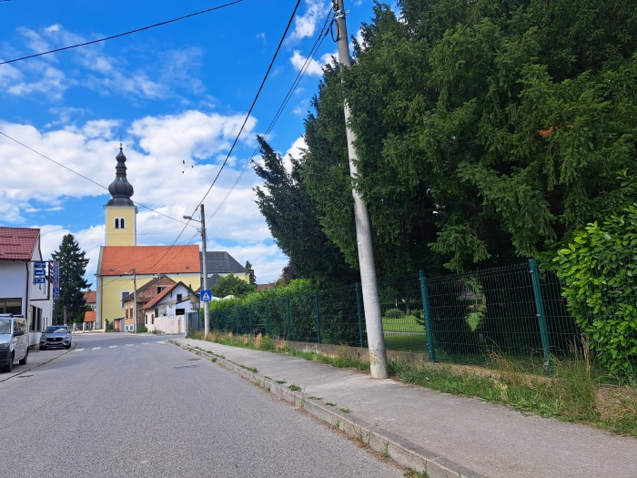

**Seniori, 6.kolo  
  
**  
Proljetni dio sezone smo završili pobjedom protiv prijateljske ekipe iz Mača. Meč je dobro počeo za nas jer je Ivan brzo uzeo figuru, a Ivo pješaka. Nažalost, Zvjezdan je nastavio svoj loši niz te je nakon lošeg otvaranja odigrao još lošiju središnjicu te je njegov protivnik lagano kapitalizirao pozicionu prednost. Ivo je brzo uspio osvojiti još jednoga pješaka te su i on i Ivan pretočili svoje prednosti u cijele bodove. Mladen je dobro igrao, ali je trošio previše vremena. U završnici, gdje je već bio dobiven, u vremenskom tjesnacu je previdio figuru, a s njom je otišla i partija. Darko je cijelu partiju držao pritisak, ali njegov protivnik se dobro branio. Međutim, na našu sreću, protivnik previđa taktiku nakon koje ostaje bez figure i tako Darko prelazi 50% bodova. Zadnji je ostao igrati Stjepko, pozicija je bila tipično “njegova” (većini neugodna oku, ali skroz dobra :)), budući da je njegovu protivniku Kolednjaku trebala pobjeda, partija se odužila do duboke završnice. Obojica su previdjeli u jednome momentu dobitak svoga protivnika, ali osim toga su igrali dobro te nitko nije imao dobivenu poziciju dulje od poteza. Kraj polusezone smo tradicionalno obilježili domjenkom kojemu su se pridružili i protivnici. Nakon proljetnog dijela [lige](https://chess-results.com/tnr886630.aspx?lan=13) nalazimo se na osmome mjestu s pet meč bodova. Nadamo se kako ćemo ih na jesen osvojiti i više i ostati u ligi.

<table><tbody><tr><td>Pl.</td><td></td><td><strong>ŠK Odra</strong></td><td>–</td><td></td><td><strong>ŠK Gaj</strong></td><td><strong>3,5-2,5</strong></td></tr><tr><td>1.</td><td>MK</td><td>Karlić, Zvjezdan 2091</td><td>–</td><td>MK</td><td>Abramović, Darko 2130</td><td>0-1</td></tr><tr><td>2.</td><td>MK</td><td>Maravić, Ivan 2086</td><td>–</td><td>I</td><td>Galoić, Boris 2067</td><td>1-0</td></tr><tr><td>3.</td><td>MK</td><td>Maravić, Stjepan 2107</td><td>–</td><td>MK</td><td>Kolednjak, Tomislav 2099</td><td>½–½</td></tr><tr><td>4.</td><td>MK</td><td>Sliepčević, Mladen 2093</td><td>–</td><td>MK</td><td>Svrtan, Zlatko 2036</td><td>0-1</td></tr><tr><td>5.</td><td>MK</td><td>Vidaković, Darko 2119</td><td>–</td><td>MK</td><td>Hamer, Ivan 1967</td><td>1-0</td></tr><tr><td>6.</td><td>II</td><td>Pahljina, Ivo 1969</td><td>–</td><td>I</td><td>Bogi, Tomislav 1972</td><td>1-0</td></tr></tbody></table>

##### 8\. ŠK Odra, Zagreb (TB1:5 / TB2:17,5)

<table><tbody><tr><td><strong>Pl.</strong></td><td></td><td><strong>Ime</strong></td><td><strong>1</strong></td><td><strong>2</strong></td><td><strong>3</strong></td><td><strong>4</strong></td><td><strong>5</strong></td><td><strong>6</strong></td><td><strong>Bod.</strong></td><td><strong>Partije</strong></td></tr><tr><td>1</td><td>MK</td><td>Karlić Zvjezdan</td><td>0</td><td></td><td>0</td><td>0</td><td></td><td>0</td><td>0</td><td>4</td></tr><tr><td>2</td><td>MK</td><td>Maravić Ivan</td><td>½</td><td>½</td><td>1</td><td></td><td>½</td><td>1</td><td>3,5</td><td>5</td></tr><tr><td>3</td><td>MK</td><td>Maravić Stjepan</td><td>½</td><td>½</td><td>½</td><td></td><td>½</td><td>½</td><td>2,5</td><td>5</td></tr><tr><td>4</td><td>MK</td><td>Sliepčević Mladen</td><td></td><td>1</td><td></td><td>½</td><td>1</td><td>0</td><td>2,5</td><td>4</td></tr><tr><td>5</td><td>MK</td><td>Vidaković Darko</td><td>1</td><td>0</td><td>0</td><td>1</td><td></td><td>1</td><td>3</td><td>5</td></tr><tr><td>6</td><td>MK</td><td>Kovač Hrvoje</td><td>0</td><td>0</td><td></td><td></td><td></td><td></td><td>0</td><td>2</td></tr><tr><td>7</td><td>MK</td><td>Cvetković Ivan</td><td></td><td></td><td></td><td></td><td>½</td><td></td><td>0,5</td><td>1</td></tr><tr><td>8</td><td>MK</td><td>Bačurin Juraj</td><td></td><td>0</td><td></td><td></td><td></td><td></td><td>0</td><td>1</td></tr><tr><td>10</td><td></td><td>Mikić Ivana</td><td></td><td></td><td></td><td>1</td><td>0</td><td></td><td>1</td><td>2</td></tr><tr><td>11</td><td>II</td><td>Pahljina Ivo</td><td></td><td></td><td>½</td><td>1</td><td>0</td><td>1</td><td>2,5</td><td>4</td></tr><tr><td>12</td><td>II</td><td>Vraneša Ivan</td><td>1</td><td></td><td>0</td><td>1</td><td></td><td></td><td>2</td><td>3</td></tr></tbody></table>

*IvanM*
