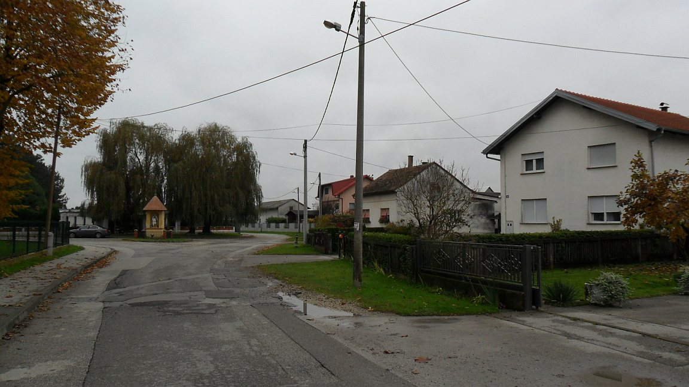
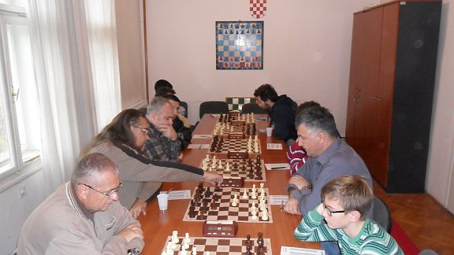

**Seniori, 10. kolo**

Danas je odigrano deseto kolo, rezultatski nebitno, prilično izjednačeno, kako govori i sam rezultat. Danko, Golub, Cvetko i Darko su remizirali, iako je Darko mogao izgubiti, a Golub lako dobiti. Premda je neplanirano, u posljednji trenutak, zbog Ljubićeve bolesti, upao u ekipu, Ivan je odigrao kvalitetnu i čvrstu partiju i pokazao znatan napredak u igri. Ovaj put nije dopustio neke veće pozicijske slabosti u svojoj poziciji, ali nažalost previdio je taktički udar na ulasku u završnicu. Na prvoj ploči Stipetov protivnik ušao je u komplikacije u cajtnotu koje se nisu dobro završile po njega. ŠK HRT se pokazao kao dostojan protivnik i čestitamo im na plasmanu u višu ligu!

ŠK Odra, Zagreb – ŠK HRT, Zagreb   3 : 3

1\. Maravić Stjepan – Malada Vinko    1 – 0  
2\. Brajdić Danko – Basarić Srđan       ½ – ½  
3\. Golub Vladimir – Božičević Ivo       ½ – ½  
4\. Cvetković Ivan –  Fiamengo Joško ½ – ½  
5\. Vidaković Darko – Horvat Tihomir  ½ – ½  
6\. Maravić Ivan – Fiamengo Andrija   0 – 1
