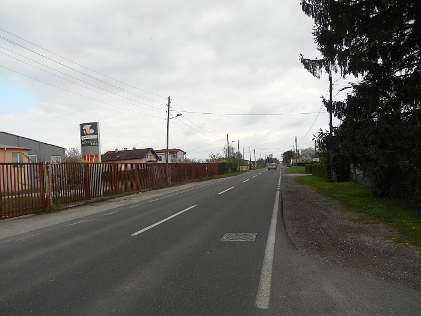
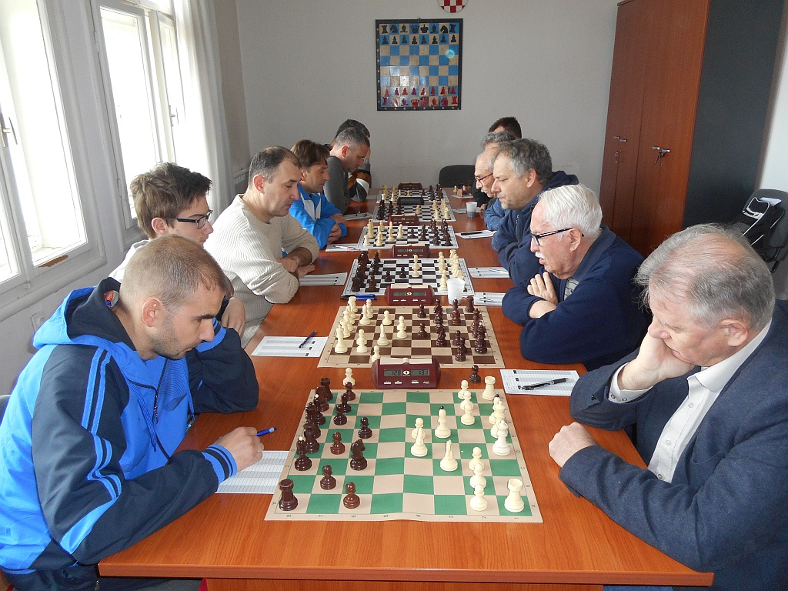

**Seniori, 3. kolo  
**Seniorska ekipa izgubila je današnji meč od vrlo raspoložene ekipe ŠK Ina. ŠK Ina zasluženo je odnio bodove s ovoga gostovanja te nam na dostojan način uzvratio za prošlogodišnji poraz. Gorana i Ivana protivnici su nadigrali ili, kako je  Ivan slikovito opisao svoju partiju, “ne znam brojiti do tri”. Boris je odigrao čvrsto i izmjenama ušao u remi-poziciju. Jura je imao nadmoćnu, štoviše, dobivenu poziciju ali je pogrešnim planom upao u matnu mrežu. Darko je imao pješaka više, propustio jednostavan dobitnički plan s guranjem pješaka po damu, a zatim grubo previdio materijal. Stipe je jedini nadmudrio protivnika i pobrao istrčale pješake te lako realizirao završnicu s dva više. U svakom slučaju, Boris je najugodnije iznenađenje ovoga kola.

ŠK ODRA – ŠK INA 1,5:4,5

1\. Vidaković, Darko – Ćelepirović, Vinko 0:1  
2\. Maravić, Stjepan – Prskalo, Zoran 1:0  
3\. Bačurin, Juraj – Jakovljevski, Radivoje 0:1  
4\. Kobali, Boris – Borota, Igor 1/2  
5\. Maravić, Ivan – Koporčić, Branko 0:1  
6\. Fiolić, Goran – Biljak, Tomislav 0:1

Sljedeće kolo igra se za tjedan dana, a ŠK Odra gostuje u Dugom Selu. Tin ima fakultetske obveze pa se nadamo da će uskočiti Zvjezdan.
