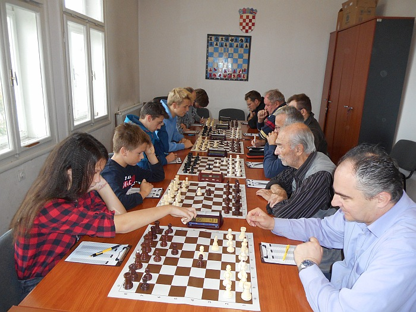
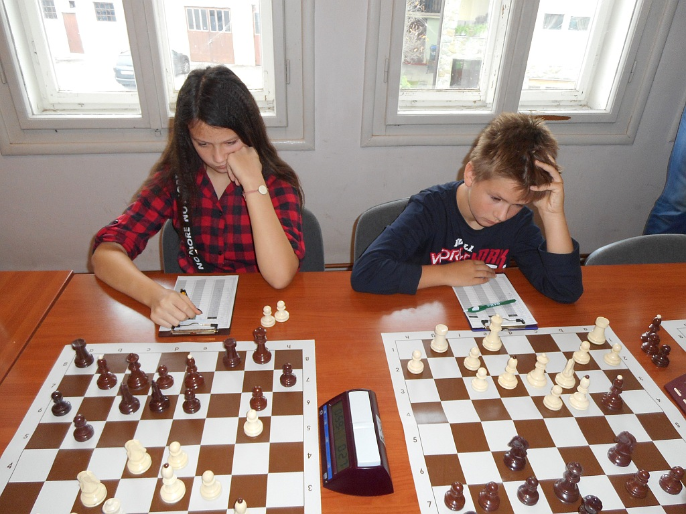

**Seniori, 11. kolo  
**Posljednje ovogodišnje kolo u goste nam je došao ŠK INA. U ugodnom raspoloženju, gosti su odnijeli bodove koji su im, uz odgovarajuće rezultate ostalih susreta, donijeli plasman u višu ligu, a mi smo pružili priliku mlađim generacijama da se okušaju u seniorskoj konkurenciji. I viđenim možemo biti i više nego zadovoljni. Naš standardni igrač na šestoj ploči, Ivan, upisao je pobjedu i na prvom stolu. Luka je hrabro prihvatio ponuđenu priliku i prilično ozbiljno i odigrao. U partiji je imao priliku uzeti i figuru sa neizvjesnim ishodom, ali se nije usudio. Kasnije je ipak “zaboravio” jednu svoju figuru. Ali za prvi put i više nego dobro. Božo je malo zakazao, teško se prisilio i da igra jer ne podnosi poraze baš najbolje, a nasjeo je i na štos te u ranoj fazi igre ostao s figurom manje. Ipak, i ovaj put je nešto naučio. Boris je dosta loše odigrao otvaranje koje inače dobro poznaje i to ga je stajalo partije. Vraneša je samo potvrdio koliko je dobar. Ipak, protivnik mu se izvukao te je ovaj puta upisao samo pola boda. Jedini je standardni igrač bez poraza. Najugodnije iznenađenje je Samanta koja je odigrala koncentrirano i pažljivo i, što je najvažnije, bez straha. Imala je dobivenu poziciju i materijalni višak, ali je pri ulasku u završnicu ispustila prednost  te prihvatila remi u izjednačenoj poziciji.  
Na oproštajnom ručku od ovogodišnje lige, janjetina je bila i više nego dobra!

<table><tbody><tr><td></td><td></td><td>&nbsp;&nbsp;ŠK Odra</td><td>–</td><td></td><td>&nbsp;&nbsp;ŠK INA</td><td>2 : 4</td></tr><tr><td>1.</td><td>II</td><td><table><tbody><tr><td></td><td>Maravić, Ivan 1732</td></tr></tbody></table></td><td>–</td><td>II</td><td><table><tbody><tr><td></td><td>Glasinović, Juraj 1943</td></tr></tbody></table></td><td>1 – 0</td></tr><tr><td>2.</td><td>IV</td><td><table><tbody><tr><td></td><td>Kobali, Boris 1663</td></tr></tbody></table></td><td>–</td><td>MK</td><td><table><tbody><tr><td></td><td>Padjen, Zdenko 1933</td></tr></tbody></table></td><td>0 – 1</td></tr><tr><td>3.</td><td>III</td><td><table><tbody><tr><td></td><td>Vraneša, Ivan 1670</td></tr></tbody></table></td><td>–</td><td>I</td><td><table><tbody><tr><td></td><td>Ćelepirović, Vinko 2004</td></tr></tbody></table></td><td>½ – ½</td></tr><tr><td>4.</td><td>III</td><td><table><tbody><tr><td></td><td>Cvetković, Božo 1302</td></tr></tbody></table></td><td>–</td><td>MK</td><td><table><tbody><tr><td></td><td>Prskalo, Zoran 1961</td></tr></tbody></table></td><td>0 – 1</td></tr><tr><td>5.</td><td>IV</td><td><table><tbody><tr><td></td><td>Fiolić, Luka 1344</td></tr></tbody></table></td><td>–</td><td>MK</td><td><table><tbody><tr><td></td><td>Jakovljevski, Radivoje 1939</td></tr></tbody></table></td><td>0 – 1</td></tr><tr><td>6.</td><td>III</td><td><table><tbody><tr><td></td><td>Halužan, Samanta 1212</td></tr></tbody></table></td><td>–</td><td>II</td><td><table><tbody><tr><td></td><td>Orinčić, Damir 1896</td></tr></tbody></table></td><td>½ – ½</td></tr></tbody></table>

---

**[Konačni poredak, IV A liga centar](http://chess-results.com/tnr332243.aspx?lan=13&art=0):**

<table><tbody><tr><td>Mj.</td><td>Momčad</td><td>1</td><td>2</td><td>3</td><td>4</td><td>5</td><td>6</td><td>7</td><td>8</td><td>9</td><td>10</td><td>11</td><td>12</td><td>&nbsp;TB1</td><td>&nbsp;TB2</td></tr><tr><td>1</td><td>ŠK Dugo Selo, Dugo Selo</td><td>&nbsp;*</td><td>4</td><td>3</td><td>4</td><td>5</td><td>3</td><td>3</td><td>4</td><td>3½</td><td>4</td><td>3</td><td>4½</td><td>18</td><td>41,0</td></tr><tr><td>2</td><td>ŠK INA, Zagreb</td><td>2</td><td>&nbsp;*</td><td>3</td><td>4</td><td>3</td><td>3½</td><td>4</td><td>2½</td><td>2</td><td>3½</td><td>4</td><td>3½</td><td>14</td><td>35,0</td></tr><tr><td>3</td><td>ŠK UHBDR 99. brigade, Zagreb</td><td>3</td><td>3</td><td>&nbsp;*</td><td>3</td><td>3</td><td>3</td><td>3</td><td>5</td><td>2½</td><td>3</td><td>4</td><td>4½</td><td>13</td><td>37,0</td></tr><tr><td>4</td><td>ŠK Silent, Zagreb</td><td>2</td><td>2</td><td>3</td><td>&nbsp;*</td><td>3½</td><td>3</td><td>4</td><td>3½</td><td>3</td><td>3½</td><td>5½</td><td>2½</td><td>13</td><td>35,5</td></tr><tr><td>5</td><td>Karlovački šahovski klub, Karlovac</td><td>1</td><td>3</td><td>3</td><td>2½</td><td>&nbsp;*</td><td>3</td><td>3½</td><td>2½</td><td>4½</td><td>3</td><td>3½</td><td>3½</td><td>12</td><td>33,0</td></tr><tr><td>6</td><td>ŠK Špansko, Zagreb</td><td>3</td><td>2½</td><td>3</td><td>3</td><td>3</td><td>&nbsp;*</td><td>3½</td><td>2½</td><td>3½</td><td>2½</td><td>4</td><td>3</td><td>11</td><td>33,5</td></tr><tr><td>7</td><td><strong>ŠK Odra, Zagreb</strong></td><td>3</td><td>2</td><td>3</td><td>2</td><td>2½</td><td>2½</td><td>&nbsp;*</td><td>4½</td><td>4</td><td>3</td><td>3</td><td>3½</td><td>10</td><td>33,0</td></tr><tr><td>8</td><td>ŠK Vladimir Ivetić, Zagreb</td><td>2</td><td>3½</td><td>1</td><td>2½</td><td>3½</td><td>3½</td><td>1½</td><td>&nbsp;*</td><td>3½</td><td>3</td><td>2</td><td>3</td><td>10</td><td>29,0</td></tr><tr><td>9</td><td>ŠK Polet II, Buševec</td><td>2½</td><td>4</td><td>3½</td><td>3</td><td>1½</td><td>2½</td><td>2</td><td>2½</td><td>&nbsp;*</td><td>3½</td><td>2</td><td>3½</td><td>9</td><td>30,5</td></tr><tr><td>10</td><td>ŠK Prigorje Markuševec, Zagreb</td><td>2</td><td>2½</td><td>3</td><td>2½</td><td>3</td><td>3½</td><td>3</td><td>3</td><td>2½</td><td>&nbsp;*</td><td>2</td><td>4½</td><td>8</td><td>31,5</td></tr><tr><td>11</td><td>ŠK Klaka, Zagreb</td><td>3</td><td>2</td><td>2</td><td>½</td><td>2½</td><td>2</td><td>3</td><td>4</td><td>4</td><td>4</td><td>&nbsp;*</td><td>2</td><td>8</td><td>29,0</td></tr><tr><td>12</td><td>ŠK Rugvica-Vrbani, Zagreb</td><td>1½</td><td>2½</td><td>1½</td><td>3½</td><td>2½</td><td>3</td><td>2½</td><td>3</td><td>2½</td><td>1½</td><td>4</td><td>&nbsp;*</td><td>6</td><td>28,0</td></tr></tbody></table>

---

**Rezultati po pločama:**

<table><tbody><tr><td>Pl.</td><td></td><td>Ime</td><td>RtgI</td><td>RtgN</td><td rowspan="13"></td><td>1</td><td>2</td><td>3</td><td>4</td><td>5</td><td>6</td><td>7</td><td>8</td><td>9</td><td>10</td><td>11</td><td>Bod.</td><td>Partije</td><td>n</td><td>w</td><td>rtg+/-</td></tr><tr><td>1</td><td>MK</td><td>Bačurin Juraj</td><td>2050</td><td>2031</td><td>½</td><td></td><td>½</td><td>0</td><td>0</td><td>½</td><td>1</td><td>½</td><td>½</td><td>0</td><td></td><td>3,5</td><td>9</td><td>9</td><td>3,5</td><td>-0,2</td></tr><tr><td>2</td><td>MK</td><td>Maravić Stjepan</td><td>2115</td><td>2102</td><td>½</td><td>1</td><td>½</td><td>0</td><td>½</td><td>½</td><td>½</td><td>½</td><td>1</td><td>1</td><td></td><td>6,0</td><td>10</td><td>10</td><td>6</td><td>3,6</td></tr><tr><td>3</td><td>MK</td><td>Vidaković Darko</td><td>2116</td><td>2104</td><td>½</td><td>½</td><td></td><td>1</td><td>0</td><td>1</td><td>½</td><td>½</td><td>0</td><td>1</td><td></td><td>5,0</td><td>9</td><td>9</td><td>5</td><td>-17,2</td></tr><tr><td>4</td><td>MK</td><td>Karlić Zvjezdan</td><td>2115</td><td>2123</td><td></td><td></td><td>½</td><td>1</td><td>0</td><td>1</td><td></td><td></td><td>1</td><td>1</td><td></td><td>4,5</td><td>6</td><td>6</td><td>4,5</td><td>-3,0</td></tr><tr><td>5</td><td>MK</td><td>Cvetković Ivan</td><td>1936</td><td>1934</td><td>½</td><td>0</td><td>0</td><td>½</td><td></td><td>1</td><td>1</td><td>½</td><td>0</td><td>0</td><td></td><td>3,5</td><td>9</td><td>9</td><td>3,5</td><td>-33,4</td></tr><tr><td>6</td><td>II</td><td>Maravić Ivan</td><td>1721</td><td>1923</td><td>0</td><td></td><td>1</td><td>0</td><td>½</td><td>½</td><td>0</td><td>½</td><td>1</td><td>1</td><td>1</td><td>5,5</td><td>10</td><td>9</td><td>4,5</td><td>26,4</td></tr><tr><td>7</td><td>IV</td><td>Kobali Borislav</td><td>1663</td><td>1761</td><td></td><td>0</td><td>½</td><td></td><td></td><td></td><td></td><td></td><td></td><td></td><td>0</td><td>0,5</td><td>3</td><td>2</td><td>0</td><td>-6,6</td></tr><tr><td>8</td><td>III</td><td>Vraneša Ivan</td><td>1670</td><td>1877</td><td>1</td><td>½</td><td></td><td></td><td>1</td><td></td><td></td><td>½</td><td></td><td></td><td>½</td><td>3,5</td><td>5</td><td>5</td><td>3,5</td><td>68,4</td></tr><tr><td>9</td><td>VK</td><td>Furčić Tin</td><td>1602</td><td>1652</td><td></td><td>½</td><td></td><td></td><td></td><td></td><td></td><td></td><td></td><td></td><td></td><td>0,5</td><td>1</td><td>1</td><td>0,5</td><td>16,0</td></tr><tr><td>12</td><td>III</td><td>Cvetković Božo</td><td>1302</td><td>1789</td><td></td><td></td><td></td><td></td><td></td><td></td><td>0</td><td></td><td></td><td></td><td>0</td><td>0,0</td><td>2</td><td>2</td><td>0</td><td>-8,0</td></tr><tr><td>14</td><td>IV</td><td>Fiolić Luka</td><td>1344</td><td>1682</td><td></td><td></td><td></td><td></td><td></td><td></td><td></td><td></td><td></td><td></td><td>0</td><td>0,0</td><td>1</td><td>1</td><td>0</td><td>-3,2</td></tr><tr><td>17</td><td>III</td><td>Halužan Samanta</td><td>1212</td><td>1681</td><td></td><td></td><td></td><td></td><td></td><td></td><td></td><td></td><td></td><td></td><td>½</td><td>0,5</td><td>1</td><td>1</td><td>0,5</td><td>16,8</td></tr></tbody></table>
