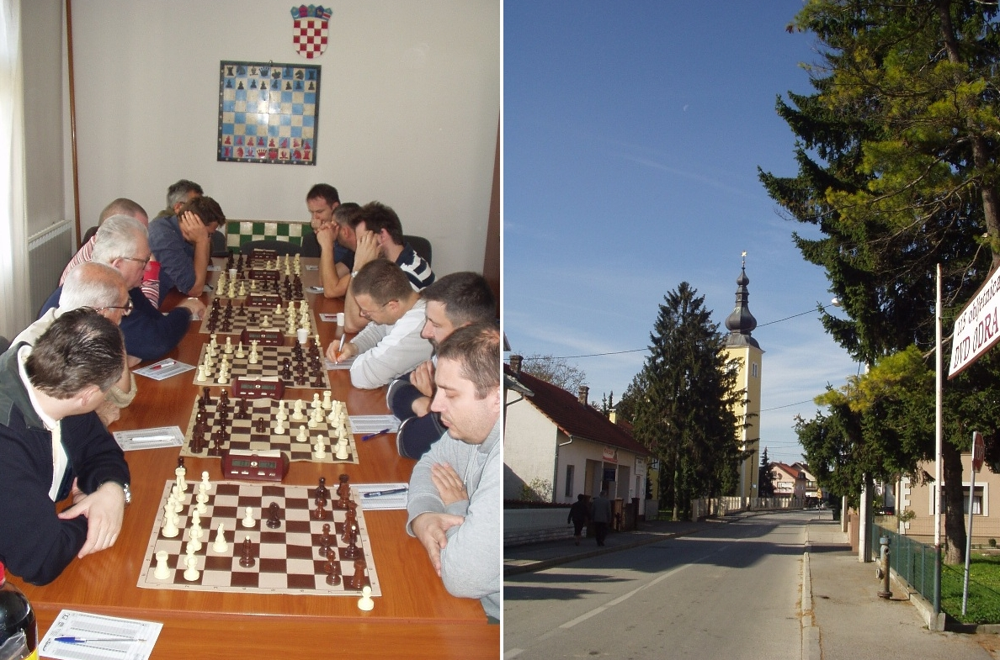

**9\. kolo, seniori**

Danas je odigrano 9. kolo. Ekipa ŠK Odre bila je domaćin. Realna šansa za ekspresni povratak u višu ligu ispuštena je u prošlom kolu. Ljubić i Danko odigrali su lijepe partije s konstantnim pritiskom na protivnika. Stipe je uzeo poklonjene pješake i realizirao materijalnu prednost. Zvjezdan je odigrao zanimljivu partiju u kojoj je uspio previdjeti nekoliko pješaka i figuru, a možda i više, ali je nasreću imao ravnopravnog protivnika te remizirao. Cvetko je igrao pomalo bez plana i uspio stvoriti tako lošu poziciju da je u prvim komplikacijama ostao bez materijala. Vjeko je, umjesto da iskoristi poklon pješaka, krivo uzeo materijal, izgubio kvalitetu, ali je ipak imao čvrstu poziciju i skakača koji je odlično poslužio za taktiku te je na kraju  ubilježio vrijedan  bod.  
Komentari su otvoreni… 🙂

ŠK ODRA – ŠK INA                                                             4,5:1,5

1\. Ljubić Ivan – Prskalo Zoran                                             1:0  
2\. Maravić Stjepan – Glasinović Juraj                                 1:0  
3\. Brajdić Danko – Ivanišević Boris                                     1:0  
4\. Karlić Zvjezdan – Branković Ljubomir                             1/2  
5\. Cvetković Ivan – Jakovljevski Radivoje                           0:1  
6\. Novak Vjekoslav – Orinčić Damir                                    1:0
