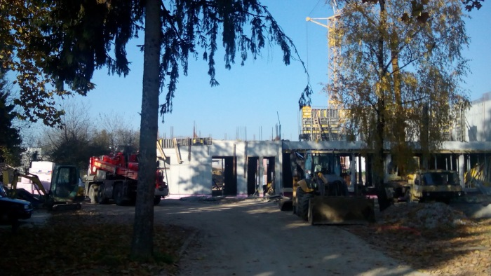
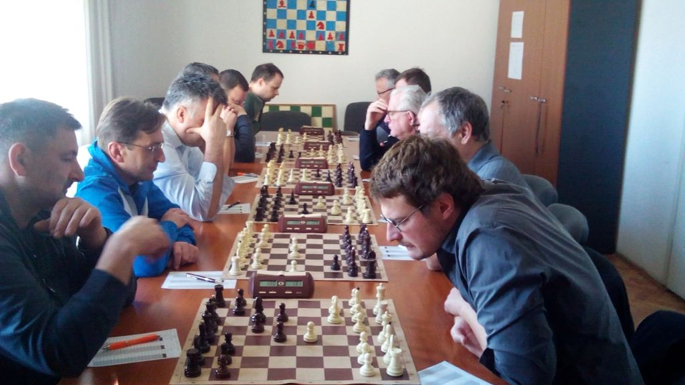
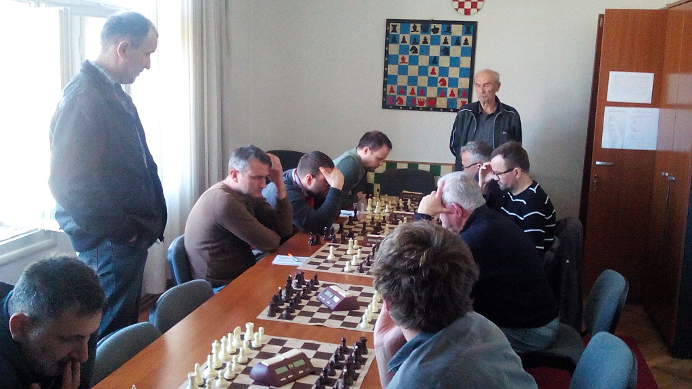

**Seniori, 10. kolo  
  
**ŠK Odra zabilježio je drugu pobjedu ove natjecateljske godine. Do jučer jedna od dvije vodeće ekipe, ŠK INA, pobijeđena je rezultatom 5,5:0,5. Inače, ŠK INA jučer je odigrao važan, zaostali meč protiv ekipe ŠK Stjepan Bosak – URIHO i doživio težak poraz te su danas, očito pod dojmom jučerašnje utakmice, odigrali vrlo loše. Istina, i ŠK Odra danas je nastupio u punome seniorskom sastavu i vidjelo se iskustvo na djelu. Naime, u gotovo svim partijama domaćini su nakon četiri sata igre imali po nekoliko minuta više te je i to odigralo važnu ulogu u raspletu partija. Prvi je završio Jura, ponavljanjem poteza. Danas je Jura odigrao nešto opreznije nego inače, a protivnik je pristao na ponavljanje poteza usprkos pješaku više. Nakon toga partiju je dobio Darko, koji je i danas dobro odigrao, ali opet propustio jednostavan dobitak. Ipak, na kraju je osvojio cijeli bod. Cvetko i Zvjezdan uhvatili su protivnike u matnu mrežu u cajtnotu, Stipe je dobio daleku lovačku završnicu zahvaljujući pravilno postavljenim pješacima, dok se najdulje igrala partija na prvoj ploči, gdje je Ljubić došao u dobivenu završnicu, uspio pogriješiti pa ući u remi i onda opet, zahvaljujući susretljivosti (ili pak iscrpljenosti) protivnika, dobiti završnicu te ubilježiti svoju prvu pobjedu ove godine.  
Ovom pobjedom Klub se pomaknuo sa začelja. Sljedeće, posljednje kolo igra se za tjedan dana u Karlovcu, a ostanak u ligi ovisi i o drugim rezultatima.  
     
ŠK ODRA – ŠK INA  5,5:0,5

1. MK Ljubić, Ivan – MK Prskalo, Zoran 1:0  
2\. MK Karlić, Zvjezdan – I Ćelepirović, Vinko 1:0  
3\. MK Maravić, Stjepan – MK Branković, Ljubomir 1:0  
4\. MK Vidaković, Darko – MK Jakovljevski, Radivoje 1:0  
5\. MK Bačurin, Juraj – I Borota, Igor 1/2  
6\. MK Cvetković, Ivan – II Glasinović, Juraj 1:0

v.d.
