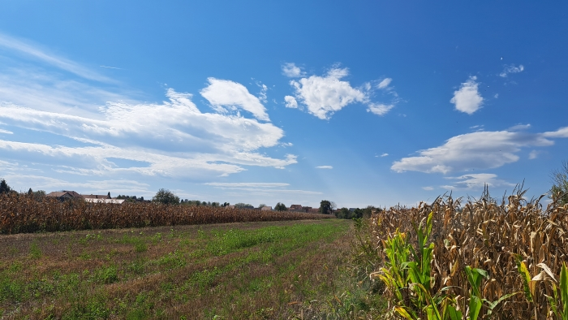

**Seniori, 8.kolo  
  
**  
Protekli vikend smo ugostili ŠK Ivanić i osvojili oba meč boda. [Meč](https://chess-results.com/tnr886630.aspx?lan=13&art=3&rd=8) je počeo Zvjezdanovim remijem koji nije dobro izašao iz otvaranja, ali na sreću Šukunda nije bio pretjerano nabrušen za borbu. Nakon nekih dva i pol sata igre je pobijedio Vraneša koji je strpljivom igrom sačekao protivnički previd te uvjerljivo realizirao materijalnu prednost. Taj susret donosimo u cjelosti. Stjepko je završio sljedeći tri puta ponavljajući istu poziciju. Međutim, niti on niti protivnik Božičević nisu vidjeli da je u tome ponavljanju postojao potez koji bi donio značajnu prednost trećoj ploči Ivanića. Ivana je pobijedila nakon dosta loše odigrane središnjice u kojoj je njen protivnik imao i značajnu prednost. Međutim, na prelasku u završnicu protivnik stavlja sve pješake na krivu boju polja te tako gubi partiju zbog preopterećenosti svoga lovca. Mladen je našao način za osvojiti pješaka u središnjici te je polako u završnici priveo partiju kraju. Ivan je ostao zadnji igrati, stalno je imao minimalnu prednost u konačnici tijekom koje je pokušao puno puta izvući neku opipljiviju prednost. Nažalost, protivnik se branio veoma dobro te tu nije bilo više od pola boda. Na koncu, rezultat daje dojam lakše pobjede nego što je ona uistinu bila. Iduće nedjelje gostujemo kod ŠK Stjepan Bosak.

<table><tbody><tr><td>Pl.</td><td></td><td><strong>ŠK Odra</strong></td><td>–</td><td></td><td><strong>ŠK Ivanić</strong></td><td><strong>4,5-1,5</strong></td></tr><tr><td>1.</td><td>MK</td><td>Karlić, Zvjezdan 2081</td><td>–</td><td>MK</td><td>Šukunda, Darko 2082</td><td>½–½</td></tr><tr><td>2.</td><td>MK</td><td>Maravić, Ivan 2102</td><td>–</td><td>MK</td><td>Mihalić, Goran 2107</td><td>½–½</td></tr><tr><td>3.</td><td>MK</td><td>Maravić, Stjepan 2108</td><td>–</td><td>MK</td><td>Božičević, Dean 2060</td><td>½–½</td></tr><tr><td>4.</td><td>MK</td><td>Sliepčević, Mladen 2092</td><td>–</td><td>II</td><td>Vujasin Dragoljub 1888</td><td>1-0</td></tr><tr><td>5.</td><td></td><td>Mikić, Ivana 1891</td><td>–</td><td>I</td><td>Srdić, Jovo 1867</td><td>1-0</td></tr><tr><td>6.</td><td>II</td><td>Vraneša, Ivan 1912</td><td>–</td><td>IV</td><td>Mumelaš, Marko 1789</td><td>1-0</td></tr></tbody></table>

```pgn
[Event "III A liga - Odra : Ivanić"]
[Site "sahovski-klub.com"]
[Date "2024.09.22"]
[Round "8"]
[White "IV Mumelaš, Marko"]
[Black "II Vraneša, Ivan"]
[Result "0-1"]
[ECO "A05"]
[WhiteElo "1789"]
[BlackElo "1912"]
[PlyCount "74"]
1. Nf3 Nf6 2. g3 d5 3. Bg2 e6 4. O-O Bd6 5. d3 O-O 6. Nbd2 Nbd7 7. c4 c6 8. a3 b6 9. b4 Bb7 10. Bb2 Re8 11. Qc2 Qc7 12. Nd4 Rac8 13. N2f3 h6 14. Nb3 e5 15. c5 bxc5 16. bxc5 Bf8 17. Bh3 Rb8 18. e3 Ba6 19. Nfd2 e4 20. d4 Bxf1 21. Bxf1 Nh7 22. Ba6 Ndf6 23. Bc3 Ng5 24. h4 Ne6 25. Qd1 g5 26. h5 Qd7 27. Be2 Nc7 28. g4 Nh7 29. Nf1 Ne6 30. Ng3 Ng7 31. Na5 Nf6 32. Ra2 Be7 33. Bd2 Bd8 34. f4 exf3 35. Bxf3 Bxa5 36. Bxa5 Rxe3 37. Kf2 Rbb3 0-1
```
