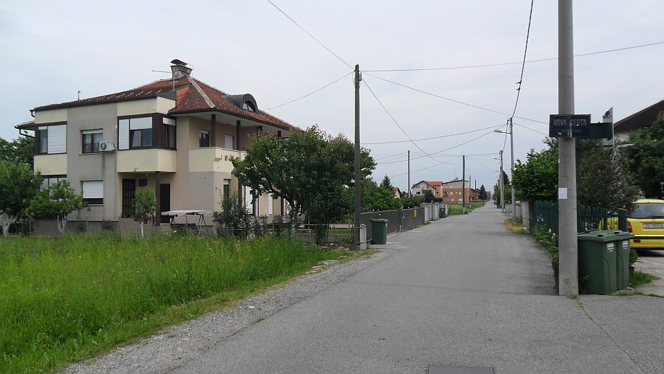
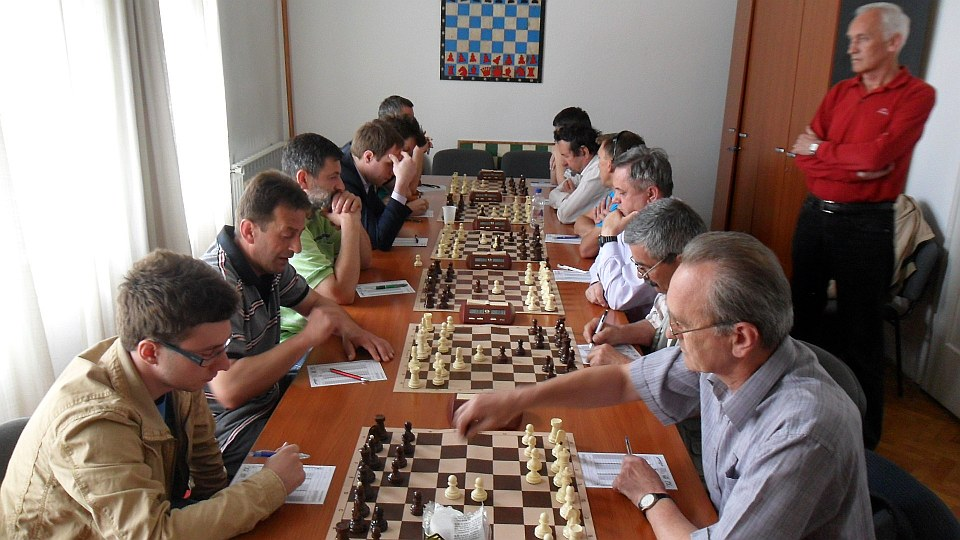

##### Seniori, 6. kolo



Danas je odigrano šesto kolo seniorske lige. U goste je stigla ekipa ŠK Jaska u nešto oslabljenom izdanju (doba je krizmi i pričesti…) i odigrala ravnopravan susret sa ekipom domaćina. Iako to rezultat ne pokazuje. Meč je bio ravnopravan sve do četvrtog stata igre. Tada su redom počeli previđati, uglavnom igrači ŠK Jaska. Pojedinačno, Stjepkov protivnik je pogriješio dosta rano i dozvolio otvaranje pozicije bez rohade i tu se našao u problemima u kojima je na kraju previdio taktički udar i ostao bez dame. Dankov protivnik je pružio ravnopravnu igru, ali je Danko pokazao više kondicije. Naime, blizu isteka četvrtog sata igre, njegov protivnik je previdio šeh-šuh! Na trećoj ploči je danas igrao Golubinjo i to je vrlo pohvalno.Već dugo ga nije bilo u ekipi. Nadam se da će navratiti i na poneko druženje petkom jer ga rijetko viđamo otkako je preselio. Odigrao je lijepu partiju, ali je opet trošio previše vremena te propustio nekoliko dobitaka u vremenskom tjesnacu, kada je njegov protivnik već bio “na konopcima”. Tu partiju donosimo u prilogu. Na četvrtoj ploči Jagunić je izgradio prilično nadmoćnu poziciju nad našim Cvetkom, ali je previdio jednostavnu taktiku, također u četvrtom satu igre te ostao bez figure. Na petoj ploči Jura je odigrao (pre)samouvjereno, ali je u svakom slučaju brzo nadigrao protivnika i uprkos jednom manjem previdu uspio dobiti topovsku završnicu. Tin je igrao dosta dobro, crnim figurama ušao u završnicu raznobojaca i onda nažalost grubo previdio. Srećom po njega, Lončarić danas nije bio naročito nabrušen te nije previše pokušavao dobiti završnicu raznobojnih lovaca pa je partija završila remijem uprkos njegovoj materijalnoj prednosti. U svakom slučaju lijepa pobjeda ŠK Odra za povratak raspoloženja nakon kiksa u prošlom kolu. Slijedi ljetna stanka. Liga se nastavlja 7. rujna protiv ŠK Ina.

ŠK ODRA – ŠK JASKA  5:1

1\. MARAVIĆ STJEPAN -ŽEPIĆ LUKA                 1:0  
2\. BRAJDIĆ DANKO – DIVJAK ŽELIMIR            1:0  
3\. GOLUB VLADIMIR – CVETKO VJEKOSLAV 1/2  
4\. CVETKOVIĆ IVAN – JAGUNIĆ VLADIMIR      1:0  
5\. BAČURIN JURAJ – JOVIČEVIĆ NIKOLA       1:0  
6\. FURČIĆ TIN -LONČARIĆ ZLATKO               1/2



```pgn
[Event "IV liga centar A"]
[Date "2014.05.11"]
[Round "6"]

[WhiteElo "2064"]
[BlackElo "1972"]
[White "Golub , Vladimir"]
[Black "Cvetko, Vjekoslav"]
[Result "1/2-1/2"]
[ECO "B12"]

[PlyCount "85"]

1. e4 c6 2. d4 d5 3. e5 Bf5 4. g4 Bg6 5. Nc3 e6 6. Nge2 Bb4 7. Nf4 Ne7 8. h4 h6
9. h5 Bh7 10. Bd3 Bxd3 11. Qxd3 Nd7 12. Bd2 Bxc3 13. Bxc3 Qb6 14. O-O-O c5 15.
Qe3 Nc6 16. dxc5 Qxc5 17. Bd4 Nxd4 18. Rxd4 Rc8 19. c3 Nb6 20. Nd3 Qe7 21. Rb4
O-O 22. Kb1 Rc7 23. f4 Rfc8 24. g5 Rc4 25. gxh6 Rxb4 26. cxb4 gxh6 27. f5 Kh7
28. f6 Qc7 29. Rg1 Qc2+ 30. Ka1 Rg8 31. Rxg8 Kxg8 32. Qg1+ Kf8 33. Qg7+ Ke8 34.
Qg8+ Kd7 35. Qxf7+ (35. Nc5+ Kc6 36. Qe8+ Kc7 37. Qxf7+ Kc6 38. Qe8+ Kc7 39.
Nxe6#) 35... Kc6 36. Qe8+ Kc7 37. Qe7+ Nd7 38. Qd6+ Kc8 39. a3 Qxd3 40. Qxe6
Qf1+ 41. Ka2 Qc4+ 42. Ka1 (42. Kb1 Qe4+) 42... Qc1+ 43. Ka2 1/2-1/2
```
