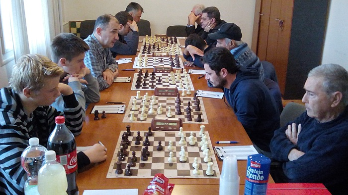
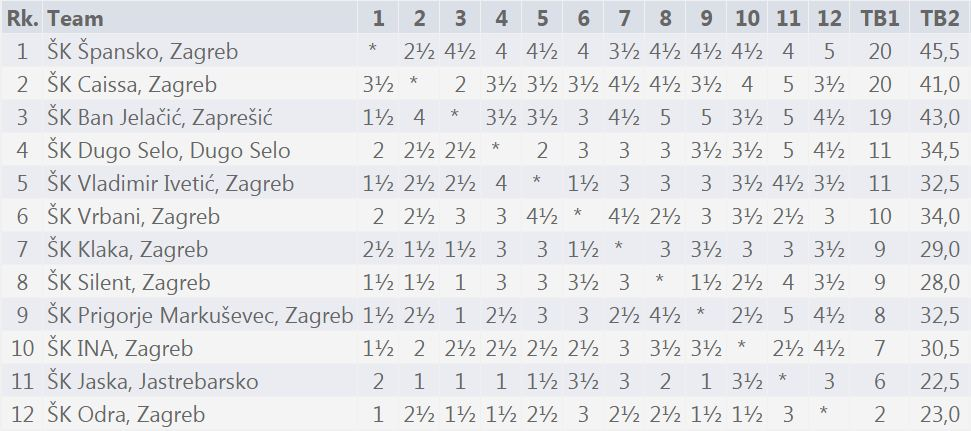
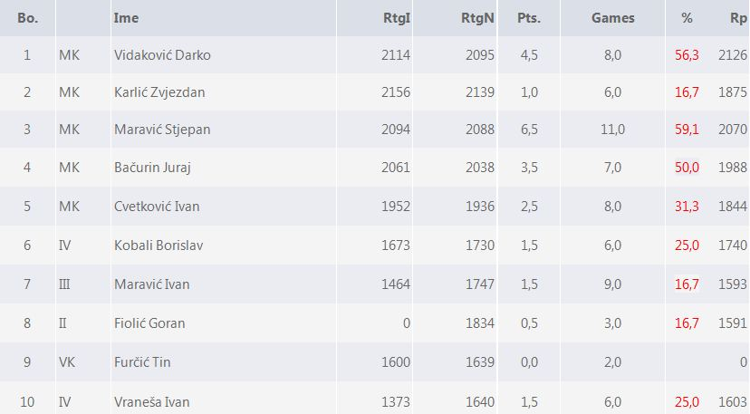
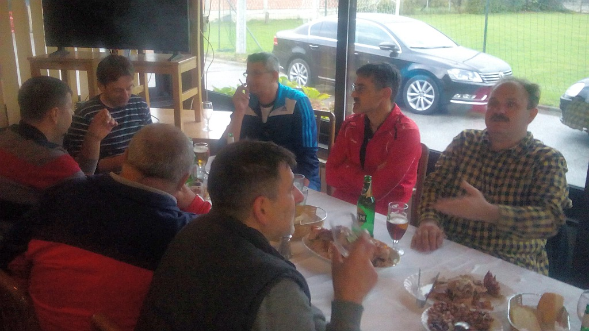
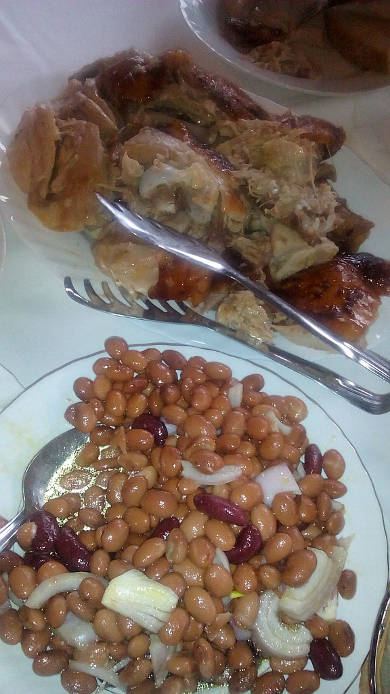
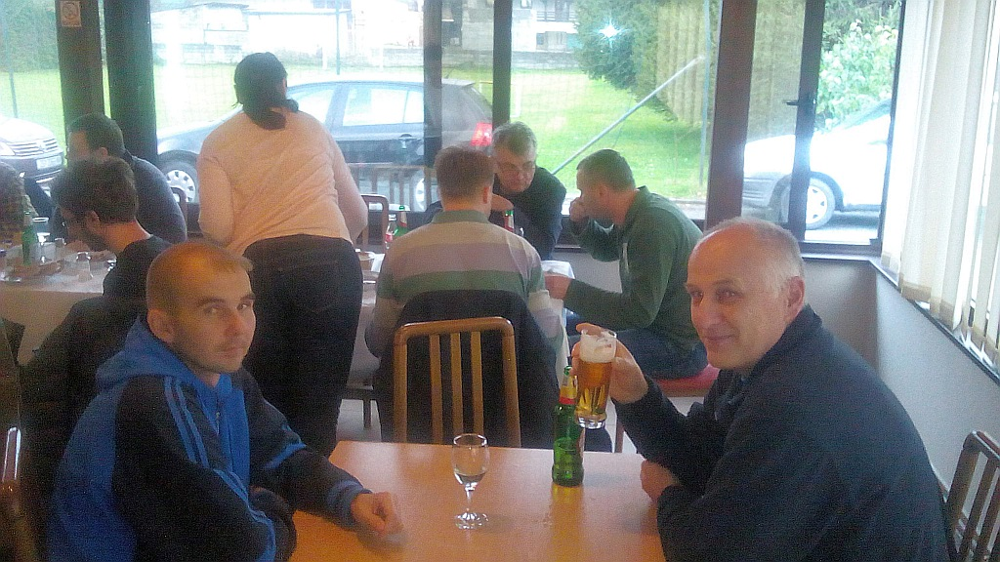

**Seniori, 11. kolo  
  
**Jučer je odigrano posljednje kolo ovogodišnje seniorske lige. Gosti iz Dubrave zasluženo su odnijeli puni plijen i osigurali si ostanak u ligi. Nas pak sljedeće godine očekuje posve novo iskustvo igranja u petoj ligi. Na prvoj ploči Darko je pogrešno izračunao žrtveni nastavak i došao u izgubljenu poziciju. Nasreću po njega, protivnik je neobjašnjivo previdio damu. Zvjezdan je igrao rastreseno, partija je obilovala s dosta obostranih previda, ali je ključne ipak počinio Zvjezdan te izgubio partiju u kojoj je imao i remi vječnim šahom i materijalnu prednost. Stipe je pravocrtnim napadom razbio protivničku obranu i također ubilježio cijeli bod. Boris se dobro držao, imao jedan manji previd, ali je onda previdio šeh-šuh. Ivan na petoj ploči nije odigrao dovoljno hrabro. Nakon što je protivnik pogriješio u otvaranju, nije se usudio ući u suprotne rokade s nadmoćnom pozicijom, izgubio pješaka i partija je bila izgubljena. Vraneša se dosta patio i nije se previše dobro snašao u postavljanju pješačke strukture, ali je imao ravnopravnog protivnika te na kraju stajao i bolje. Igrajući na rezultat, u vremenskom tjesnacu zablokirao je poziciju i na jednostavan način remizirao partiju.

**ŠK Odra – ŠK Klaka 2,5:3,5**  
1\. MK Darko Vidaković 2114 – MK Vitomir Šunjić  2132     1:0  
2\. MK Zvjezdan Karlić 2156 – MK Perica Josipović 2159   0:1  
3\. MK Stjepan Maravić 2094 – III Damjan Horvat 1924     1:0  
4\. IV Borislav Kobali 1673 – MK Milivoj Mitrović 1909        0:1  
5\. III Ivan Maravić 1464 – III Ivan Glasnović 1838             0:1  
6\. IV Ivan Vraneša 1373 – IV Ivan Žuvić 1788                   1/2

Tablica                                                                      Statistika igrača  
   

Klub je uvjerljivo završio na posljednjemu mjestu na tablici, ali nije bilo razočaranja. Cilj je što prije uvesti kadetsku ekipu u seniorski šah, a na tom su putu Ivan i Vraneša već ove godine pokazali svoju snagu. Od njih se (još!) ne očekuje da igraju na rezultat, nego da uče na pogreškama i igraju što oštrije prije nego što počnu pozicijski razmišljati. Božu, Kljujeva i Brunu još čekamo, ponajprije da počnu samostalno raditi na otvaranjima, a već ovog tjedna sva petorica imat će priliku odigrati nekoliko ozbiljnijih partija na seniorskom turniru ( I. memorijal “Marko Damjanović”) koji počinje u četvrtak. Od majstorskih kandidata ove godine rezultatski je prilično podbacio Zvjezdan, a ni Cvetku nije baš išlo, iako se mora priznati da se svojski trudio. Darko, Stipe i Jura dostigli su 50%, što je solidan rezultat s obzirom na to koliko ulažu u svoju igru.  
Nakon meča organiziran je tradicionalni ručak za završetak lige. Cvetko je donirao prasića kojeg smo okrenuli na ražnju. U dobrom raspoloženju očekujemo nove mečeve sljedeće godine!  
  
