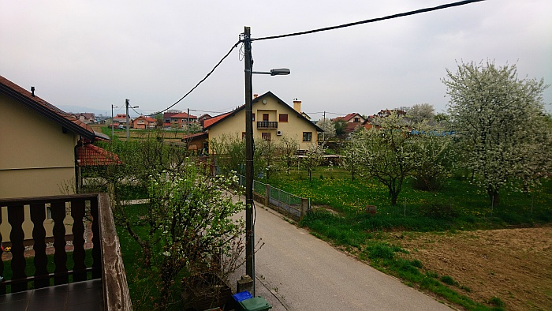
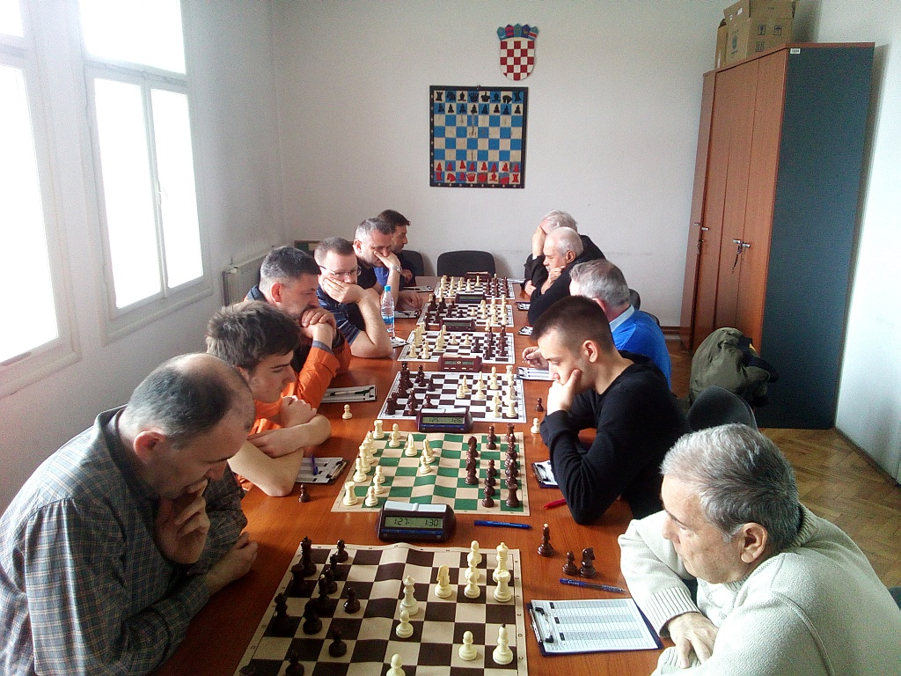

**Seniori, 3. kolo  
  
**Treće kolo [seniorske lige](http://chess-results.com/tnr332243.aspx?lan=13&art=0) završilo je neodlučenim rezultatom. Tin ovo kolo nije mogao suditi, a kadeti su igrali nogomet, tako da je od mlađih u seniorskoj ekipi igrao samo Ivan. U ekipu su se vratili Jura i Zvjezdan. Vrlo brzo prijateljske remije, bez previše borbe sklopili su Boris na šestoj i Zvjezdan na trećoj ploči. Jura je žrtvovao kvalitet, ali je protivnik vratio materijal i ušao u topovsku s pješakom više. Ipak, Jura se preciznom obranom izvukao. Stipe je osvojio pješaka, ali u završnici lovačkih parova nije mogao izvući više od pola boda. Cvetko je previdio pješaka, ali je agresivnom igrom, kasnije i žrtvom kvalitete uspio doći u dobru poziciju. Ipak, poraz u prošlom kolu ostavio je traga na njemu i cijelu partiju je zaboravljao na vrijeme. Tako je i ovo kolo izgubio dobivenu završnicu jer je zaboravio pritisnuti sat. Mladi Ivan je izgradio lijepu poziciju, taktikom osvojio pješaka, ali se dosta mučio jer je veliki dio partije igrao u vremenskom tjesnacu. Na kraju je uspio realizirati ostvarenu prednost. Rezultat je prilično pravedan, ali opet ostaje žal zbog Cvetkove partije koja je mogla prevagnuti meč u našu korist. Sljedeće kolo igra se 22. travnja kada gostujemo u Karlovcu.

**ŠK Odra – ŠK Klaka 3:3**

1.   MK Juraj Bačurin – MK Vitomir Šunjić **1/2**
2.   MK Stjepan Maravić – MK Milivoj Mitrović **1/2**
3.   MK Zvjezdan Karlić – II Ivan Glasnović **1/2**
4.   MK Ivan Cvetković – I Bruno Sontag **0:1**
5.   II Ivan Maravić –  VK Šimun Damjanović **1:0**
6.   IV Borislav Kobali – IV Ivan Žuvić **1/2**
