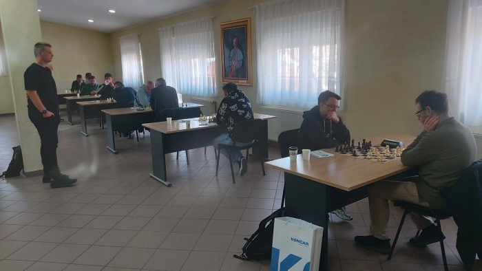

**Seniori – I. ekipa, 3.kolo**  
  
[Treće kolo](https://s2.chess-results.com/tnr1352607.aspx?lan=13&art=3&rd=3&SNode=S0) donijelo nam je prvi ovosezonski poraz. Moglo bi se reći, više nego zaslužen poraz. Meč je počeo loše za nas jer je Lucijan brzo previdio figuru nakon čega više nije bilo povratka. Ivo Knezović je debitirao za nas te remizirao, imao je njegov protivnik šansu u završnici napraviti nešto više, ali obojica su previdjeli taj dobitnički manevar. Čestitke na prvom nastupu! Darko i njegov suparnik su odigrali solidnu partiju koja je završila podjelom boda. Ivan Maravić je dobro odigrao otvaranje, imao je šansu isforsirati protivnika na ponavljanje poteza, međutim, precjenjuje poziciju te malo po malo gubi partiju. Ivan Vraneša je odigrao jednu dinamičnu partiju gdje je u dva navrata imao šanse za ozbiljnu prednost, ali na kraju je zapao i u lošiju poziciju te je remi pošten ishod. Zvjezdan je odigrao dobro i lijepo nadigrao svoga protivnika te došao u potpuno dobivenu poziciju. Nažalost, u vremeskoj oskudici radi grubi previd te se partija skroz okreće za konačnih 1,5 : 4,5. Taj sraz donosimo u prilogu. Čestitamo Končaru, a mi se nadamo novim bodovima već za dva tjedna protiv ŠK Sveta Nedelja.

<table><tbody><tr><td>Pl.</td><td></td><td><strong>ŠK Odra</strong></td><td>–</td><td></td><td><strong>ŠK Končar</strong></td><td><b>1,5-4,5</b></td></tr><tr><td>1.</td><td>MK</td><td>Karlić, Zvjezdan 2034</td><td>–</td><td>MK</td><td>Pavčević, Bruno 2198</td><td>0-1</td></tr><tr><td>2.</td><td>MK</td><td>Maravić, Ivan 2197</td><td>–</td><td>NM</td><td>Dugandžić, Boris 2165</td><td>0-1</td></tr><tr><td>3.</td><td>MK</td><td>Vidaković, Darko 2115</td><td>–</td><td>MK</td><td>Skrbin, Krešimir 2103</td><td>½–½</td></tr><tr><td>4.</td><td>I</td><td>Hadviger, Lucijan 2060</td><td>–</td><td>MK</td><td>Erenda, Bruno 2083</td><td>0-1</td></tr><tr><td>5.</td><td>II</td><td>Vraneša, Ivan 1863</td><td>–</td><td>&nbsp;MK</td><td>Starčević, Krešimir 2090</td><td>½–½</td></tr><tr><td>6.</td><td>I</td><td>Knezović, Ivo 1956</td><td>–</td><td>I</td><td>Pfeifer, Antun 1965</td><td>½–½</td></tr></tbody></table>

```pgn
[Event "III A liga - Odra : Končar"]
[Site "sahovski-klub.com"]
[Date "2026.04.10"]
[Round "3"]
[White "MK Karlić, Zvjezdan"]
[Black "MK Pavčević, Bruno"]
[Result "1/2-1/2"]
[ECO "E11"]
[WhiteElo "2034"]
[BlackElo "2198"]
1. d4 Nf6 2. Nf3 e6 3. c4 Bb4+ 4. Bd2 a5 5. a3 Be7 6. Nc3 d5 7. e3 O-O 8. Bd3 dxc4 9. Bxc4 c5 10. O-O Nc6 11. dxc5 Bxc5 12. Qb3 Qe7 13. e4 Ng4 14. Bf4 Qf6 15. Bg3 Nd4 16. Nxd4 Bxd4 17. Rad1 a4 18. Nxa4 h5 19. h3 Nh6 20. Nc3 e5 21. Nb5 h4 22. Bh2 Rd8 23. Nxd4 exd4 24. Bd5 Be6 25. Rfe1 Ra5 26. Qb6 Raxd5 27. exd5 Rxd5 28. Rd3 Qg6 29. Rxd4 Rg5 30. Qxb7 Bxh3 31. Rxh4 Bxg2 32. Qb8+ Kh7 33. Bg3 Bc6 34. Kh2 Qd3 35. Qd6 Qf3 36. Rg1 Rh5 37. Qd1 Ng4+ 38. Kh3 Nxf2+ 0-1
```

*IvanM*
