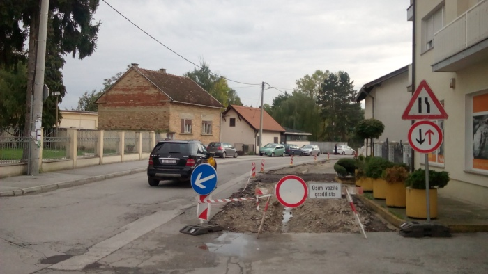
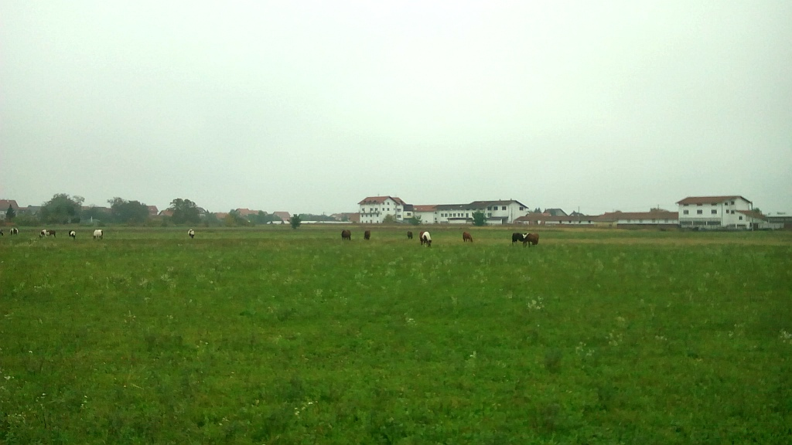
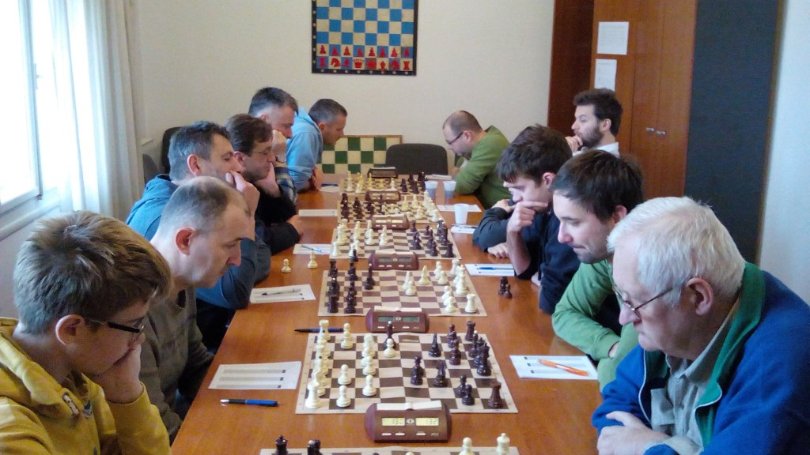
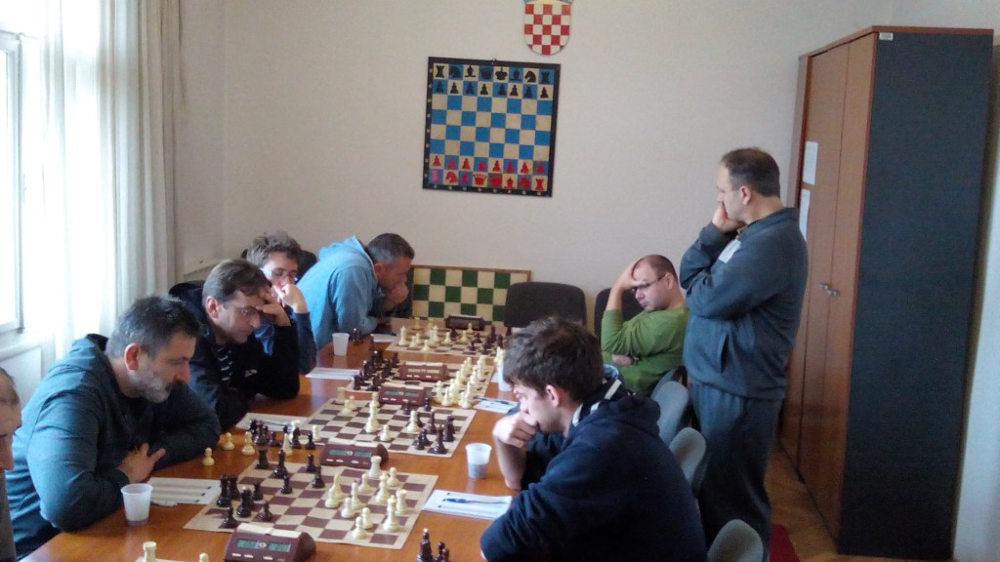

**Seniori, 8. kolo** ****

U goste je danas stigla ekipa ŠK Končar, predvođena dvojicom naših bivših članova, Leom i Dankom na prve dvije ploče, i zasluženo odnijela pobjedu. To je ekipa koja najozbiljnije konkurira da se ove godine plasira u višu ligu. Darko i Danko prijateljski su remizirali na drugoj ploči. Danko je naš dragi član i prijatelj, bez obzira na frizuru. Ivan je odigrao nekoliko loših poteza, još mu nije sjela kraljeva indijka, i izgubio od vrlo dobrog Takača na šestoj ploči. Boris se dobro držao, izgubio kvalitetu, ali je došao u taktički bogatu poziciju. Nažalost, tada je izmijenio nekoliko figura te olakšao protivniku put do pobjede. Jura je na trećoj ploči vrlo rano ušao u komplikacije koje su bile nepovoljne za njega, ali se njegov mladi protivnik nije najbolje snašao te je propustio dobitnički plan. Jura je imao pješaka više, ali i raznobojne lovce te je partija završila remijem. Cvetko je na četvrtoj ploči crnima dobro držao poziciju sve do pred kraj partije, kada su i on i njegov protivnik počeli fantazirati i partija je najpravednije završila podjelom bodova. Na prvoj ploči Stipe je osvojio pješaka, ali za više od podjele boda (analiza je pokazala) tu nije bilo materijala. Nažalost, Stipe je u vremenskoj oskudici uspio grubo previdjeti i nakon što je Leo vratio materijal, našao se u teškoj situaciji te na kraju izgubio partiju. Sve u svemu, očekivani poraz od perspektivne ekipe ŠK Končar. Meč je sudio naš klupski sudac Tin Furčić. Sljedeće kolo igra se za tjedan dana, 25. listopada, kada ŠK Odra gostuje kod ŠK Klaka.  
  

ŠK ODRA – ŠK KONČAR 1,5:4,5

1\. Maravić Stjepan – Pećnik Leo 0:1  
2\. Vidaković Darko – Brajdić Danko 1/2  
3\. Bačurin Juraj – Pavčević Bruno 1/2  
4\. Cvetković Ivan – Cvitković Filip 1/2  
5\. Kobali Boris – Starčević Krešimir 0:1  
6\. Maravić Ivan – Takač Zvonko 0:1

d.v.
