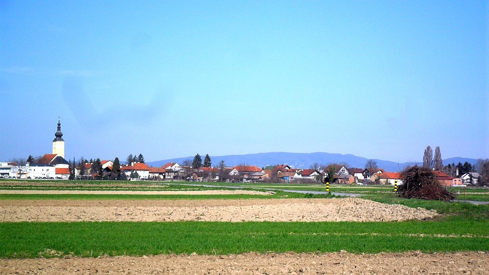
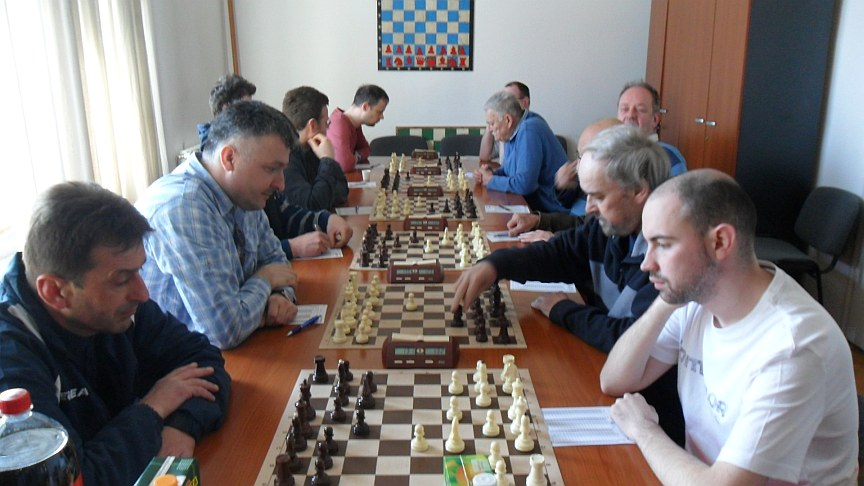
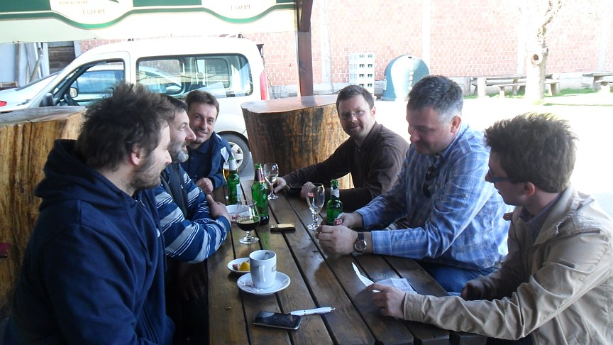

##### Seniori, 3. kolo

Težak poraz pretrpjela je seniorska ekipa u trećem kolu protiv ekipe ŠK Končar. Meč je dobro počeo i sve su pozicije bile čvrste. Vrlo rano prvi bod ekipi ŠK Odra donio je Darko brzo kaznivši preuranjeni i nepripremljeni napad protivnika. Uslijedila je protužrtva i neobranjivi mat. Ubrzo zatim Cvetko je crnima remizirao protiv čvrstog Subotičanca, odigravši hrabro rohadni napad, ali je nakon izmjena figura sklopljen remi. Nakon toga Zvjezdan je postigao bolju poziciju protiv Padjena i činilo se kao laka pobjeda, ali se protivnik hrabro branio i partija je otplovila u remi. Danko je uspio izjednačiti na drugoj ploči, Jura je ušao u remi završnicu koju nije bilo moguće izgubiti, a Ljubić je cijelo vrijeme pritiskao protivnika, ali i igrao sporo. Tada Danko ulazi u izmjene u kojima gubi pješaka i iskusni protivnik polako vodi partiju k pobjedi. Ljubić neoprezno ulazi u vremenski tjesnac i igra nekoliko loših poteza zaredom te također gubi, a nakon toga i Juri na šestoj ploči potpuno pada koncentracija i uspijeva naći način kako izgubiti.  
Meč je kvalitetno i neprimjetno, kako i treba, sudio naš novi klupski sudac Tin Furčić!  
Protivnicima treba priznati da su bili bolji i zasluženo pobijedili te se treba odmoriti i pripremiti za sljedeće kolo, koje je na rasporedu 30. ožujka.

ŠK ODRA – ŠK KONČAR 2 : 4

1\. Ljubić Ivan – Pećnik Leo 0:1  
2\. Brajdić Danko – Šribar Peter 0:1  
3\. Karlić Zvjezdan – Padjen Zdenko 1/2  
4\. Cvetković Ivan – Subotičanec Dražen 1/2  
5\. Vidaković Darko – Fabris Željko 1:0  
6\. Bačurin Juraj – Jergović Andrija 0:1

Nakon meča ekipa se okupila u sportskom svratištu “Kod Jure”, nadaleko poznatu po vanjskim stolovima iz Ikee. U analizi partija i stilova igre Darko je velikodušno objašnjavao kako treba igrati šah, a suigrači su ga slušali pozorno i sa zadovoljstvom. Otišao je u zadnji čas.
