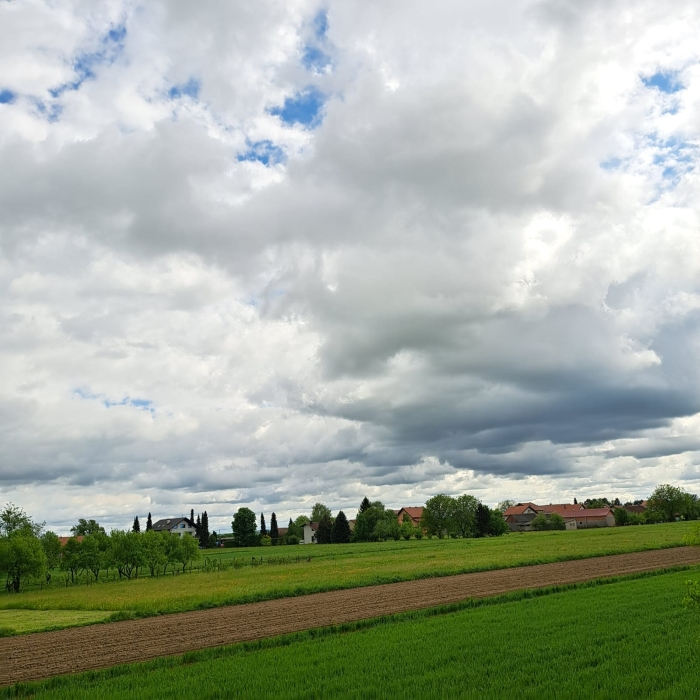

**Seniori, 2.kolo  
  
**  
Vratili smo se starim navikama i glatkim porazima u [seniorskoj ligi](https://chess-results.com/tnr886630.aspx?lan=13&art=3&rd=2). Ekipa Končara je više nego zasluženo odnijela pun plijen iz Male Mlake. Prvo su Hrvoje i Jura zapali u probleme. Hrvoje je žrtvovao figuru, ali nije uspio održati inicijativu, dok je Jura previdio pješaka i poziciono također stajao slabo. Stjepko je dobro stajao, međutim, dopustio preveliki napad na svoga kralja koji je mogao poći i lošije po njega, ali na kraju je partija završena vječnim šahom. U međuvremenu, Hrvoje i Jura gube. Mladen dobiva lijepu pozicionu partiju igrajući protiv udvojenih pješaka. Ivan je odigrao još jednu čvrstu partiju te je nakon duge, ali uvijek ujednačene borbe, partija završena podjelom bodova. Zadnji je ostao igrati Darko, u središnjici bez dama ga je njegov protivnik Starčević nadigrao, odigravši nekolicinu veoma teških i jakih poteza. U završnici je Darko dobio šansu izvući se vječnim napadom na pješake i kralja, ali nije to uočio te gubi partiju. Sve u svemu, apsolutno zaslužena pobjeda gostiju. Idući vikend gostujemo u Travnom.

<table><tbody><tr><td>Pl.</td><td></td><td><strong>ŠK Odra</strong></td><td>–</td><td></td><td><strong>ŠK Končar</strong></td><td><strong>2-4</strong></td></tr><tr><td>1.</td><td>MK</td><td>Maravić, Ivan 2079</td><td>–</td><td>NM</td><td>Dugandžić, Boris 2191</td><td>½–½</td></tr><tr><td>2.</td><td>MK</td><td>Maravić, Stjepan 2107</td><td>–</td><td>MK</td><td>Skrbin, Krešimir 2178</td><td>½–½</td></tr><tr><td>3.</td><td>MK</td><td>Sliepčević, Mladen 2088</td><td>–</td><td>MK</td><td>Erenda, Bruno 2109</td><td>1-0</td></tr><tr><td>4.</td><td>MK</td><td>Vidaković, Darko 2127</td><td>–</td><td>MK</td><td>Starčević, Krešimir 2100</td><td>0-1</td></tr><tr><td>5.</td><td>MK</td><td>Kovač, Hrvoje 2126</td><td>–</td><td>I</td><td>Pfeifer, Antun 1987</td><td>0-1</td></tr><tr><td>6.</td><td>MK</td><td>Bačurin, Juraj 2009</td><td>–</td><td>MK</td><td>Purkić, Ruža 1927</td><td>0-1</td></tr></tbody></table>
