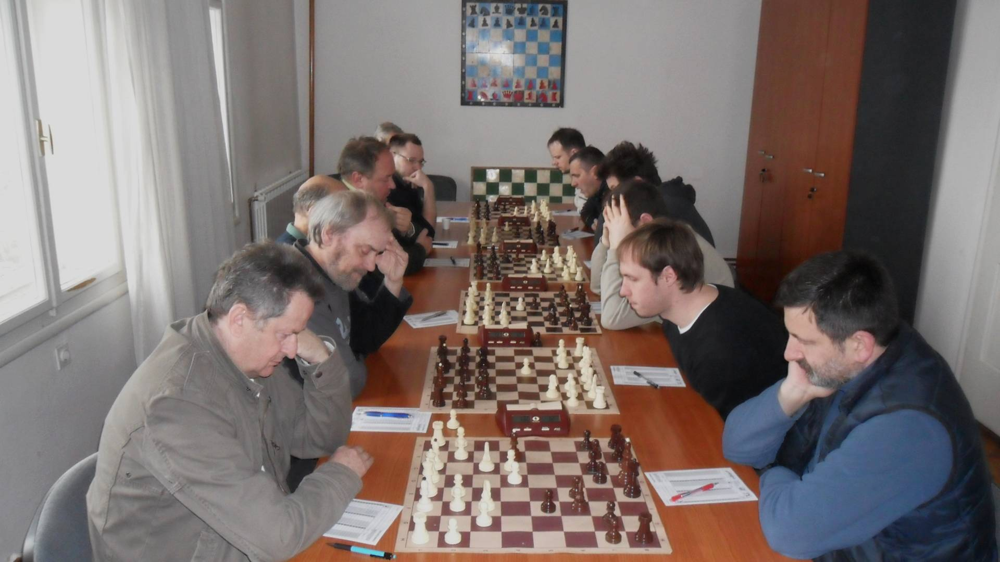

## **2\. kolo, seniori**

U drugom kolu ekipa  ŠK Odra izgubila je meč protiv tvrde i dobre ekipe ŠK Končar. Podbacile su zadnje ploče. Na 6. ploči Ivan Cvetković nakon duge borbe u kojoj je cijelo vrijeme imao nadmoćnu poziciju, tri poteza prije grubog previda, previđa dobitnički matni napad kojim je mogao donijeti vrijedan bod. Golub na 5. ploči previše troši vrijeme za razmišljanje i ulazi u bolju završnicu, ali gubi na vrijeme. Vrijedi spomenuti zanimljiv meč na prvoj ploči, gdje je Ljubić cijelo vrijeme držao inicijativu, ali se iskusni protivnik vraća i tri poteza prije predaje zbog neobranjivog mata neobjašnjivo ne ulazi u varijantu u kojoj ima remi vječnim šahom. Padjen je cijelo vrijeme “držao u šahu” indisponiranog Brajdića i na kraju remizirao jer je time donio meč-bodove za svoju ekipu. Stipe i Zvjezdan ostvarili su borbene remije crnim figurama.

REZULTATI:

ŠK ODRA – ŠK KONČAR   2,5:3,5

1\. Ivan Ljubić – Peter Šribar                           1:0

2\. Stjepan Maravić  – Leo Pećnik                  1/2

3\. Danko Brajdić  – Zdenko Padjen              1/2

4\. Zvjezdan Karlić – Dražen Subotičanec    1/2

5\. Vladimir Golub  – Željko Fabris                0:1

6\. Ivan Cvetković  – Vladimir Ostojić           0:1
