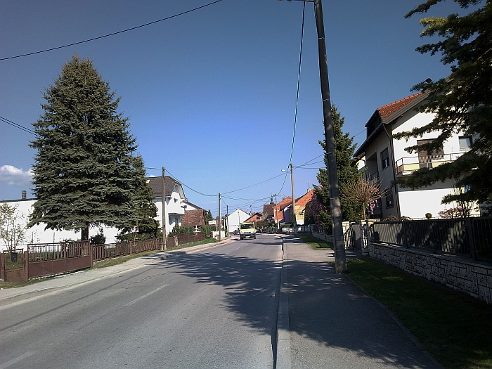
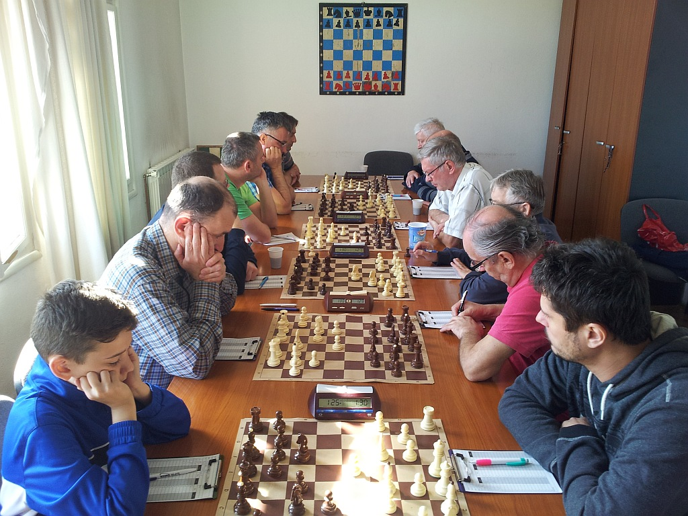

**Seniori, 3. kolo  
  
**Nakon dugo, dugo vremena, i seniori ŠK Odra uspjeli su dobiti meč. Jura je na prvoj ploči imao ravnopravnog protivnika, i mijenjanjem figura partija je bez većih uzbuđenja otišla u remi pješačku završnicu. Darko je previdio uzeti pješaka još u otvaranju, ali je poslije u partiji njegov protivnik previdio još dva. Stjepkov je protivnik također, još u otvaranju, previdio simpatičnu taktiku i također ostao bez dva pješaka. Zvjezdan je uzeo pješaka i nakon toga se pokušavao razvezati. Tada je vidio lijepu žrtvu topa za pješaka i efektno dobio. Boris je izgradio ugodnu, ali prilično blokiranu poziciju, u kojoj je imao mnogo više manevarskog prostora. Nažalost, nakon nekoliko sati igre popustila mu je koncentracija, izgubio je pješaka, a  time i partiju. Božo, danas jedini kadet u seniorskoj ekipi Odre, dobio je novu priliku da igra za seniore. Prošlu nije baš iskoristio i gubio je već u otvaranju. Sada je dobro odigrao otvaranje, razvio sve figure i imao dobru poziciju sa samo jednom slabošću, zaostalim pješakom na d6. Nažalost, iako je imao nekoliko prilika u partiji, nije se sjetio progurati pješaka na d5 i osloboditi se. Ipak, vidi se veliki napredak i mislim da je zaslužio zaigrati još poneku partiju u seniorskoj konkurenciji.

ŠK Odra – ŠK Maksimir   3,5:2,5

1\.  MK Juraj Bačurin 2047 – MK Darko Nesek  1976   1/2  
2\. MK Darko Vidaković 2133 – I Zdenko Nesek 2012   1:0  
3\. MK Stjepan Maravić 2096 – I Branko Vukman 1860  1:0  
4\. MK Zvjezdan Karlić 2138 – II Josip Gradinščak 1845   1:0  
5\. IV Borislav Kobali 1669 – VK Ivica Hađur 1631   0:1  
6\. IV Božo Cvetković 1158 – VK Wilson Kos 1623  0:1
