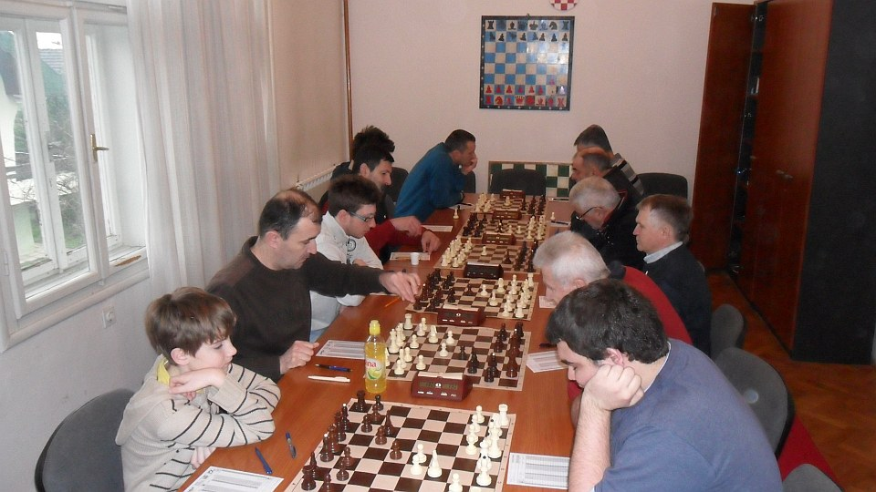

**Seniori, 1. kolo**

Danas je odigrano prvo kolo seniorske lige. Uobičajeno su prva kola prilično teška jer se igrači još nisu uigrali, ali je danas ekipa ŠK Odra ipak zabilježila samo naoko uvjerljivu pobjedu u meču s ravnopravnom ekipom ŠK Maksimir. Na prve tri ploče Stipe, Danko i Cvetko pokazali su strpljenje i upornost te polako isticali sitne slabosti u protivničkim pozicijama. Tako su ostvarili tri pobjede, a Stipe je imao i malo sreće jer je u završnici previdio topa, no nasreću protivnik to nije uočio.  
U donjem domu Ivan je igrao dobro, u središnjici je propustio napraviti usamljenog pješaka protivniku (zbog pogrešnog redoslijeda poteza), ali je ipak uplivao u remi-završnicu s raznobojcima. Tada je ipak zamijenio skakača, ali i složio pješake na pogrešnu boju te ušao u lošiju završnicu koju je teško bilo održati. Tin je pokazao vrlo lijepu igru, ali je nažalost pogrešno odigrao u otvaranju te se mučio cijelu partiju, propustio nekoliko puta izjednačiti taktičkim udarom i čak možda i dobiti partiju, ali je na kraju u već izgubljenoj poziciji i previdio. Boris je igrao vrlo hrabro i pješačkim jurišem doveo protivnika u izgubljenu poziciju. Nažalost, tada je previdio dvopotez kojim je trebao osvojiti figuru te ušao u neizvjesnu poluzavršnicu. Njegov je protivnik odbio remi, a onda previdio mat!

 

1\. Maravić Stjepan -Marević Alen       1:0  
2\. Brajdić Danko – Nesek Zdenko      1:0  
3\. Cvetković Ivan – Nesek Darko       1:0  
4\. Furčić Tin -Gradinščak Josip          0:1  
5\. Kobali Borislav -Lukić Velimir         1:0  
6\. Maravić Ivan – Horina Tomislav      0:1

Drugi krug školskih natjecanja nastavlja se u srijedu za djevojčice te u četvrtak za dječake, a igra se u Domu sportova. Liga za kadete i kadetkinje počinje sljedeće subote u Hotelu Antunović u 9:30. Tempo igre je 30 minuta +30 sekundi po potezu. Seniorska liga nastavlja se u sljedeću nedjelju na gostovanju u Dugom Selu.
